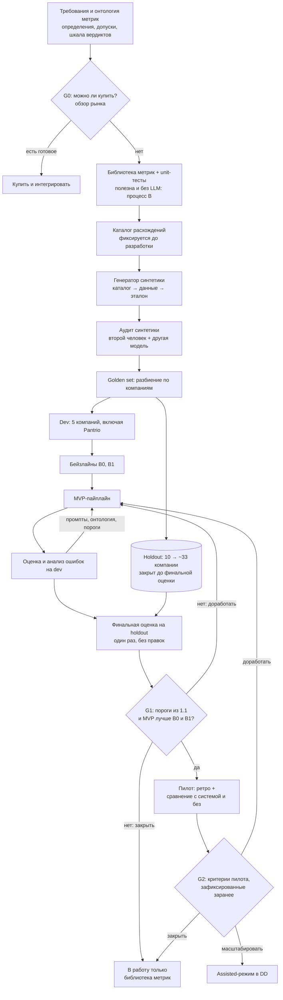
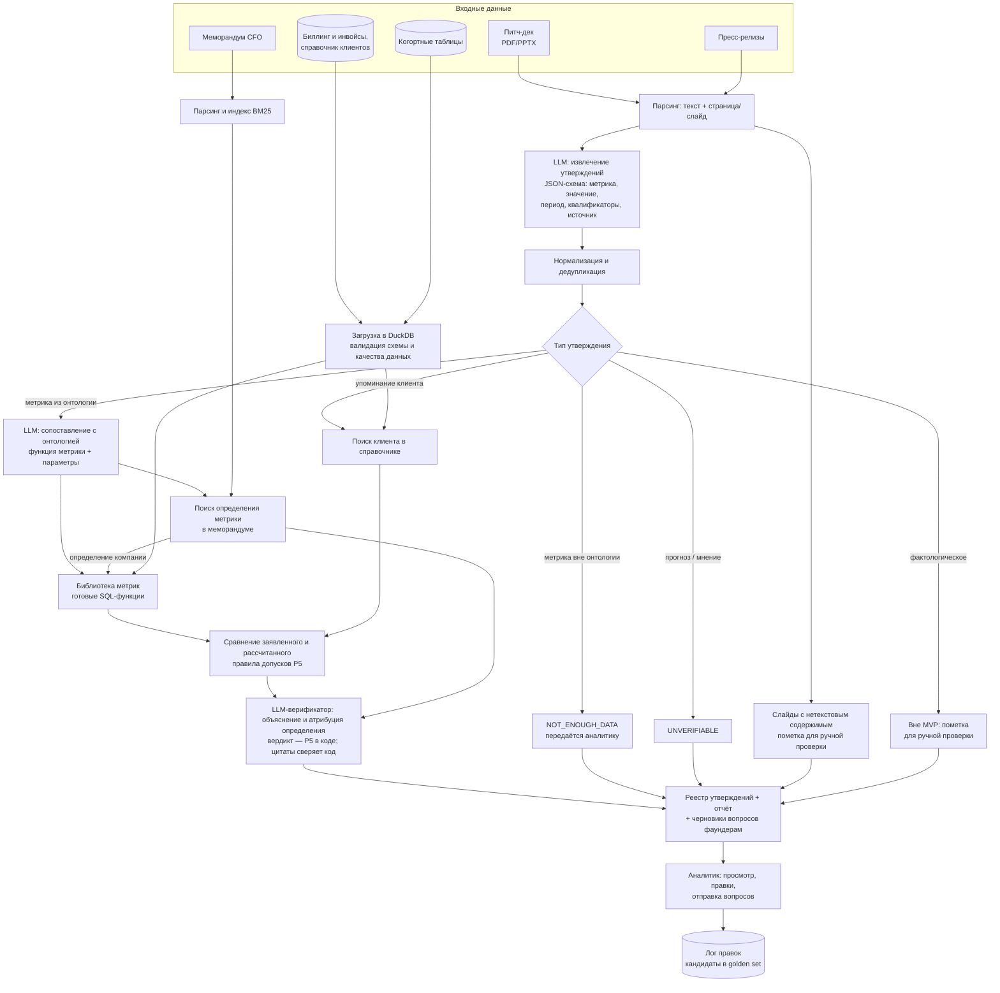
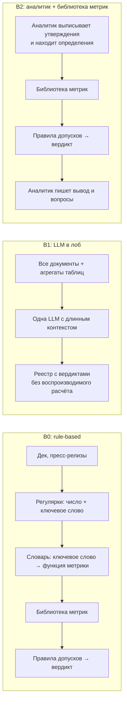
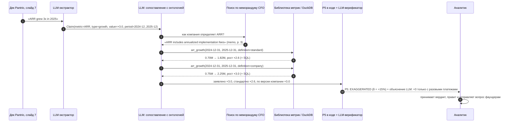
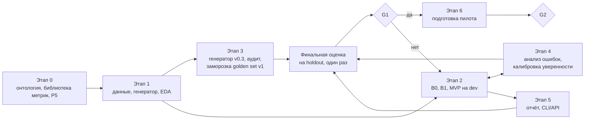

# ML System Design Doc: DD Verifier

**Автоматическая проверка утверждений стартапа по его документам и данным для due diligence венчурного фонда**

| | |
| --- | --- |
| Статус | черновик v0.4 (ДЗ №2: EDA и раздел [2.3. Этапы решения задачи](#23-этапы-решения-задачи); разделы 1–2 из ДЗ №1 доработаны по двум раундам ревью и по итогам EDA — см. [историю изменений](#история-изменений)) |
| Автор | Булат Гумеров |
| Шаблон | [ML System Design Doc (Reliable ML, ODS)](https://github.com/IrinaGoloshchapova/ml_system_design_doc_ru/blob/main/ML_System_Design_Doc_Template.md) |
| Сквозной пример | Pantrio: B2B SaaS для учёта запасов в ресторанах, раунд Series A |

> **Про цифры в документе.** Проект учебный, заказчик условный. Всё, что помечено **[гипотеза]**, — допущения автора от лица заказчика: бизнес-цель, объёмы, пороги, сроки. Бизнес-цель и требования формулирует и подтверждает заказчик, поэтому каждое такое число — кандидат на письменное согласование (вопросы в [разделе 3.4](#34-открытые-вопросы-к-заказчику)). Числа в примерах с Pantrio иллюстративные.

## Термины

| Термин | Значение |
| --- | --- |
| DD, due diligence | проверка компании перед инвестицией: финансы, коммерция, продукт, юридическая часть, команда |
| Data room | набор документов и выгрузок, который стартап открывает фонду под NDA |
| IC memo | меморандум для инвестиционного комитета фонда с выводами DD и рекомендацией |
| Утверждение (claim) | высказывание компании о себе, которое можно проверить: «ARR вырос в 3 раза за 2025 год» |
| Красный флаг | вердикт `EXAGGERATED` или `CONTRADICTED` |
| ARR / MRR | годовая / месячная регулярная (подписочная) выручка |
| NRR / GRR | net / gross revenue retention: удержание выручки когорты клиентов с учётом / без учёта допродаж |
| Logo churn | доля клиентов, ушедших за период |
| ACV | средняя годовая стоимость контракта |
| HITL | human-in-the-loop: аналитик просматривает и правит выдачу системы |
| LP | limited partners: инвесторы, которые дают фонду капитал |
| Golden set | эталонный набор: утверждения с точной цитатой, слотами, истинным значением метрики и вердиктом |
| Семейство утверждений | одно и то же утверждение в разных документах (дек и пресс-релиз); в оценке считается одним наблюдением |
| Hard negative | трудный пример без расхождения: округление, «более N», перефразированный рост; эталон `SUPPORTED` |

---

## 1. Цели и предпосылки

### 1.1. Зачем идём в разработку продукта?

#### Заказчик, пользователи, стейкхолдеры

- **Заказчик (Product Owner):** инвестиционный партнёр венчурного фонда стадий Seed – Series B, который отвечает за качество DD.
- **Пользователи:** аналитики и ассоциаты фонда, которые проводят DD.
- **Стейкхолдеры:**
  - инвестиционный комитет: читает выводы DD и принимает решение;
  - юристы и compliance: отвечают за соблюдение NDA и хранение данных;
  - LP фонда: косвенно, им важно качество инвестиционных решений.

#### Бизнес-цель

**[гипотеза, формулировка от лица заказчика]** Фонд хочет проводить глубокий DD по большему числу сделок тем же составом аналитиков и реже переплачивать за компании, которые завышают свои метрики.

Как это превращается в деньги (уровень L0):

- **Мощность — избегание расходов.** При росте потока сделок фонд не нанимает ещё одного аналитика или тем же штатом доводит до глубокого DD больше сделок. Эффект есть, только если на мощность есть спрос: у фонда есть очередь сделок, которые сейчас отсеиваются из-за нехватки времени аналитиков **[гипотеза, вопрос 2 в 3.4]**.
- **Потери — снижение ожидаемого ущерба.** Пойманное завышение метрик меняет оценку компании или само решение об инвестиции. Ожидаемый эффект = вероятность пропустить существенное завышение × размер переплаты. Заранее эту величину не посчитать, поэтому на пилоте измеряем прокси: число существенных расхождений, которые нашла система и пропустила обычная проверка.

Высвобожденное время аналитика само по себе деньгами не является: эффектом оно становится только через один из двух механизмов выше.

#### Как процесс устроен сейчас

1. Стартап присылает питч-дек и пресс-релизы, после подписания NDA открывает data room: выгрузку биллинга и инвойсов, справочник клиентов, когортные таблицы, финмодель, меморандум CFO с пояснениями к метрикам.
2. Аналитик вручную выписывает утверждения из дека и пресс-релизов: «ARR вырос в 3 раза», «120+ ресторанных сетей», «NRR 130%», «logo churn ниже 2% в месяц».
3. Для каждого утверждения аналитик ищет данные и определение метрики, пересчитывает её в Excel или SQL и сверяет результат с меморандумом CFO. Если что-то не сходится, он формулирует вопрос фаундерам.
4. Выводы попадают в DD-отчёт и IC memo.

#### Проблема

- **Долго.** Проверка финансовых и коммерческих утверждений одного стартапа занимает у аналитика несколько рабочих дней **[гипотеза: 3–5 дней]**. Сроки при этом жёсткие: в конкурентном раунде эксклюзивность длится 2–4 недели **[гипотеза]**.
- **Неполно.** Времени хватает на 5–10 ключевых метрик **[гипотеза]**, остальные утверждения принимаются на веру.
- **Непоследовательно.** Что входит в ARR, как считается NRR, кто считается клиентом: от сделки к сделке и от аналитика к аналитику ответы разные. Не остаётся следа, по каким данным сделан вывод.
- **Дорого ошибиться.** Типичные приёмы, которые завышают метрики:
  - разовые платежи (внедрение, обучение) включены в ARR;
  - аннуализирован пиковый месяц;
  - подписанные, но не запущенные контракты и пилоты посчитаны как клиенты;
  - выбран удобный период сравнения;
  - выручка показана gross вместо net.

  Пропущенное расхождение означает переплату в оценке или неудачную инвестицию, а заодно репутационный риск перед LP.

#### Почему здесь нужен ML, а где не нужен

Проверку одного утверждения можно разложить на четыре шага:

1. Выписать утверждение и понять, что именно утверждается: метрика, период, база сравнения, квалификаторы («более», «около»).
2. Найти нужные данные и определение метрики, которым пользуется компания.
3. Пересчитать метрику.
4. Сравнить с заявленным, сформулировать вывод и вопрос фаундерам.

**Шагам 3 и 4 ML не нужен.** Метрики считает детерминированный, протестированный код (библиотека метрик), сравнение делают правила допусков. **Шаги 1 и 2** — языковые задачи на разнородных текстах: утверждения написаны в произвольной форме и разбросаны по слайдам, сноскам и пресс-релизам, определения метрик спрятаны в меморандуме. Правила и регулярные выражения здесь ломаются (это бейзлайн B0, см. [2.1](#21-постановка-задачи)), поэтому для этих шагов нужен LLM.

#### Альтернативы и «можно ли купить»

| Альтернатива | Что закрывает | Чего не закрывает |
| --- | --- | --- |
| **A.** Ручная проверка (as-is) | Всё, но медленно и выборочно | Масштаб, единообразие, след выводов |
| **B.** Аналитик + библиотека метрик, без LLM | Пересчёт и сравнение по единым определениям, воспроизводимость | Утверждения выписывает и сопоставляет с метриками человек, определения в меморандуме ищет человек |
| Аутсорс финансового DD (аудиторы, консультанты) | Глубину проверки | Дорого и долго для Seed – Series A |
| Универсальный LLM-чат: «загрузить всё и спросить» (бейзлайн B1) | Быстрый черновик | Галлюцинации в числах, нет воспроизводимого расчёта, данные под NDA уходят третьей стороне |
| Купить: AI-функции data room-платформ (вопросы к документам, суммаризация) | Поиск по текстам data room | Сверку с первичными транзакционными данными и единую онтологию метрик |
| Купить: AI-инструменты для инвесткоманд (скрининг, рыночные данные, CRM) | Внешнюю информацию о компании | Проверку внутренних данных data room |

**Вывод про покупку.** Готового продукта, который сверяет утверждения с транзакционными данными стартапа и работает в контуре фонда, на этапе дизайна не видно **[гипотеза: подтвердить обзором рынка — это гейт G0 перед PoC, см. 2.2.1]**.

**Лучшая альтернатива без ML — B.** Поэтому эффект ML-решения C считаем как дельту к лучшей альтернативе, а не к ручному процессу: эффект = ценность(C) − max(ценность(A), ценность(B)). Отсюда два следствия для плана:

1. Библиотеку метрик делаем первой. Она нужна и MVP, и процессу B, и полезна аналитикам сама по себе, даже если LLM-часть не оправдается.
2. LLM-часть должна доказать, что экономит время аналитика относительно B при не худшей полноте найденных расхождений.

#### Что станет лучше благодаря ML

Аналитик получает **реестр утверждений** за часы, а не за дни. По каждому утверждению в реестре есть:

- вердикт;
- пересчитанное значение и отклонение от заявленного;
- доказательства: SQL-расчёт из библиотеки метрик и цитаты с указанием страницы;
- черновик вопроса фаундерам.

Время аналитика смещается с выписывания и сопоставления утверждений на разбор флагов и разговор с командой. Все утверждения проверяются по одним правилам, у каждого вывода есть след.

#### Метрики и критерии успеха

Это единая таблица ролей метрик для всего документа; в [2.1](#21-постановка-задачи) — только диагностические метрики и протокол оценки.

| Роль | Уровень | Метрика | Цель / порог |
| --- | --- | --- | --- |
| Финансовая цель | L0 | Мощность: стоимость не нанятого аналитика или дополнительных глубоких DD тем же штатом. Потери: переплата, которой удалось избежать (прокси на пилоте — число существенных завышений, найденных до решения IC) | Рост; в деньгах считается после внедрения (вопросы 1–2 в 3.4) |
| Целевая | L1 | Время аналитика на проверку утверждений одной сделки **вместе с просмотром и правкой выдачи системы**, относительно процесса B | Цель −50%, порог гейта пилота −40% **[гипотеза]** |
| Драйвер | L2 | Покрытие: доля проверяемых количественных утверждений из текстового слоя дека и пресс-релизов, попавших в реестр. Рядом показывается доля помеченного для ручной проверки (нетекстовые слайды, фактологические утверждения), чтобы покрытие нельзя было «улучшить» исключениями | ≥ 90% **[гипотеза]** |
| Драйвер | L2 | Среднее время просмотра одного вердикта; аномально быстрые просмотры (< 10 с) отслеживаются как сигнал просмотра «не глядя» | ≤ 2 мин **[гипотеза]** |
| Драйвер | L2 | Доля верных вердиктов, принятых аналитиком без правок (от всех верных вердиктов) | ≥ 70% **[гипотеза]** |
| Защитная | L2 | Доля ошибочных вердиктов, принятых аналитиком без правок (от всех ошибочных вердиктов; automation bias) | ≤ 5% **[гипотеза]** |
| Защитная | L3 | Recall красных флагов | ≥ 0,9 **[гипотеза]** |
| Защитная | L3 | Precision красных флагов: при частых ложных тревогах аналитики перестают доверять флагам | ≥ 0,7 **[гипотеза]** |
| Защитная | L3 | Точность пересчитанных значений относительно эталона, посчитанного по тем же файлам, что видит система (на синтетике — `true_value_observed`) | ≥ 95% **[гипотеза]** |
| Жёсткое ограничение | L3 | Critical error rate: доля неверных утверждений (эталон — красный флаг `EXAGGERATED` или `CONTRADICTED`), получивших `SUPPORTED`; считается по семействам утверждений. Прогнозы и утверждения без данных, получившие `SUPPORTED`, отчитываются отдельно | ≤ 5% **[гипотеза]** |
| Жёсткое ограничение | L3 | Число в отчёте без источника (цитаты или воспроизводимого расчёта) | 0 |
| Жёсткое ограничение | — | Инциденты с данными data room вне согласованного контура | 0 |
| Ограничение | L4 | Время полного прогона по сделке; стоимость инференса на сделку | ≤ 1 ч; ≤ $50 **[гипотеза]** |

**Почему −50% и −40%.** −50% — цель, под которую посчитана экономика ([3.3](#33-оценка-экономики)). −40% — минимальный результат пилота, при котором имеет смысл масштабироваться; это условие гейта G2, оно фиксируется до старта пилота.

**Почему доля принятых вердиктов разделена.** Максимизировать общую долю принятых нельзя: она растёт и тогда, когда аналитик бездумно соглашается с ошибками. Поэтому «принято верных» — драйвер, а «принято ошибочных» — защитная метрика.

**Критерий успеха текущей итерации (MVP курса) — гейт G1.** Считается один раз на закрытом holdout по компаниям (см. протокол в [2.1](#21-постановка-задачи)):

- recall красных флагов ≥ 0,9, precision ≥ 0,7, critical error rate ≤ 5%;
- точность пересчитанных значений ≥ 95%;
- MVP лучше B0 и B1 по recall красных флагов при не худшей precision (парное сравнение на одних и тех же утверждениях).

Если G1 не пройден, в работу уходит только библиотека метрик (процесс B), а LLM-часть дорабатывается или закрывается.

### 1.2. Бизнес-требования и ограничения

> **Статус согласования.** Все требования ниже — черновик автора от лица заказчика. Числовые значения помечены **[гипотеза]** и становятся требованиями только после письменного подтверждения заказчиком.

#### Функциональные требования

| # | Требование |
| --- | --- |
| FR1 | **Вход (MVP):** питч-дек (PDF/PPTX), пресс-релизы (PDF/HTML/TXT/MD), выгрузки биллинга и инвойсов, справочник клиентов и когорты в CSV/XLSX, меморандум CFO (PDF/DOCX/MD). SQL-дампы и другие форматы — следующие итерации |
| FR2 | Извлечение проверяемых утверждений из текстового слоя с источником: документ, страница или слайд, точная цитата. Слайды, где значимая часть содержимого — изображения (графики, скриншоты), помечаются для ручной проверки |
| FR3 | По каждому утверждению: вердикт по шкале ниже, пересчитанное значение, отклонение, доказательства, объяснение, уверенность |
| FR4 | Воспроизводимость: любой расчёт можно перезапустить, сохраняются функция метрики, параметры, SQL и хэш версии данных |
| FR5 | Сводный отчёт: топ расхождений по существенности, черновики вопросов фаундерам, список непроверенных утверждений с причинами. Вопросы фаундерам — только черновики, отправляет их аналитик |
| FR6 | Аналитик может поправить вердикт или параметры расчёта (период, определение метрики) и перезапустить проверку одного утверждения; все правки логируются |
| FR7 | Язык документов: английский в MVP (основной язык деков на Series A), русский — следующая итерация |

**Шкала вердиктов**

| Вердикт | Когда ставится | Пример (Pantrio, иллюстративно) |
| --- | --- | --- |
| `SUPPORTED`: подтверждено | Заявленное совпадает с рассчитанным в пределах допуска (P5) | «120+ ресторанных сетей»: в базе 127 активных платящих клиентов |
| `EXAGGERATED`: преувеличено | Направление верное, но величина завышена сверх допуска или получается только при нестандартном определении метрики | «ARR ×3 за 2025»: по стандартному определению ×2,6; ×3 выходит, только если включить разовые платежи за внедрение |
| `CONTRADICTED`: противоречит данным | Данные опровергают утверждение | «Logo churn ниже 2% в месяц»: фактически 4,5% |
| `NOT_ENOUGH_DATA`: недостаточно данных | Утверждение проверяемо, но нужных данных в data room нет, или метрика не описана в онтологии | «CAC payback 9 месяцев» при отсутствии данных о маркетинговых расходах; уходит в вопросы фаундерам |
| `UNVERIFIABLE`: непроверяемо | Прогноз, оценка или мнение | «Станем лидером рынка в Европе к 2028 году» |

#### Нефункциональные требования

| Аспект | Требование | Комментарий |
| --- | --- | --- |
| Нагрузка | 20–50 сделок на глубоком DD в год, до 3–5 параллельно; 30–150 утверждений на сделку; data room до ~1 ГБ и до 10⁶ строк инвойсов **[гипотеза]** | Нагрузка низкая, сложность не в RPS, а в разнородности данных |
| Скорость | Пакетный режим: полный прогон по сделке ≤ 1 часа; перепроверка одного утверждения ≤ 2 минут **[гипотеза]** | Real-time не нужен, батч дешевле и проще |
| Надёжность | Отказ системы не блокирует DD (fallback — процесс B); идемпотентные перезапуски; кэш ответов LLM | |
| Конфиденциальность | Data room под NDA. Для пилота на реальных сделках нужна либо open-weight LLM в закрытом контуре, либо провайдер с zero data retention и DPA, согласованный с юристами фонда. Данные разных стартапов изолированы друг от друга | Для MVP на синтетике можно использовать внешний API |
| Аудит | Логируются входы, версии промптов и моделей, вызовы функций метрик, результаты; срок хранения по политике фонда | |
| Стоимость | Инференс ≤ $50 на сделку **[гипотеза]** | Оценка в [3.3](#33-оценка-экономики) |
| Интерпретируемость | Каждый вердикт объясним; просмотр одного вердикта аналитиком ≤ 2 минут **[гипотеза]** | |

#### Бизнес-ограничения

- **Поддержка решений, а не автопилот.** Система не даёт инвестиционных рекомендаций и не заменяет аналитика. Выводы в IC memo подписывает человек, вердикты без просмотра аналитиком в отчёт не попадают.
- **Вопросы фаундерам отправляет только аналитик.** Ложный флаг, отправленный от имени фонда, портит отношения с командой — особенно в конкурентном раунде.
- **Только собственные данные компании.** Проверка идёт по документам и данным из data room. Внешние источники (рынок, конкуренты, реестры) — следующие итерации.
- **Определения метрик и пороги согласуются заранее.** Они фиксируются в версионируемой онтологии, а не «зашиваются» в промпты.
- **Ошибки асимметричны.** Пропустить расхождение (ложное `SUPPORTED`) намного дороже ложной тревоги, поэтому recall красных флагов — защитная метрика, а ложное `SUPPORTED` — жёсткое ограничение.

#### Ожидания от итерации (MVP курса)

1. **Библиотека метрик** по онтологии с unit-тестами — первый результат; она полезна и без LLM (процесс B).
2. **Генератор синтетических data room:** Pantrio и ещё 14 компаний с расхождениями из заранее зафиксированного каталога. Генерация дешёвая, поэтому компаний много: golden set разбит по компаниям — 5 для разработки, 10 — закрытый holdout. EDA показало, что 10 компаний дают слишком широкий интервал для гейта, поэтому до первого прогона holdout расширяется до ~33 компаний (2.3, этап 3).
3. **Пайплайн для количественных утверждений:** документы → реестр утверждений → отчёт; CLI и одна HTTP-ручка инференса (FastAPI).
4. **Офлайн-оценка** на holdout против бейзлайнов B0 и B1, анализ ошибок, решение по гейту G1.

#### Как система встраивается в процесс на пилоте

1. **Ретроспективный пилот — проверка качества.** Прогон по 5–10 закрытым сделкам фонда **[гипотеза]**, где DD уже провели вручную и найденные расхождения известны. Сравниваем флаги системы с находками аналитиков.
2. **Сравнение «с системой / без системы» — проверка эффекта по времени.** На 5–10 текущих сделках **[гипотеза]** утверждения каждой сделки случайно делятся пополам с балансом по типам метрик. Одну половину аналитик проверяет по процессу B (сам + библиотека метрик), другую — с реестром системы. Время фиксируется по каждому утверждению в инструменте, а не по таймшитам. Так сравниваются одинаковые по сложности задачи у тех же аналитиков. Порядок половин чередуется между сделками и аналитиками: если бы половина «без системы» всегда шла первой, ко второй аналитик уже знал бы data room, и система выглядела бы быстрее, чем есть. Порядок записывается и учитывается при анализе.
3. **Assisted-режим** после гейта G2: аналитик начинает DD сразу с реестра системы.

#### Критерии успешного пилота (гейт G2, фиксируются до старта)

- Ретро: система находит ≥ 90% расхождений, которые аналитики нашли вручную.
- Сравнение: время на утверждение с системой на ≥ 40% меньше, чем по процессу B, при не худшей полноте найденных расхождений.
- Доля ошибочных вердиктов, принятых без правок, ≤ 5%; доля верных, принятых без правок, ≥ 70%.
- Ни одного инцидента с данными data room.

Утверждения внутри одной сделки зависимы, поэтому эффективный размер выборки — число сделок, а не утверждений. На 5–10 сделках статистически строгого вывода не получится, и это признаём заранее: пилот проверяет эффект на порядок величины. Разницу во времени оцениваем смешанной моделью со сделкой и аналитиком как случайными эффектами (или бутстрепом по сделкам), а уверенность в эффекте накапливается с новыми сделками в assisted-режиме.

Если пилот не проходит G2, решаем по Stage-Gate: доработать или остановиться на библиотеке метрик (процесс B).

#### Возможные пути развития

- Фактологические утверждения, проверяемые по текстам data room (партнёрства, интеграции, награды): полноценный RAG по документам.
- Метрики вне онтологии через text-to-SQL — только с обязательной проверкой SQL человеком.
- Внешняя верификация: размер рынка, конкуренты, корпоративные реестры, новости, публичные профили команды.
- Мониторинг портфеля: ежемесячная сверка investor updates с отчётностью уже проинвестированных компаний.
- Интеграция с CRM фонда и data room-платформой.

### 1.3. Что входит в скоуп проекта/итерации, что не входит

Первая итерация намеренно узкая: только **количественные утверждения, которые проверяются по биллингу и справочнику клиентов**. Это ядро ценности (выручка, рост, клиенты, удержание) и самая формализуемая часть задачи.

#### Входит в MVP

| Блок | Что делаем |
| --- | --- |
| Приём документов | Дек (PDF/PPTX), пресс-релизы, меморандум CFO; текст с привязкой к странице или слайду; пометка слайдов с нетекстовым содержимым |
| Приём данных | CSV/XLSX биллинга, справочника клиентов и когорт загружаются в DuckDB с проверкой схемы и качества: дубли, пропуски, валюты, аннулированные инвойсы |
| Библиотека метрик | Онтология из 10 SaaS-метрик с формулами и unit-тестами; стандартное определение и 1–4 варианта компании там, где компании обычно расходятся (например, ARR с разовыми платежами и без) |
| Извлечение утверждений | Количественные утверждения: ARR/MRR и рост, число клиентов, logo churn, GRR/NRR, ACV, концентрация выручки; упоминания клиентов (есть ли такой клиент в справочнике). Фактологические утверждения распознаются и помечаются для ручной проверки, но не проверяются |
| Поиск определений | BM25 по меморандуму CFO — только чтобы найти, как компания определяет метрику |
| Вердикт | Правила допусков P5 в коде по стандартному определению; LLM-верификатор объясняет, каким определением получено заявленное число, и может понизить уверенность, но не меняет вердикт |
| Результат | Реестр утверждений (JSON/CSV) и отчёт (Markdown/HTML) с черновиками вопросов фаундерам |
| Оценка | Генератор синтетики, каталог расхождений, golden set с разбиением по компаниям, офлайн-оценка против B0 и B1 |
| Сервинг | CLI и одна HTTP-ручка (FastAPI) для прогона по одной сделке |

#### Не входит в MVP

| Что | Почему |
| --- | --- |
| Фактологические утверждения, которые проверяются только по текстам (партнёрства, интеграции, награды) | Нужен полноценный RAG по всему data room — следующая итерация |
| Метрики вне онтологии (text-to-SQL) | LLM писала бы расчёт сама, а это противоречит P6. Такие утверждения получают `NOT_ENOUGH_DATA` и уходят аналитику |
| Внешняя верификация (рынок, конкуренты, реестры, новости, LinkedIn) | Другой класс источников и рисков. Задача итерации — проверка по собственным документам и данным компании |
| Legal, tech и team DD | Отдельные экспертизы и данные |
| Инвестиционная рекомендация или скоринг стартапа | Решение остаётся за людьми; другая постановка задачи |
| Выявление подделки первичных документов (forensic accounting) | Система ловит несоответствия между заявлениями и данными, но не подделку самих инвойсов |
| OCR сканов, разбор графиков | Утверждения на картинках не извлекаются: такие слайды помечаются для ручной проверки и не входят в знаменатель метрики покрытия |
| Документы на русском, SQL-дампы | Следующая итерация (FR1, FR7) |
| Гибридный поиск и реранкер | Для поиска определений в одном меморандуме хватает BM25 |
| Полноценный UI, интеграции с CRM и data room-платформами | После пилота; в MVP хватит отчёта и CLI/API |
| Развёртывание в закрытом контуре | Спроектировано (см. 1.2), реализуется под пилот на реальных данных |

#### Требования к качеству кода и воспроизводимости

- Репозиторий с `ruff` и `pre-commit`, зависимости зафиксированы в `uv.lock`, CI запускает линтеры на каждый пуш.
- Функции метрик покрыты unit-тестами на синтетических данных с известным ответом.
- Вызовы LLM: фиксированная версия модели, `temperature=0`, версионируемые промпты, кэширование ответов. Повторный прогон оценки воспроизводит результат.
- Конфиги (онтология метрик, допуски, модели) отделены от кода.
- Офлайн-оценка запускается одной командой и выдаёт отчёт с метриками.

#### Технический долг, который оставляем на следующие итерации

- Только количественные утверждения по биллингу; фактологические — следующая итерация.
- Нет дообучения моделей: только промптинг и few-shot.
- Упрощённая онтология SaaS-метрик (~10 метрик), без отраслевых особенностей.
- BM25 вместо гибридного поиска.
- Однопользовательский режим, без разграничения доступа между сделками на уровне сервиса.
- Нет OCR и разбора графиков.
- Нет UI для правок аналитика: правки идут через файл реестра.

### 1.4. Предпосылки решения

| # | Допущение | Обоснование |
| --- | --- | --- |
| P1 | В data room есть транзакционные данные биллинга. Минимум: `invoice_id`, `customer_id`, дата, период оказания услуги, сумма, валюта, тип платежа (подписка, разовый, внедрение), статус (оплачен, аннулирован, кредит-нота). Есть справочник клиентов: дата подписания, дата go-live, дата оттока, сегмент. Если стартап даёт только агрегаты (помесячную выручку по клиентам), проверка идёт по ним с пометкой пониженной уверенности | Стандартный запрос фонда на Series A **[гипотеза, вопрос 6 в 3.4]**. Без этих данных финансовые утверждения получают `NOT_ENOUGH_DATA`, и это корректный исход, а не ошибка |
| P2 | Для MVP данные синтетические: генератор с известными «истинными» метриками и расхождениями из каталога, который фиксируется до разработки пайплайна. Pantrio — сквозной пример. Параметры holdout-компаний автор не смотрит во время разработки | Реальные data room закрыты NDA. Синтетика даёт точную разметку. Каталог заранее и закрытый holdout снижают риск, что автор «сажает» только то, что сам умеет ловить |
| P3 | Метрики описаны в **онтологии**: ARR, MRR, рост за период, выручка, число активных клиентов, logo churn, GRR/NRR, ACV, концентрация выручки. Gross margin, CAC payback, LTV/CAC и burn multiple записаны в онтологию как метрики без данных: затрат и COGS в data room MVP нет, такие утверждения получают `NOT_ENOUGH_DATA`. У каждой метрики есть формула, протестированная функция и пороги допусков. Если компания определяет метрику иначе (видно из меморандума CFO), считаем оба варианта и отдельно отмечаем расхождение определений | Главный источник «преувеличений» в SaaS — разные определения метрик. Явная онтология делает проверку единообразной |
| P4 | Вердикт выносится по отдельному утверждению. Метрики считаются помесячно. Если период в утверждении не указан, берётся последний закрытый месяц или год на дату документа, и это допущение записывается в реестр | Деки обычно опираются на месячный биллинг. Явные допущения проверяет аналитик |
| P5 | **Допуски зависят от типа метрики** **[гипотеза: пороги согласуются с фондом и задаются в онтологии]**.  • *Уровни* (ARR, MRR, число клиентов, ACV): δ = (заявленное − рассчитанное) / рассчитанное.  • *Рост*: любая формулировка приводится к множителю («×3», «+200%», «утроили» → 3,0), δ считается по множителю.  • *Доли* (logo churn, GRR/NRR, gross margin): разница в процентных пунктах, у каждой метрики свои пороги (например, для месячного churn — 0,3 и 1 п.п.).  Правило: отклонение в пределах нижнего порога → `SUPPORTED`; завышение в пользу компании между порогами → `EXAGGERATED`; завышение выше верхнего порога, отклонение не в пользу компании больше нижнего порога, противоположное направление роста или отсутствие факта → `CONTRADICTED`. Для уровней и роста пороги 5% и 25%, для долей — свои у каждой метрики в `configs/ontology.yaml`. Квантификаторы: «более N» выполнено, если факт ≥ N, иначе δ считается от N; «менее N» выполнено, если факт ≤ N, иначе δ считается от N; «около N» — как точное значение N с нижним порогом метрики (для уровней ±5%). Считать ли занижение красным флагом — вопрос 9 в 3.4 | Деки округляют, поэтому нужно отделить округление от систематического завышения. Приведение роста к множителю делает вердикт независимым от формулировки: «×3» и «+200%» против фактических ×2,6 дают одно и то же δ = +15%. Относительное δ на маленьких долях «взрывается»: заявлен churn 1%, факт 1,5% — это 33%, хотя разница всего 0,5 п.п. Поэтому для долей нужны пункты |
| P6 | LLM решает только языковые задачи: извлечение утверждений, сопоставление с метрикой онтологии и параметрами, поиск определения, объяснение. Вся арифметика и все запросы к данным — заранее написанный и протестированный код библиотеки метрик; **LLM не пишет SQL**. Цитаты проверяются точным совпадением с исходным текстом | Главная защита от галлюцинаций в числах, неверных запросов и выдуманных цитат |
| P7 | Документы цифровые, с текстовым слоем, на английском | Покрывает основной поток деков на Series A; сканы и русский — следующие итерации |
| P8 | На MVP используем LLM через API: сначала подтверждаем ценность на лучшей доступной модели. Для закрытого контура — open-weight модель с function calling на своей инфраструктуре. Выбор по офлайн-оценке и TCO | Логика Stage-Gate: если лучшая модель не справляется, self-host тем более не поможет |
| P9 | Первичные записи data room не сфальсифицированы | Подделка инвойсов — задача forensic accounting. Система проверяет согласованность заявлений с данными |

---

## 2. Методология

### 2.1. Постановка задачи

С технической стороны это **верификация утверждений (claim verification / fact-checking)** по разнородному корпусу: тексты и таблицы одной компании.

Формально: дан набор документов компании $D$ (дек, пресс-релизы) и data room $R$ (таблицы и тексты). Нужно найти множество утверждений $C$ и для каждого $c_i \in C$ предсказать:

- вердикт $y_i \in$ {`SUPPORTED`, `EXAGGERATED`, `CONTRADICTED`, `NOT_ENOUGH_DATA`, `UNVERIFIABLE`};
- доказательства $E_i \subset R$: расчёт и (или) цитаты, по которым человек проверит вердикт.

Это расширение классической постановки FEVER (SUPPORTS / REFUTES / NOT ENOUGH INFO) и табличной верификации (TabFact) на числовые рассуждения над транзакционными данными.

Задача раскладывается на подзадачи:

| # | Подзадача | Тип задачи | Вход → выход | Решение в MVP |
| --- | --- | --- | --- | --- |
| 1 | Парсинг документов | не ML | PDF/PPTX/DOCX → текстовые блоки с привязкой к странице или слайду; пометка слайдов с нетекстовым содержимым | библиотеки парсинга |
| 2 | Извлечение утверждений | information extraction (structured generation) | фрагмент текста → список `Claim{text, metric, value, unit, period, comparison, qualifier, source}` | LLM с JSON-схемой и few-shot примерами |
| 3 | Тип утверждения | классификация | `Claim` → метрика из онтологии / упоминание клиента / метрика вне онтологии / фактологическое (вне MVP) / прогноз или мнение | в том же вызове LLM |
| 4 | Дедупликация | семантическое сходство | одно утверждение в деке и пресс-релизе → одно семейство | эмбеддинги + совпадение метрики и периода |
| 5 | Сопоставление с онтологией | классификация по онтологии + slot filling (function calling) | `Claim` → `Plan{metric_fn, definition, params}` | LLM выбирает функцию и параметры; вне онтологии → `NOT_ENOUGH_DATA` |
| 6 | Расчёт | не ML | план + DuckDB → значение + SQL из библиотеки | библиотека метрик |
| 7 | Поиск определения метрики | retrieval | метрика → фрагменты меморандума CFO с определением | BM25 |
| 8 | Вердикт | классификация на 5 классов (fact verification) | утверждение + расчёт + определение → вердикт, уверенность, объяснение | правила P5 в коде; LLM-верификатор — атрибуция определения, объяснение, понижение уверенности |
| 9 | Отчёт | grounded generation | реестр → отчёт и черновики вопросов фаундерам | LLM по шаблону; числа подставляются из расчётов, а не генерируются |

> **Терминология.** Модуль вердикта в пайплайне называется **LLM-верификатором**. Термин «LLM-судья» в документе зарезервирован за оценщиком качества системы, у которого своя валидация (разделы про оценку — в следующих ДЗ).

#### Протокол оценки

- **Единица анализа — утверждение, но утверждения группируются.** Утверждения одной компании зависимы (общие данные, один стиль дека), а одно утверждение в деке и пресс-релизе — это одно семейство.
- **Разбиение по компаниям.** 5 компаний (вместе с Pantrio) — разработка: подбор промптов, few-shot примеров и порогов. 10 компаний — закрытый holdout, на котором один раз считается гейт G1; править промпты по его результатам запрещено. До первого прогона holdout расширяется до ~33 компаний: на 10 компаниях интервал для recall флагов слишком широкий (EDA, см. 2.3). Если после G1 систему дорабатывают, для следующей финальной оценки генерируются новые компании.
- **Аудит синтетики до финальной оценки.** Эталон считает код (библиотека метрик и P5), поэтому аудит проверяет генератор, а не разметчика. Второй человек (аналитик-эксперт или одногруппник) проверяет реалистичность документов и корректность эталонных вердиктов, часть проверки делает модель другого семейства. Полностью проверяются 3 компании, у остальных — случайная выборка утверждений. Каталог расхождений фиксируется до разработки пайплайна.
- **Сравнение с бейзлайнами — парное**, на одних и тех же утверждениях. Интервалы — кластерный бутстреп по holdout-компаниям; если они слишком широкие, добавляем компании, а не дробим утверждения.

Детальная схема валидации, функция потерь и расчёт числа компаний — в [2.3, этап 2](#этап-2-подготовка-прогнозных-моделей).

#### Метрики

Роли и пороги метрик — в единой таблице [1.1](#11-зачем-идём-в-разработку-продукта). Здесь — диагностические метрики уровня L3, по которым ищем причины ошибок:

- precision и recall извлечения утверждений; точность слотов (метрика, значение, период);
- точность сопоставления утверждения с метрикой онтологии;
- точность пересчитанных значений относительно ground truth (порог — в таблице 1.1, входит в гейт G1);
- recall@k поиска определений в меморандуме;
- groundedness: у вердикта есть корректная ссылка на расчёт или цитату;
- macro-F1 по 5 классам — для сводки, решения по ней не принимаются.

#### Бейзлайны

- **B0, rule-based.** Регулярные выражения находят числа рядом с ключевыми словами (ARR, MRR, customers, churn, NRR). Ключевые слова вручную сопоставлены с функциями библиотеки метрик, допуски те же (P5). Это нижняя граница: показывает, сколько утверждений теряется без понимания языка.
- **B1, «LLM в лоб».** Все документы и агрегированные таблицы отправляются в длинный контекст одной LLM с просьбой выдать реестр с вердиктами. Аналог «взять готовый чат». Ожидаем правдоподобные, но непроверяемые числа; измеряем, насколько это хуже.
- **B2, аналитик + библиотека метрик** — процессная альтернатива B из 1.1. Офлайн её не прогнать (нужен человек), поэтому с MVP она сравнивается на пилоте по времени и полноте найденных расхождений. Golden set по сути и есть результат тщательного B2, так что офлайн мы меряем, насколько MVP к нему приближается.
- **MVP:** пайплайн из таблицы выше.

### 2.2. Блок-схема решения

#### 2.2.1. Этапы работ и гейты

Вернуться к доработке MVP можно с G1 и G2; holdout после этого не переиспользуется (см. протокол в 2.1).

#### 2.2.2. Архитектура MVP-пайплайна (инференс по одной сделке)

Ключевые решения в схеме:

- **Числа считает только код.** LLM выбирает функцию метрики и параметры, а значение возвращает заранее написанная функция библиотеки. Это закрывает жёсткое ограничение «0 чисел без источника».
- **Определения сверяются по меморандуму.** Если компания считает метрику по-своему, поиск находит определение в меморандуме CFO, и метрика считается в двух вариантах: стандартном и «по версии компании». Вердикт даёт P5 по стандарту, а вариант компании объясняет, откуда взялось заявленное число: так в отчёте появляется «×3 только с разовыми платежами».
- **Аналитик в контуре.** Вопросы фаундерам уходят только через него. Правки аналитика перезапускают проверку отдельного утверждения с шага сопоставления (FR6; на схеме эта петля не показана, чтобы не загромождать её), а лог правок даёт кандидатов в golden set — эталоном они становятся только после проверки.

#### 2.2.3. Бейзлайны

Бейзлайны заметно отличаются от MVP, поэтому для них отдельная схема:

#### 2.2.4. Пример: проверка «ARR вырос в 3 раза за 2025 год»

Строка реестра, которую получает аналитик:

| Поле | Значение |
| --- | --- |
| Утверждение | «ARR grew 3x in 2025» (дек, слайд 7) |
| Метрика / период | ARR, рост 31.12.2024 → 31.12.2025 |
| Рассчитано | ×2,6 (0,70 → 1,82 млн $) по стандартному определению; ×3,0 (0,75 → 2,25 млн $) с аннуализированными платежами за внедрение |
| Вердикт | `EXAGGERATED`, δ = +15% по множителю роста (P5) |
| Доказательства | Вызовы функции `arr_growth` с SQL для обоих определений; цитата из меморандума CFO, стр. 3 |
| Черновик вопроса фаундерам | Платежи за внедрение разовые? Какой ARR и рост без них? |

### 2.3. Этапы решения задачи

Этапы ниже опираются на EDA из ДЗ №2. Сводка находок — в [`reports/eda/README.md`](../reports/eda/README.md), подробности — в отчётах [02 (реальная выгрузка инвойсов)](../reports/eda/02_billing_proxy.md) и [03 (синтетический data room)](../reports/eda/03_synthetic_dataroom.md), реальные аналоги каталога — в [`docs/real_world_cases.md`](real_world_cases.md), карточка данных — в [`data/README.md`](../data/README.md). Ссылки вида «EDA 03 §7» ведут в эти отчёты.

Главное, что EDA поменяло в плане:

1. **Вердикт числового утверждения в эталоне полностью определяется правилами P5 по стандартному определению.** Эталон считает `evaluate_claim`, и у всех посаженных числовых расхождений отклонение за порогом уже относительно стандарта (EDA 03 §6). Поэтому ошибка вердикта возникает почти только на шагах извлечения, классификации типа и сопоставления с онтологией (метрика, период, квантификатор). LLM-верификатор вердикт не меняет: он объясняет, каким определением получено заявленное число, и может только понизить уверенность (этап 4).
2. **Признака «вариант компании больше стандарта» для флага недостаточно.** Платежи за внедрение есть у всех dev-компаний, и ARR с ними выше стандарта на 9–24% даже там, где D01 не посажен (EDA 03 §3).
3. **Holdout маленький.** 56 красных флагов на 10 компаниях — это 42 семейства (повторы одного факта не независимы): при recall 0,90 95% интервал — [0,77; 0,96]. Порог гейта G1 проверяется только как точечная оценка (EDA 03 §5).
4. **Эталон чувствителен к пустым `customer_id`.** 1% подписочных инвойсов без клиента сдвигает GRR/NRR до −2,9 п.п. при пороге P5 в 2 п.п. (EDA 03 §4.3). Доля выручки без клиента должна понижать уверенность клиентских метрик. Значение, посчитанное по чистым таблицам, у 7 из 68 числовых утверждений dev отличается от расчёта по файлам «как пришли» больше допуска G1, поэтому точность значений меряется против `true_value_observed` (EDA 03 §4.5).
5. **Синтетика проще реальности.** Документы ~650 слов на компанию, у NRR два названия против пяти в проспектах ПО (EDA 01), 92 из 101 утверждения без квантификаторов, определения только в меморандуме, dev и holdout рендерятся из одних шаблонов (EDA 03 §1, §8, §9). Офлайн-оценка извлечения будет оптимистичной (R2).
6. **EDA нашло ошибку генератора.** D09 подавал устаревшее значение в любую сторону, и 5 из 6 «занижений» среди числовых флагов dev были этой ошибкой. В генераторе v0.2 D09 берёт только прошлое значение в пользу компании (EDA 03 §5–6).

#### Обзор этапов

| Этап | Что делаем | Статус на ДЗ №2 | Критерий перехода |
| --- | --- | --- | --- |
| 0. Онтология, библиотека метрик, допуски P5 | определения, варианты компании, функции метрик, правило вердикта | код, конфиги и 83 теста готовы; критерий выхода ждёт ответа заказчика (вопросы 4 и 9 в [3.4](#34-открытые-вопросы-к-заказчику)) | согласование порогов с заказчиком |
| 1. Подготовка данных | данные для таргета и входов, генератор синтетики (v0.2 с исправлениями по EDA), EDA 01–03, проверки качества | сделано, кроме корпуса предложений SEC (вторая часть EDA 01) | данные есть для каждой метрики онтологии; известные проблемы описаны и имеют ответ в плане |
| 2. Подготовка прогнозных моделей | бейзлайны B0, B1 и MVP на dev, выбор конфигурации, финальная оценка | следующее ДЗ | гейт G1 |
| 3. Генерация и аудит golden set | генератор v0.3 по выводам EDA, аудит с независимым пересчётом, заморозка holdout | генератор v0.2 готов; аудит не начат | golden set v1 заморожен до первого прогона на holdout |
| 4. Анализ ошибок и калибровка уверенности | ошибки по шагам и случаям каталога, сигналы уверенности | после первых прогонов этапа 2 | у каждой ошибки на dev есть шаг-источник; critical error rate ≤ 5% |
| 5. Отчёт, CLI/API и черновики вопросов | отчёт аналитику, реестр, перепроверка одного утверждения | после этапа 2 | 0 чисел без источника; просмотр вердикта ≤ 2 мин на dev **[гипотеза]** |
| 6. Подготовка пилота | закрытый контур, ретро, сравнение «с системой / без» | после G1 | гейт G2 |

Этапы 2 и 3 идут параллельно: разработка на dev не ждёт аудита, но финальная оценка на holdout возможна только на замороженном golden set v1.

#### Этап 0. Онтология, библиотека метрик и правила допусков

Этот этап сделан первым, потому что библиотека метрик нужна и MVP, и бейзлайну B0, и процессу B (см. 1.1).

| | Содержание |
| --- | --- |
| Вход | P3, P5, P6; каталог расхождений; реальные случаи из [`docs/real_world_cases.md`](real_world_cases.md) |
| Техника | Онтология в YAML: 10 метрик, у каждой формула, стандартное определение, варианты компании, допуски, направление и нужные данные; 4 метрики вне онтологии (CAC payback, LTV/CAC, gross margin, burn multiple) → `NOT_ENOUGH_DATA`. Функции метрик на pandas, рядом эквивалентный SQL для DuckDB. Правила признания: void исключаются, кредит-ноты вычитаются, выручка распределяется по месяцам периода услуги, курс — месяца начала услуги, net = сумма − комиссия реселлера. Вне покрытия выгрузки функция бросает `NotEnoughData` |
| Выход | [`configs/ontology.yaml`](../configs/ontology.yaml), [`configs/discrepancy_catalog.yaml`](../configs/discrepancy_catalog.yaml), [`src/dd_verifier/metrics/`](../src/dd_verifier/metrics/): `compute` возвращает значение, след расчёта на русском и SQL; `verdict_for_metric` применяет P5; `evaluate_claim` — единая функция вердикта для генератора, B0, MVP и процесса B |
| Проверка | [`tests/test_metrics.py`](../tests/test_metrics.py) — метрики на ручных данных с известным ответом, SQL совпадает с pandas для всех 26 пар «метрика × определение» (10 стандартных + 16 вариантов; `arr_growth`/`peak_month` — только при start = end, потому что фикстура короче 24 месяцев). Это проверка согласованности двух реализаций одного автора, а не независимая проверка: независимый пересчёт — в аудите этапа 3; [`tests/test_tolerance.py`](../tests/test_tolerance.py) — пороги, квантификаторы, примеры из P5; пример Pantrio из 2.2.4 воспроизводится (`tests/test_synth.py`) |
| Baseline / MVP | B0 и MVP используют библиотеку, P5 и `evaluate_claim` целиком; B1 их не использует (вердикт и числа даёт LLM), библиотека нужна только для оценки B1 |
| Критерий выхода | все метрики онтологии покрыты тестами; пороги P5 и правило для занижений подтверждены заказчиком — **ещё не выполнено** |

Как реализованы граничные случаи P5 (уточнение записано в P5):

- невыполненный квантификатор: «more than 130» при факте 127 → δ считается от 130 с обычными порогами, то есть `SUPPORTED`;
- отклонение не в пользу компании больше нижнего порога → `CONTRADICTED`. В dev это 1 из 23 числовых красных флагов (D08: 293 клиента при 380). В генераторе v0.1 таких было 6, но 5 из них дала ошибка D09 (устаревшее значение бралось в любую сторону); исправлено в v0.2. Риска переплаты в занижении нет, поэтому recall флагов считаем в двух вариантах — со всеми флагами и только по завышениям — до ответа заказчика (вопрос 9 в 3.4);
- рост в противоположную сторону → всегда `CONTRADICTED`.

#### Этап 1. Подготовка данных

##### Какие данные нужны

Данные для таргета (эталонная разметка):

| Данные | Есть ли у заказчика / источник | Ресурс и роли для получения | Качество проверено |
| --- | --- | --- | --- |
| Эталонные вердикты по утверждениям | MVP: синтетика, `gold/claims.jsonl`, вердикт считает `evaluate_claim` на чистых данных. Пилот: выводы DD-отчётов по закрытым сделкам в архиве фонда **[гипотеза, вопрос 8]** | генератор — ML-инженер; на пилоте аналитик сверяет флаги системы с находками DD | синтетика: да, автоматически — генератор пишет `noise_sensitive` (вердикт по файлам «как пришли» ≠ эталону): сейчас 0 утверждений в 15 компаниях; это отчёт, а не условие генерации. Человеком и независимым пересчётом: нет, это этап 3 |
| Слоты утверждения: тип, метрика, значение, единица, период, квантификатор, точная цитата, место в документе | синтетика: те же файлы. Реальные: нет, нужна ручная разметка | аналитик или ассоциат, ~20–30 мин на дек **[гипотеза]** | синтетика: цитаты — точные подстроки документа на указанном слайде или странице (тест); реализм формулировок — нет (EDA 03 §8) |
| Истинные значения метрик: стандарт и вариант компании, помесячно | синтетика: `true_value_standard` (чистые таблицы), `true_value_observed` (файлы «как пришли» — эталон для точности G1), `true_value_company_def`, `gold/truth_monthly.csv`. Реальные: пересчёт процессом B | аналитик + библиотека метрик | да: библиотека воспроизводит `true_value_observed` по файлам на диске на 100%; `true_value_standard` отличается от него больше допуска G1 у 7 из 68 числовых утверждений dev (EDA 03 §4.5) |
| Семейства утверждений (одно утверждение в деке и пресс-релизе) | синтетика: `family_id`. Реальные: ручная разметка | аналитик | да: 101 утверждение dev → 77 семейств |
| Где в меморандуме определение метрики | **нет в эталоне**; генератор знает, какой абзац он написал | доработка генератора: `gold/definitions.jsonl` (этап 3) | — |
| Реальные KPI-предложения из проспектов SEC для проверки экстрактора | не собраны: архив SEC требует контакт в User-Agent. Список 50 проспектов готов (`data/reference/sec_filings_selected.csv`, EDA 01) | автор задаёт `SEC_USER_AGENT` и размечает 60 извлечённых + 30 отклонённых предложений (~2 ч) | нет |

Входные данные (аналог признаков):

| Данные | Есть ли у заказчика / источник | Ресурс и роли для получения | Качество проверено |
| --- | --- | --- | --- |
| Питч-дек, пресс-релизы | синтетика: Markdown, 13 слайдов, 1–3 пресс-релиза. Реальные: приходят в фонд при каждой сделке (CRM, почта) | ассоциат выгружает из CRM | синтетика: да. Реализм: короткие и шаблонные, ~650 слов на компанию (EDA 03 §1) |
| Меморандум CFO с определениями метрик | синтетика: 5 страниц. Реальные: data room под NDA | аналитик запрашивает по чек-листу DD; юрист — NDA | синтетика: да. Определения встречаются только здесь, рядом с числом в деке их нет |
| Инвойсы, справочник клиентов, курсы валют | синтетика: CSV, dev — 17 940 строк инвойсов и 1 611 клиентов. Реальные: data room под NDA | аналитик запрашивает сырые выгрузки (P1, вопрос 6); ML-инженер загружает в закрытом контуре | да: 25 проверок качества на dev, 0 ошибок уровня `error` |
| Когортная таблица компании | синтетика: `cohorts.xlsx`, может содержать определение компании (выжившие). Реальные: data room | аналитик | да, EDA 03 §3.1: у четырёх dev-компаний таблица совпадает с инвойсами (NRR ±1 п.п.), у Pantrio с D06 («только выжившие») NRR по таблице на 27,8 п.п. выше. Используется как документ компании, а не как источник истины |
| Реальная выгрузка инвойсов (прокси биллинга) | [UCI Online Retail II](https://archive.ics.uci.edu/dataset/502/online+retail+ii), CC BY 4.0, 1 067 371 строка | скрипт `scripts/fetch_online_retail.py` | да, EDA 02 |
| Частоты названий метрик в проспектах | SEC EDGAR, полнотекстовый поиск, 21 термин в `data/reference/sec_efts_term_counts.csv`: все отрасли и SIC 737x | ноутбук 01 (efts.sec.gov, общий User-Agent, 21 запрос) | да, [EDA 01](../reports/eda/01_sec_claims.md) |

##### Какие данные нужны для какой метрики

Замечание ревьюера ДЗ №1 закрыто матрицей «метрика × данные» в [EDA 03 §7](../reports/eda/03_synthetic_dataroom.md#7-какие-данные-нужны-для-какой-метрики-матрица) и в карточке данных ([`data/README.md` §1.5](../data/README.md#15-какие-данные-нужны-для-какой-метрики)). Коротко:

| Группа метрик | Нужно минимум | Нужно для вариантов компании | Если данных нет |
| --- | --- | --- | --- |
| Денежные: MRR, ARR, рост ARR, выручка | `invoices`: период услуги, сумма, валюта, тип платежа, статус, комиссия реселлера; `fx_rates` | `payment_type` (D01), `reseller_fee` (D05), 12 месяцев истории (D02), всё окно (D04) | `NOT_ENOUGH_DATA` |
| Клиентские: активные клиенты, logo churn, GRR/NRR, ACV, концентрация | то же + `invoices.customer_id` + даты go-live и оттока в `customers` | `is_pilot`, `signed_date` (D03), `segment` (D07); NRR и GRR — история на m − 12 | `NOT_ENOUGH_DATA`; пустые `customer_id` занижают метрику — понижаем уверенность |
| Упоминание клиента | `customers.customer_name`, статус на дату | — | `NOT_ENOUGH_DATA` |
| Вне онтологии: CAC payback, LTV/CAC, gross margin, burn multiple | затраты на продажи и маркетинг, COGS, денежный поток — в data room MVP их нет | — | `NOT_ENOUGH_DATA` + запрос данных у компании |

В dev денежным метрикам хватает данных полностью, `customer_id` заполнен у 99,8% строк. Все 4 утверждения N02 в dev — нехватка истории (NRR на дату, когда когорте нет 12 месяцев). Сценария «нужной таблицы нет» синтетика пока не покрывает.

##### Какие данные и какая предобработка нужны бейзлайнам и MVP

| Система | Данные на входе | Предобработка (скриптом, до модели) |
| --- | --- | --- |
| B0 | документы; таблицы в DuckDB | деление на слайды и блоки; загрузка с удалением точных дублей; словарь «ключевое слово → метрика» с синонимами из [`data/reference/sec_efts_term_counts.csv`](../data/reference/sec_efts_term_counts.csv) (5 названий NRR, 3 — GRR, «customer churn») |
| B1 | документы; агрегаты таблиц; `cohorts.xlsx` как есть | скрипт строит помесячные суммы по типу платежа и валюте, число клиентов по статусам и сегментам; сырые инвойсы в контекст не идут |
| MVP | документы; таблицы в DuckDB; меморандум | загрузка с проверками качества; индекс BM25 по абзацам меморандума; для оценки поиска — `gold/definitions.jsonl` (этап 3) |

##### Проблемы объёма, качества и разметки, найденные в EDA

| # | Проблема | Числа | Что делаем (этап) |
| --- | --- | --- | --- |
| 1 | Holdout мал для гейта | 56 красных флагов = 42 семейства (4,2 на компанию); интервал для recall 0,90 — [0,77; 0,96]; для ±0,05 нужно ~140 семейств-флагов, то есть ~33 компании | расширить holdout до первого прогона (этап 3); метрики по семействам, интервалы — кластерным бутстрепом (этап 2) |
| 2 | Дисбаланс классов | от утверждений в 5 классах: `SUPPORTED` 61% в dev (60 из 99) и 59% в holdout (114 из 193), флаги 26% и 29%; `UNVERIFIABLE` 2 в dev и 8 в holdout | решения по recall/precision флагов и critical error rate; macro-F1 только для сводки; «всё SUPPORTED» как нижняя граница |
| 3 | Тонкие случаи каталога | D02, D03, D05, D06 — по одному утверждению в dev; D06 — 0 из 4 `EXAGGERATED` (dev + holdout) | recall по группам случаев, а не по отдельным id; `EXAGGERATED` для D06 — генератор v0.3 (этап 3) |
| 4 | Пустая зона у порога P5 | \|δ\| от 0,4 до 1,6 нижнего порога (для уровней 2–8%): ни одного утверждения; все `SUPPORTED` — до 0,36 порога, все `EXAGGERATED` — от 1,67 (EDA 03 §6) | пограничные случаи в генераторе v0.2: hard negatives с δ 3–5%, D01–D05 с разрывом 5–8% |
| 5 | Занижения среди флагов | 1 из 23 числовых флагов dev (D08); в v0.1 было 6, из них 5 — ошибка генератора D09, исправлена | recall в двух вариантах; вопрос 9 заказчику; тест, что D09 всегда в пользу компании |
| 6 | Эталон чувствителен к пустым `customer_id` | 1% → ΔGRR/NRR до −2,9 п.п., вердикт меняется у 1,6% утверждений; в конфиге 0,2% — вердикт меняется в 2% наложений шума; значение по чистым таблицам ≠ значению по файлам у 7 из 68 числовых утверждений | сигнал качества понижает уверенность (этап 4); точность G1 — против `true_value_observed`; `noise_sensitive` отчитывается, а не гейтится; стресс-компания с эталоном по «грязным» данным (этап 3) |
| 7 | Вариант `incl_one_time` выше стандарта у всех | +9…+24% к ARR во всех 5 dev-компаниях, внедрение — 6–10% выручки | правило «вариант > стандарта → флаг» не используем; LLM-верификатор объясняет, каким определением получено число |
| 8 | Синтетика проще реальности | ~650 слов на компанию; NRR в синтетике называется двумя способами, в проспектах ПО — пятью (EDA 01); 92 из 101 утверждения точные; rule-based экстрактор SEC находит KPI в 39% из 72 числовых утверждений dev; на слайдах без текста утверждений нет | синонимы, периоды «as of», квантификаторы и определения рядом с числом в генераторе v0.3; ретро-пилот как можно раньше (R2) |
| 9 | Реальная грязь, которой нет в синтетике | в реальной выгрузке отмены без ссылки на счёт, 48% — в другом месяце; перекрытие выгрузок 2,2% строк; наивная выручка в 1,12–1,32 раза выше очищенной; число клиентов различается в 2,6 раза в зависимости от определения | правила признания зафиксированы в онтологии; проверки качества по деньгам, а не только по строкам; генератор v0.3 |
| 10 | Повторы утверждений | 48 из 101 утверждения dev повторяются в деке и пресс-релизе: 26 флагов — это 20 семейств | семейство — одно наблюдение в метриках, интервалах и при разбиении |
| 11 | Объём таблиц мал | максимум 12 тыс. строк инвойсов против 10⁶ в NFR | отдельный нагрузочный тест расчёта в DuckDB (этап 5) |
| 12 | Корпус предложений SEC не собран | частоты терминов и 50 проспектов есть (EDA 01); предложений 0, precision экстрактора не измерена | автор задаёт контакт в `SEC_USER_AGENT` и запускает скрипт до первого прогона B0 на dev (этап 2); затем раздел по предложениям в EDA 01 и пересчёт EDA 03 §8 |
| 13 | Шаблоны формулировок общие для dev и holdout | 1–3 шаблона на метрику и площадку, одни пулы имён | отдельный пул шаблонов и синонимов для holdout v1; recall извлечения отдельно по «знакомым» и «новым» шаблонам (этапы 2, 3) |
| 14 | Таблица когорт компании | у Pantrio (D06) NRR по `cohorts.xlsx` на 27,8 п.п. выше расчёта по инвойсам; у остальных ±1 п.п. | `cohorts.xlsx` — документ компании, не источник истины; B1 на D06 ожидаемо ошибается (EDA 03 §3.1) |

##### Как порождаются данные

**Реальный data room (пилот и эксплуатация).** Стартап открывает data room после NDA, обычно на платформе data room. Аналитик запрашивает данные по чек-листу DD: сырые выгрузки биллинга и справочника клиентов (CSV/XLSX), когорты, меморандум CFO. Данные приходят один раз в начале DD и обновляются 1–3 раза по запросам фонда **[гипотеза]**; сделок на глубоком DD 20–50 в год (1.2). Каждая выгрузка получает хэш, проходит проверку схемы и качества и загружается в отдельную базу DuckDB сделки (FR4). Реальная выгрузка инвойсов показывает, к чему готовиться: неполная схема (нет типа платежа и периода услуги), отмены без ссылки на исходный счёт, перекрытие выгрузок за разные периоды (EDA 02).

**Синтетический data room (MVP).** Процесс построен так, чтобы автор не подгонял данные под детектор (R3):

1. **Сначала каталог.** 11 типов расхождений, 4 hard negative, N01, N02, U01, F01 с ожидаемыми и допустимыми вердиктами зафиксированы в [`configs/discrepancy_catalog.yaml`](../configs/discrepancy_catalog.yaml) до разработки пайплайна. Для D01, D03, D05, D08, D10, D11 есть прямые реальные аналоги, у D09 аналога нет (см. [`docs/real_world_cases.md`](real_world_cases.md)) — так закрыто второе замечание ревьюера ДЗ №1.
2. **Конфиг и seed.** В [`configs/synth.yaml`](../configs/synth.yaml) 15 компаний разных архетипов (быстрый и медленный рост, высокий отток SMB, реселлеры, мультивалютность, enterprise-концентрация), у каждой свой seed; случаи каталога распределяет `assignment_seed`. Генератор проверяет покрытие: каждый id минимум 1 раз в dev и 2 раза в holdout.
3. **Генерация** (`src/dd_verifier/synth`): симуляция клиентов и инвойсов → масштабирование под целевой ARR → посадка расхождений в данные → утверждения → эталон через `evaluate_claim` на чистых данных → документы → шум, откалиброванный по реальной выгрузке (EDA 02 §12, EDA 03 §4.4). Если посаженный случай не дал допустимого вердикта, генератор падает с именем компании.
4. **Манифест.** У каждой компании `manifest.json`: версия генератора, seed, хэш конфига, sha256 каждого файла, число строк, сводка параметров, список утверждений с `noise_sensitive` (отчёт, а не условие: блок `noise:` не подбирается под нулевое число расхождений). Одинаковый конфиг даёт побайтно одинаковые файлы (тест). 15 компаний генерируются за ~4 с.
5. **Закрытый holdout.** EDA и разработка читают только `data/synthetic/dev/*` и агрегаты `data/synthetic/holdout_summary.json`. Ограничение: при отладке генератора v0.1 автор видел в выводе CLI число строк по holdout-компаниям. В v0.2 CLI печатает по holdout только число компаний, а holdout для финальной оценки всё равно перегенерируется с новыми seed (этап 3).
6. **Аудит** вторым человеком и моделью другого семейства — этап 3.

**Публичные данные.** UCI Online Retail II (CC BY 4.0, sha256 архива в EDA 02) и EDGAR (public domain) скачиваются скриптами из `scripts/`, в git попадают только скрипты и небольшие агрегаты в `data/reference/`.

##### Если данных недостаточно

| Чего не хватает | Сколько нужно | Как получить |
| --- | --- | --- |
| Красных флагов на holdout для узкого интервала | ~140 семейств-флагов, ~33 компании вместо 10 | до первого прогона на holdout перегенерировать 10 компаний с новыми seed и добавить ~23 по тому же каталогу (этап 3); ограничение — время аудита, а не генерации |
| Пограничных случаев P5 и `EXAGGERATED` для D06 | по 2–3 на каждый тип в dev и holdout **[гипотеза]** | генератор v0.3 (этап 3) |
| Реальных формулировок KPI | ~50 проспектов, разметка 90 предложений | `scripts/fetch_sec_claims.py` с контактом в `SEC_USER_AGENT` |
| Реальных деков Seed–Series A | 20–30 публичных деков | открытые коллекции деков после проверки лицензии |
| Реального SaaS-биллинга (период услуги, предоплата, реселлеры) | 1–2 выгрузки | у фонда или портфельной компании под NDA; до этого — экспертные значения в блоке `noise:` |
| Реальных data room с известными находками | 5–10 закрытых сделок | ретро-пилот (этап 6, вопрос 8) |

##### Конфиденциальность

Синтетика и публичные датасеты персональных данных не содержат: имена компаний и клиентов вымышлены, в UCI вместо клиентов — числовые id. Реальный data room — под NDA, и в нём есть персональные данные: контакты сотрудников клиентов в инвойсах и CRM-выгрузках, имена и зарплаты сотрудников в финмодели и меморандумах, данные фаундеров. Правила для пилота:

| Правило | Как реализуется |
| --- | --- |
| Минимизация | загрузчик читает только колонки из P1; контакты, адреса и комментарии не загружаются |
| Псевдонимизация | `customer_id` и имя клиента заменяются стабильным хэшем с солью сделки; таблица соответствия хранится только в рабочей области сделки. Проверку упоминаний клиентов (D10) делает код внутри контура, LLM справочник клиентов не видит |
| Изоляция сделок | своя база DuckDB, свой кэш ответов LLM и свой лог на сделку; few-shot примеры из реальных сделок в промпты других сделок не попадают |
| LLM | данные реальной сделки не уходят внешнему провайдеру без ZDR и DPA, согласованных с юристами (вопрос 5); иначе — open-weight модель в закрытом контуре (P8) |
| Логи | в аудит-логе хэши файлов, версии промптов и параметры вызовов; текст документов и строки данных — только внутри контура, срок хранения по политике фонда |
| Golden set из реальных сделок | правки аналитиков становятся эталоном внутри фонда, в репозиторий не попадают |
| Секреты | ключи API и контакт для SEC — только в переменных окружения; в репозитории хук `detect-private-key` |

##### Результат этапа 1

Сделано в ДЗ №2:

- генератор синтетического data room `src/dd_verifier/synth` (CLI: `python -m dd_verifier.synth`), загрузчики и 25 проверок качества `src/dd_verifier/data`;
- 15 компаний: dev — 5 компаний, 101 утверждение (77 семейств), 17 940 строк инвойсов; holdout — 10 компаний, 197 утверждений, 42 366 строк инвойсов;
- генератор v0.2 по выводам EDA: D09 только в пользу компании, поля `delta_p5`, `true_value_observed`, `noise_sensitive`, счёт семейств в `holdout_summary.json`;
- EDA: [01 — названия KPI в проспектах SEC](../reports/eda/01_sec_claims.md), [02 — реальная выгрузка инвойсов](../reports/eda/02_billing_proxy.md), [03 — синтетический data room](../reports/eda/03_synthetic_dataroom.md), [сводка](../reports/eda/README.md), ноутбуки в `notebooks/`, графики в `reports/figures/`;
- карточка данных [`data/README.md`](../data/README.md) и обоснование каталога реальными случаями [`docs/real_world_cases.md`](real_world_cases.md).

Не сделано: корпус предложений SEC (вторая часть EDA 01: квалификаторы, периоды, определения, точность экстрактора) — нужен контакт автора в `SEC_USER_AGENT`. Следующий шаг: собрать корпус до первого прогона B0 на dev (этап 2), потому что от него зависят словарь B0 и поведенческие тесты.

Критерий выхода: для каждой метрики онтологии известно, какие данные нужны и есть ли они; эталон воспроизводится библиотекой по файлам на диске; найденные проблемы данных имеют ответ в этапах 2–6. **Выполнен, кроме корпуса предложений SEC** (проблема 12).

#### Этап 2. Подготовка прогнозных моделей

##### Что здесь «модели»

Обучения весов нет (технический долг в 1.3). «Модели» — LLM-компоненты пайплайна и правила, которые их заменяют в бейзлайнах:

| Компонент (подзадача 2.1) | MVP | B0 | B1 |
| --- | --- | --- | --- |
| Извлечение утверждений и слотов (2, 3) | LLM, structured output по схеме `Claim` | регулярки: число + ключевое слово | одна LLM делает всё сразу |
| Дедупликация (4) | совпадение метрики, периода и значения, затем эмбеддинги | совпадение метрики и значения | — |
| Сопоставление с онтологией (5) | LLM, function calling с перечнем метрик и вариантов из `ontology.yaml` | словарь «ключевое слово → метрика» | — |
| Поиск определения (7) | BM25 по абзацам меморандума | — | — |
| Расчёт (6) и вердикт (8) | библиотека метрик и P5 в коде | библиотека метрик и P5 в коде | LLM |
| Объяснение (8) | LLM-верификатор: какой вариант метрики воспроизводит заявленное число, пометка «определение отличается» | — | LLM |

##### Метрики и функция потерь

Оптимизируются промпты, набор few-shot примеров, схема вывода, k в поиске, число сэмплов и пороги уверенности, а не веса. Конфигурацию выбираем по правилу в три шага:

1. **Жёсткие ограничения на dev:** critical error rate ≤ 5%, 100% вердиктов с доказательством (цитата + расчёт), 100% цитат совпадают с текстом. Конфигурация, которая их нарушает, отбрасывается.
2. **Минимум ожидаемой стоимости ошибок** — это и есть «функция потерь»: $L = \sum_i w_i \cdot \text{cost}(y_i, \hat y_i) \,/\, \sum_i w_i$, где $w_i = 1/|\text{семейство}_i|$, чтобы утверждение из дека и пресс-релиза считалось один раз. Знаменатель $\sum_i w_i$ — число семейств, поэтому $L$ сравнимо между dev и holdout с разной долей повторов. Утверждения с эталоном `FACTUAL_OUT_OF_SCOPE` в $L$ и во все 5-классовые метрики не входят: это маршрут «на ручную проверку», он проверяется отдельно (доля помеченных в 1.1).
3. **При равенстве** — стоимость прогона и время (L4).

Матрица стоимости ошибок **[гипотеза, согласуется вместе с порогами P5]**:

| Эталон \ Прогноз | `SUPPORTED` | флаг (`EXAGGERATED` / `CONTRADICTED`) | `NOT_ENOUGH_DATA` | `UNVERIFIABLE` |
| --- | --- | --- | --- | --- |
| Красный флаг | **10** | 0; 0,2 если перепутаны `EXAGGERATED` и `CONTRADICTED` | 2 | 5 |
| `SUPPORTED` | 0 | 1 | 1 | 1 |
| `NOT_ENOUGH_DATA` | 5 | 1 | 0 | 0,5 |
| `UNVERIFIABLE` | 5 | 1 | 0,5 | 0 |

Это полная матрица 4 × 4 по свёрнутым классам: стоимость 0,2 за путаницу `EXAGGERATED` ↔ `CONTRADICTED` живёт внутри клетки «флаг → флаг».

Откуда веса. Ложная тревога стоит ≈ 10 минут аналитика на перепроверку (3.3) — это единица. Пропущенный флаг означает риск переплаты в оценке, на порядки дороже, — это асимметрия из 1.2. Но вес пропуска не делаем бесконечным: иначе выигрывает система, которая флагует всё, а precision флагов — защитная метрика. `NOT_ENOUGH_DATA` вместо флага дешевле `SUPPORTED`: утверждение уходит аналитику, и тот проверит его вручную. `UNVERIFIABLE` дороже: прогнозы аналитик обычно не перепроверяет. Чувствительность: выбранная конфигурация должна оставаться лучшей или в пределах 5% от лучшей при весе пропуска 5, 10 и 20.

Метрики по компонентам и сквозные. Сквозные решают гейт G1, компонентные показывают, где ошибка:

| Уровень | Метрика | Эталон | Роль |
| --- | --- | --- | --- |
| Сквозной | recall и precision красных флагов; в двух вариантах — все флаги и только завышения | `gold_verdict` | гейт G1 |
| Сквозной | critical error rate (определение из 1.1): доля семейств с эталоном-флагом, получивших `SUPPORTED` (знаменатель — 20 семейств в dev, 42 в holdout); отдельно — доля `NOT_ENOUGH_DATA`/`UNVERIFIABLE`, получивших `SUPPORTED` (8 и 16 семейств) | `gold_verdict` | гейт G1 (первая часть), диагностика (вторая) |
| Сквозной | точность значений: доля утверждений, где пересчитанное значение отличается от `true_value_observed` не больше чем на 0,5% (для долей — на 0,1 п.п.) **[гипотеза]**. Эталон — расчёт по тем же файлам, что видит система: против `true_value_standard` (чистые таблицы) даже идеальная система получила бы 61 из 68 = 0,90 (EDA 03 §4.5). Утверждения с `noise_sensitive` отчитываются отдельно | `true_value_observed` | гейт G1 |
| Сквозной | матрица ошибок 5 × 5 (без `FACTUAL_OUT_OF_SCOPE`); macro-F1; ожидаемая стоимость $L$ | `gold_verdict` | сводка и выбор конфигурации |
| Извлечение | precision и recall утверждений (совпадение цитаты по пересечению и места в документе); recall по типам утверждений | `quote`, `location`, `claim_type` | диагностика |
| Слоты | точность метрики, значения, периода, квантификатора | слоты в `claims.jsonl` | диагностика |
| Онтология | точность пары «метрика + вариант компании» | `metric_id`, `company_variant` | диагностика |
| Поиск определений | recall@k страницы меморандума | `gold/definitions.jsonl` (этап 3) | диагностика |
| LLM-верификатор | точность атрибуции: какой вариант дал заявленное число | `company_variant` | диагностика |
| Стоимость | $ и минуты на компанию | лог вызовов | ограничение L4 |

Accuracy не используем: «всё `SUPPORTED`» даёт 0,61 на dev и 0,59 на holdout (от утверждений в 5 классах) при нулевом recall флагов.

##### Схема валидации

Схема выбрана под данные: утверждения одной компании зависимы, а в эксплуатации система всегда видит новую компанию.

| Решение | Как | Почему |
| --- | --- | --- |
| Единица разбиения | компания: dev 5, holdout 10, до первого прогона ~33 | перенос на новую компанию; утверждения одной компании связаны общими данными и стилем |
| Семейства | семейство утверждений целиком в одной части и в одном фолде; recall, precision и critical error rate считаются по семействам (вердикт семейства — по большинству его утверждений) | 48 из 101 утверждения dev — повторы; иначе пересказ из пресс-релиза «подсказывает» ответ, а интервалы получаются слишком узкими |
| Подбор на dev | leave-one-company-out: 5 фолдов, few-shot примеры и пороги подбираются на 4 компаниях, проверяются на пятой | примеры из той же компании дают утечку словаря и формулировок; итоговая конфигурация — лучшая по среднему $L$ по фолдам |
| Holdout | один прогон для G1, без правок по его результатам; при доработке после G1 — новые компании | протокол 2.1 |
| Нестабильность LLM | каждая конфигурация — 3 прогона без кэша на dev; отчёт — среднее и разброс; для флагов — доля утверждений с одинаковым вердиктом во всех 3 прогонах (pass^3) | `temperature=0` не гарантирует одинаковый ответ у провайдера |
| Финальный прогон | 3 прогона на holdout, гейт по медиане; ответы кэшируются, чтобы отчёт воспроизводился | одна удачная попытка не равна стабильности |
| Сравнение с бейзлайнами | парное, на тех же утверждениях; кластерный бутстреп по компаниям (10 000 повторов): компании выбираются с возвращением, recall и precision в каждом повторе пересчитываются как отношение сумм (Σ найденных / Σ флагов), а не как среднее по компаниям; смотрим 95% интервал разницы. Рядом с каждым интервалом пишем число компаний | утверждения внутри компании зависимы; бутстреп по утверждениям дал бы слишком узкий интервал |
| Правило «MVP лучше» | пока компаний меньше 20: парный перестановочный тест (смена знака разниц по компаниям, точный при 10 компаниях — 1 024 перестановки), p < 0,05 для разницы recall флагов, и нижняя граница BCa-интервала разницы precision ≥ −0,05 **[гипотеза]**. От 20 компаний — интервал кластерного бутстрепа целиком больше 0 | процентильный бутстреп на 5–10 кластерах грубый и даёт слишком узкие интервалы; формализация «лучше по recall при не худшей precision» из G1 |
| Шаблоны формулировок | holdout v1 рендерится из отдельного пула шаблонов и синонимов; recall извлечения отчитывается отдельно для «знакомых» и «новых» шаблонов | сейчас dev и holdout рендерятся из одних шаблонов, и holdout мерил бы запомненные формулировки, а не перенос; leave-one-company-out внутри dev от этого не спасает |

Сколько компаний достаточно. Ширина интервала для recall красных флагов по семействам (интервал Уилсона, без учёта кластеров по компаниям — с ним шире; в скобках — сколько это утверждений):

| Выборка | Семейств-флагов | Интервал при recall 0,90 |
| --- | --- | --- |
| dev, 5 компаний | 20 (26 утверждений) | [0,70; 0,97] |
| holdout, 10 компаний | 42 (56) | [0,77; 0,96] |
| ~33 компании | ~140 | [0,84; 0,94], то есть ±0,05 |

Если считать по утверждениям, интервалы выглядят уже ([0,79; 0,95] на 56 флагах holdout), но повторы одного факта не независимы, и такой расчёт занижает нужное число компаний примерно на четверть (25 вместо 33). Для critical error rate то же: при 2 ошибках из 42 семейств верхняя граница интервала — 15,8%, то есть ограничение ≤ 5% на 10 компаниях не доказывается. Решение: до первого прогона на holdout добавить ~23 компании по тому же каталогу (этап 3). Если аудит не успевает, G1 считается на 10 компаниях, а результат при recall 0,88–0,92 записывается как «на пороге» с интервалом и числом компаний в отчёте.

##### Бейзлайны

| Бейзлайн | Предобработка | Моделирование | Что покажет |
| --- | --- | --- | --- |
| Константа «всё `SUPPORTED`» | — | один класс | нижняя граница: recall флагов 0, critical error rate 100% |
| B0, правила | деление на слайды, страницы и блоки (`split_slides`, `split_pages`, `split_blocks`); нормализация чисел («$1.65 million», «3x», «+160%», «120+»); загрузка данных с удалением точных дублей | регулярки «число + ключевое слово», словарь «ключевое слово → метрика» с синонимами из EDGAR; шаблоны периодов («in 2025», «end of 2024», «as of»); «Customers include X» → поиск в справочнике; слова прогноза («will», «by 2028») → `UNVERIFIABLE`; CAC, LTV, margin, burn → `NOT_ENOUGH_DATA`; дальше `evaluate_claim` | потерю от непонимания языка. Ориентир: rule-based экстрактор SEC без настройки находит KPI в 39% из 72 числовых утверждений dev и не находит ни одного числа клиентов («restaurant groups» вместо «customers») |
| B1, «LLM в лоб» | документы целиком + агрегаты таблиц: помесячные суммы по типу платежа и валюте, число клиентов по статусам и сегментам, `cohorts.xlsx` как есть | одна LLM той же версии, что в MVP; промпт со шкалой вердиктов и порогами P5; JSON-реестр | цену отказа от расчёта в коде: числа без воспроизводимого расчёта, ловушка в `cohorts.xlsx` с определением компании (D06: NRR по таблице на 27,8 п.п. выше расчёта по инвойсам, EDA 03 §3.1) |
| B2, аналитик + библиотека | — | — | офлайн не прогоняется, сравнение на пилоте (этап 6) |

Бейзлайны настраиваются на dev по той же схеме, что и MVP: словарь B0 пополняется по ошибкам на dev, у B1 один раунд правки промпта. Иначе превосходство MVP над недонастроенным бейзлайном ничего не докажет.

Чего ждём **[гипотеза]**. По P5 стандартный расчёт уже выдаёт флаг на D01–D07, если утверждение извлечено и сопоставлено правильно. Значит, B0 теряет флаги в основном на извлечении, периодах и квантификаторах (H02, H03), а не на правиле вердикта. B1 найдёт часть флагов, но нарушит «0 чисел без источника» и, вероятно, ограничение на critical error rate.

##### Стратегия построения MVP

Порядок — от простого к сложному, одно изменение за раз (абляции):

1. **Решаемость.** Лучшая доступная модель по API на Pantrio (21 утверждение), разбор вручную (P8).
2. **Извлечение.** Вызов на документ, structured output по JSON-схеме, совпадающей со схемой эталона; 3–5 few-shot примеров из других компаний. Код проверяет, что цитата — точная подстрока документа; при ошибке — до 2 повторов, затем утверждение уходит в «не извлечено».
3. **Нормализация в коде:** числа, множители роста, квантификаторы, период по умолчанию (P4), нормализация имён клиентов (`normalize_name`).
4. **Сопоставление с онтологией.** Function calling: перечень метрик и вариантов генерируется из `ontology.yaml`, определения в промпт не зашиваются (бизнес-ограничение 1.2).
5. **Поиск определения.** BM25 по абзацам меморандума, k = 1–3. Меморандум в синтетике — 5 страниц, поэтому поиск здесь почти тривиален; на реальных меморандумах он станет важнее.
6. **Расчёт и атрибуция.** Библиотека считает стандарт и все варианты метрики. Код находит вариант, ближайший к заявленному числу; LLM-верификатор получает утверждение, расчёты и найденное определение и пишет объяснение. Вердикт — P5 по стандарту.
7. **Самосогласованность** для извлечения: n = 3 сэмпла, слоты принимаются по большинству, расхождение понижает уверенность.

Гиперпараметры: вариант промпта, число few-shot примеров (0 / 3 / 5), temperature (0 или 0,3 с n = 3–5 сэмплами), k в BM25, пороги уверенности, модель (2–3 кандидата, включая open-weight для закрытого контура). Каждый прогон записывается: хэш конфига, версии промптов и модели, хэш манифеста данных, метрики. Ответы LLM кэшируются. Бюджет: прогон по dev ≈ $4–60 (см. 3.3).

##### Анализ и интерпретация

- **След по каждому вердикту:** цитата и место в документе, вызов функции метрики с параметрами, SQL, хэш данных, найденное определение, вычисление δ и порога. Решающее правило — код, поэтому вердикт объясняется полностью; LLM объясняет только связь числа с определением.
- **Ошибки по шагам.** Для каждой ошибки ищем первый шаг, где прогноз разошёлся с эталоном: не извлечено → неверный тип → неверная метрика или вариант → неверный период → неверный квантификатор → расчёт → правило. Oracle-абляции: подставляем эталон на шаг (например, эталонные слоты) и смотрим, сколько ошибок исчезает. Так получается бюджет ошибок по компонентам.
- **Ошибки по случаям каталога.** Recall по группам: определения ARR (D01, D02, D05 — 8 утверждений dev), клиенты (D03, D08, D10 — 6), удержание и отток (D06, D07, D09 — 8), база и направление (D04, D11 — 4); отдельно hard negatives H01–H04 (15) как проверка ложных тревог.
- **Сегменты:** дек и пресс-релиз, тип утверждения, квантификатор, архетип компании.
- **Поведенческие тесты:** меняем число в цитате на ±3% и ±10% и проверяем, что вердикт меняется по P5; подставляем синонимы NRR из EDGAR («net dollar retention», «dollar-based net retention rate»); периоды «as of December 31, 2025»; определение в сноске рядом с числом.
- **LLM-судья** нужен только для текста: объяснений и черновиков вопросов. Вердикты и слоты сравнивает с эталоном код. Рубрика бинарная: верны ли метрика и период; совпадает ли число с расчётом; нейтральный ли тон; можно ли ответить на вопрос. Судья — модель другого семейства, чем верификатор. Перед использованием его сверяют с разметкой эксперта на 50–100 объяснениях dev: матрица ошибок с упором на пропуск критических дефектов (например, неверное число в объяснении), каппа Коэна между судьёй и экспертом.

##### Риски этапа

| Риск | Откуда видно | Что делаем |
| --- | --- | --- |
| Переподгонка промптов под 5 dev-компаний | 26 флагов в dev; у D02, D03, D05, D06 по одному утверждению | leave-one-company-out; регрессионный прогон на всех dev-компаниях; holdout закрыт |
| Утечка через few-shot | одна компания — один словарь (EDA 03 §8.2) | примеры только из других компаний и других семейств |
| Нестабильность LLM | провайдер не гарантирует детерминизм | 3 прогона, pass^3 для флагов, кэш для финального отчёта |
| Оценка извлечения оптимистична (R2) | документы короткие, названия метрик однообразные | генератор v0.3, корпус SEC, ретро-пилот |
| Недонастроенные бейзлайны | — | одинаковый бюджет настройки на dev |
| Автор генератора и детектора — один человек (R3) | пустая зона у порога P5; ошибка D09, найденная только в EDA | аудит этапа 3, перегенерация holdout с новыми seed |
| Эталон считает тот же код, что система | `gold_verdict` = `evaluate_claim` + библиотека метрик; ими же пользуются B0 и MVP | ошибка в функции метрики или в P5 одинаково попадает в эталон и прогноз и офлайн не видна → независимый пересчёт вне `src/dd_verifier` в аудите этапа 3 с записанной долей совпадений |
| Шаблоны dev = шаблоны holdout | общий `synth/documents.py` | отдельный пул шаблонов для holdout v1; recall по «знакомым» и «новым» шаблонам |
| Смена версии модели (R9) | — | версия зафиксирована; при смене — регрессия на dev и новых компаниях |

##### Результат этапа 2

Конфигурации B0, B1 и MVP в репозитории; реестр экспериментов с хэшами; отчёт dev по фолдам; отчёт финальной оценки на holdout с парным сравнением и интервалами; решение по G1. Ожидание **[гипотеза]**: MVP проходит пороги G1 на dev; B0 теряет большую часть флагов на извлечении; B1 нарушает «0 чисел без источника».

#### Этап 3. Генерация и аудит golden set

| | Baseline и MVP (общий golden set) |
| --- | --- |
| Вход | генератор v0.2 (уже исправлено по EDA: D09 только в пользу компании, `delta_p5`, `true_value_observed`, `noise_sensitive`, семейства в `holdout_summary.json`), список улучшений [EDA 03 §9](../reports/eda/03_synthetic_dataroom.md#9-что-улучшить-в-генераторе-конкретно), реальные случаи |
| Техника | 1) **Генератор v0.3** по приоритету EDA: пограничные случаи P5 (hard negatives с δ 3–5%, D01–D05 с разрывом 5–8%); стресс-компания с 1–5% пустых `customer_id` и эталоном по «грязным» данным; частичные кредит-ноты с лагом через границу месяца, перекрытие выгрузок, неполный последний месяц; синонимы метрик и периоды «as of» по частотам EDGAR; определения рядом с числом; утверждения на слайдах без текста; `EXAGGERATED` для D06; N02 «нет таблицы»; экспорт `gold/definitions.jsonl`. 2) **Holdout v1:** новые seed, ~33 компании (см. этап 2), отдельный пул шаблонов и синонимов; блок `noise:` заморожен по dev и не подбирается под исходы holdout. 3) **Аудит:** второй человек (аналитик-эксперт или одногруппник) и модель другого семейства независимо проверяют 3 компании целиком и случайную выборку утверждений остальных; holdout-компании проверяет только второй человек, автору он передаёт агрегаты дефектов |
| Рубрика аудита | бинарные вопросы по утверждению: цитата есть в документе; число в цитате равно `claimed_value`; период однозначен; расхождение можно найти по документам и данным (случай решаемый). По документу: аналитик поверил бы, что это настоящий дек. **Независимый пересчёт:** аудитор без `src/dd_verifier` (Excel или SQL, написанный вручную по формулам онтологии) считает ARR, NRR, logo churn и число активных клиентов прямо из `invoices.csv` и `customers.csv` для 3 dev-компаний и ~30 утверждений holdout, применяет пороги P5 и сравнивает с `true_value_observed` и `gold_verdict`. Записывается доля совпадений; каждое расхождение разбирается до причины (ошибка библиотеки, онтологии или аудитора) |
| Выход | golden set v1: версия генератора, хэш конфига, sha256 файлов в манифестах, лог аудита, список исправленных и исключённых утверждений с причинами; согласие аудиторов (каппа Коэна) |
| Критерий выхода | ≥ 95% проверенных утверждений с верным эталоном **[гипотеза]**; независимый пересчёт совпадает с эталоном в 100% случаев после разбора расхождений; 0 нерешаемых посаженных случаев; каждый id каталога минимум в 2 holdout-компаниях; хэши holdout записаны в репозиторий до первого прогона MVP на нём |

#### Этап 4. Анализ ошибок и калибровка уверенности

| | Baseline | MVP |
| --- | --- | --- |
| Вход | прогнозы B0 и B1 на dev | прогнозы MVP на dev по фолдам, следы, проверки качества |
| Техника | B0 уверенности не даёт; у B1 берём уверенность, которую называет сама модель, и проверяем её калибровку | сигналы уверенности: 1) расхождение слотов между n = 3 сэмплами; 2) доля выручки без `customer_id` в нужных месяцах для клиентских метрик (EDA: 1% → до −2,9 п.п. NRR); 3) история короче нужной (N02); 4) \|δ\| в пределах ±25% от ближайшего порога P5, нижнего или верхнего (все 6 таких утверждений dev — флаги); 5) найденное определение отличается от стандарта; 6) два варианта метрики одинаково близки к заявленному числу. Правила низкой уверенности задаются в конфиге и подбираются на dev; диаграмма надёжности по dev |
| Выход | калибровка B1 для сравнения | таксономия ошибок, правила уверенности в конфиге, список правок промптов и онтологии (только по dev) |
| Критерий выхода | — | у каждой ошибки на dev найден шаг-источник; critical error rate ≤ 5% на dev; среди вердиктов с высокой уверенностью ошибок ≤ 2% **[гипотеза]** |

Низкая уверенность не меняет вердикт, а поднимает утверждение в начало очереди аналитика. Без доказательства (нет цитаты или расчёта) вердикт понижается до `NOT_ENOUGH_DATA` (R1).

#### Этап 5. Отчёт, CLI/API и черновики вопросов фаундерам

| | Содержание |
| --- | --- |
| Вход | реестр утверждений с вердиктами, следами и уверенностью |
| Техника | Отчёт собирается по шаблону: топ расхождений по существенности (модуль δ × важность метрики для инвесткомитета, вопрос 3), утверждения с низкой уверенностью, непроверенные с причинами, список данных, которые надо запросить у компании (для N01 — затраты и COGS, для N02 — история). Числа подставляет код из реестра; LLM пишет только текст объяснения и вопроса в нейтральном тоне. Проверка: каждое число в тексте отчёта совпадает с реестром, иначе отчёт не собирается. CLI и одна HTTP-ручка FastAPI; перепроверка одного утверждения с шага сопоставления (FR6); нагрузочный тест расчёта на 10⁶ строк инвойсов |
| Выход | Markdown/HTML-отчёт и CSV/JSON-реестр по каждой dev-компании |
| Baseline и MVP | B1 пишет отчёт сам и служит сравнением по числам без источника; B0 даёт только таблицу |
| Критерий выхода | 0 чисел без источника на dev; судья откалиброван по эксперту (этап 2); аналитик-эксперт просматривает 2 отчёта dev, время просмотра одного вердикта ≤ 2 мин **[гипотеза]**; полный прогон по компании ≤ 1 ч |

#### Этап 6. Подготовка пилота

| | Содержание |
| --- | --- |
| Вход | пройденный G1; ответы на вопросы 5 (ZDR + DPA или закрытый контур) и 8 (закрытые сделки) |
| Техника | Развёртывание в согласованном контуре; при переходе на open-weight модель — регрессия на dev и на новых синтетических компаниях (holdout после G1 не переиспользуется). Псевдонимизация и изоляция сделок (этап 1). Ретро на 5–10 закрытых сделках: находки аналитиков — кандидаты в эталон, после сверки становятся golden set фонда. Затем сравнение «с системой / без» по протоколу 1.2: случайное деление утверждений пополам с балансом по типам метрик, чередование порядка, время по утверждению в инструменте |
| Выход | протокол пилота с критериями G2, зафиксированный до старта; инструкция по контуру; отчёт ретро |
| Критерий выхода | гейт G2 (1.2) |

---

## 3. Дополнительно

### 3.1. Риски

Оценки по шкале 1–10, важность = вероятность × последствия.

| # | Причина → риск → эффект | Вер. | Посл. | Важн. | Стратегия |
| --- | --- | --- | --- | --- | --- |
| R1 | LLM склонна выдумывать → галлюцинация числа или цитаты → ложный вердикт в отчёте | 6 | 9 | 54 | **Mitigate:** арифметика и запросы к данным только в коде (P6); цитаты сверяются точным совпадением с источником; без доказательства вердикт понижается до `NOT_ENOUGH_DATA` |
| R2 | Синтетика проще реальных data room (форматы, грязь, нестандартные выгрузки, формулировки) → качество на пилоте ниже офлайн-оценки | 7 | 7 | 49 | **Mitigate:** шум откалиброван по реальной выгрузке инвойсов; генератор v0.3 с синонимами метрик и периодами из проспектов SEC (2.3, этап 3); ретро-пилот на реальных закрытых сделках как можно раньше |
| R3 | Синтетику и детектор делает один человек, эталон считает тот же код, что и система → «сажает» только то, что сам умеет ловить, а ошибка в функции метрики не видна → завышенная офлайн-оценка | 6 | 7 | 42 | **Mitigate:** каталог расхождений до разработки, закрытый holdout с отдельными шаблонами, аудит синтетики вторым человеком и другой моделью с независимым пересчётом метрик вне `src/dd_verifier`, ретро-пилот на реальных сделках |
| R4 | Компании по-разному определяют метрики → много ложных `EXAGGERATED` → аналитики перестают доверять флагам | 8 | 5 | 40 | **Mitigate:** онтология с вариантами определений, расчёт в двух вариантах, отдельная пометка «определение отличается»; precision флагов — защитная метрика |
| R5 | Data room уходит внешнему LLM-провайдеру → нарушение NDA → юридический и репутационный ущерб | 4 | 10 | 40 | **Transfer / mitigate:** MVP только на синтетике; на пилоте закрытый контур или ZDR + DPA, согласованные с юристами |
| R6 | Automation bias: аналитик соглашается с вердиктами без проверки → пропуск расхождения | 5 | 8 | 40 | **Mitigate:** доказательства рядом с каждым вердиктом; «принято ошибочных» — защитная метрика; выборочный аудит принятых вердиктов; без автоапрува |
| R13 | Holdout маленький (42 семейства-флага на 10 компаниях) → recall 0,88 и 0,92 статистически не различаются → неверное решение по гейту G1 | 6 | 6 | 36 | **Mitigate:** до первого прогона расширить holdout до ~33 компаний; метрики по семействам; перестановочный тест и кластерный бутстреп по компаниям; результат «на пороге» записывается явно (2.3, этап 2) |
| R7 | Аналитики не доверяют системе и не пользуются ей → эффект не доходит до процесса | 5 | 7 | 35 | **Mitigate:** аналитики участвуют в онтологии и аудите синтетики с самого начала; «принято верных» — драйвер; ложные флаги ограничены защитной метрикой |
| R8 | Мало сделок на пилоте → эффект по времени не доказать статистически | 7 | 5 | 35 | **Mitigate:** ретро-пилот увеличивает выборку; сравнение внутри сделки (утверждения пополам) убирает разброс между сделками; оценка по сделкам (смешанная модель или бутстреп), без иллюзии «сотен независимых наблюдений»; пилот проверяет эффект на порядок величины |
| R9 | Провайдер обновил или отключил версию LLM → деградация качества | 5 | 6 | 30 | **Mitigate:** фиксированные версии моделей, регрессионный прогон golden set при любой смене, совместимость с open-weight моделью |
| R10 | Ложный флаг ушёл фаундерам → испорчены отношения с командой в конкурентном раунде | 3 | 9 | 27 | **Mitigate:** система готовит только черновики, отправляет аналитик; формулировки нейтральные — просьба уточнить, а не обвинение |
| R11 | Стартап не даёт сырые инвойсы, только агрегаты, или data room неполный → много `NOT_ENOUGH_DATA` | 5 | 5 | 25 | **Accept / mitigate:** проверка по агрегатам с пометкой пониженной уверенности; список недостающих данных — тоже полезный результат; сырые выгрузки — в стандартный чек-лист запроса DD |
| R12 | Инвойсы без `customer_id` (в реальной выгрузке 16% инвойсов) → клиентские метрики занижены: 1% пустых id сдвигает NRR/GRR до −2,9 п.п. → ложный флаг по удержанию или неверный эталон | 5 | 5 | 25 | **Mitigate:** доля выручки без клиента — сигнал пониженной уверенности (2.3, этап 4); стресс-компания в синтетике с эталоном по «грязным» данным; вопрос компании о пропусках |

### 3.2. AI Canvas (кратко)

| Блок | Содержание |
| --- | --- |
| Value Proposition | Проверка всех количественных утверждений стартапа за часы вместо дней, с доказательствами |
| Customers | Аналитики и ассоциаты венчурного фонда |
| Stakeholders | Инвестпартнёр (заказчик), инвестиционный комитет, юристы и compliance |
| Data | Дек, пресс-релизы, биллинг и инвойсы, справочник клиентов, когорты, меморандум CFO; для MVP — синтетика |
| Solution | Библиотека метрик + LLM-пайплайн: извлечение → сопоставление с онтологией → детерминированный расчёт → вердикт с доказательствами |
| Integration | MVP: CLI/API и отчёт. Позже: CRM фонда, data room-платформа |
| Output | Время аналитика относительно процесса B; recall красных флагов |
| Skills | NLP/LLM, SQL, понимание SaaS-метрик и венчурного DD; эксперт-аналитик для онтологии, аудита синтетики и разметки |
| Cost / Revenue | Затраты: разработка (1 ML-инженер), время эксперта, прогоны оценки, токены или GPU. Эффект: мощность команды DD и меньше переплат |

### 3.3. Оценка экономики

Денежные механизмы — мощность и потери (см. «Бизнес-цель» в 1.1). Ниже — эффект по времени относительно лучшей альтернативы B, с учётом времени на просмотр выдачи системы (HITL). Все значения — **[гипотеза]**.

**Время аналитика на одну сделку**

| Процесс | Из чего складывается | Дней на сделку |
| --- | --- | --- |
| A: как сейчас | выписать утверждения, найти данные и определения, пересчитать, сравнить, написать вывод | 4 |
| B: аналитик + библиотека метрик | то же, но пересчёт и сравнение делает код | 3 |
| C: MVP + просмотр | просмотр 100 вердиктов × 2 мин ≈ 0,4 дня; правка 30% всех вердиктов (ошибочные + уточнение верных) × 10 мин ≈ 0,6 дня; утверждения вне онтологии, нетекстовые слайды и вопросы фаундерам ≈ 0,5 дня | 1,5 |

Эффект ML-решения = T(B) − T(C) = 1,5 дня на сделку, то есть −50% к процессу B. Сравнение с ручным процессом (4 − 1,5 = 2,5 дня) завысило бы эффект: день из этих 2,5 даёт библиотека метрик без всякого ML.

**Сценарии**

| Параметр | Негативный | Базовый | Позитивный |
| --- | --- | --- | --- |
| Сделок на глубоком DD в год | 20 | 30 | 50 |
| T(B), дней на сделку | 2,5 | 3 | 3,5 |
| T(C), дней на сделку | 1,5 | 1,5 | 1,1 |
| Снижение времени к процессу B | −40% (порог G2) | −50% (цель) | −69% |
| Экономия на сделку, дней | 1,0 | 1,5 | 2,4 |
| Экономия в год, дней аналитика | 20 | 45 | 120 |
| В долях ставки (≈ 220 рабочих дней в году) | ≈ 0,09 | ≈ 0,2 | ≈ 0,55 |

Негативный сценарий — система проходит гейт G2 ровно на пороге (−40%), а сделок мало; результаты хуже порога в эксплуатацию не попадают, их отсекает G2. В позитивном сценарии правок мало (10% вердиктов): 0,42 + 0,21 + 0,5 ≈ 1,1 дня. На пороге G2 при базовых значениях (30 сделок, T(B) = 3): 1,2 дня × 30 = 36 дней в год.

**Чувствительность.** Сильнее всего эффект зависит от T(C), то есть от времени на просмотр и правки: каждые +10 п.п. вердиктов, требующих правки, добавляют ≈ 0,2 дня на сделку (10 вердиктов × 10 мин). Поэтому precision флагов и «принято верных» стоят в таблице метрик. Второй по силе фактор — число сделок и наличие спроса на высвобожденную мощность.

**Вывод.** По одному только времени эффект скромный: в базовом сценарии ≈ 0,2 ставки аналитика в год, а заметную часть выигрыша (A → B, 1 день на сделку) даёт библиотека метрик без LLM. LLM-часть оправдана, только если выполняется хотя бы одно условие:

1. У фонда есть очередь сделок, и сэкономленные дни превращаются в дополнительные глубокие DD (мощность).
2. На ретро-пилоте система находит существенные расхождения, которые пропускает обычная проверка (потери).

Оба условия проверяются гейтами G1 и G2. Если они не подтверждаются, проект останавливается на библиотеке метрик.

**TCO первого года**

| Статья | Оценка |
| --- | --- |
| Разработка MVP | 6 недель одного ML-инженера в оптимистичном сценарии → закладываем 12 (правило «×2 от оптимистичной оценки») |
| Эксперт: каталог расхождений, аудит синтетики, разметка | ≈ 5–10 дней аналитика **[гипотеза]** |
| Прогоны оценки | Синтетическая компания меньше реальной сделки: 16–29 утверждений и ~650 слов документов (EDA 03) против 30–150 утверждений. Это ≈ 0,45 млн входных и 0,06 млн выходных токенов, $1–11 на компанию. Прогон по 5 dev-компаниям ≈ $4–60, с тремя повторами для оценки нестабильности ≈ $12–180; за разработку десятки прогонов — от сотен долларов до нескольких тысяч, меньше с кэшированием. Финальная оценка: три прогона на ~33 holdout-компаниях ≈ $100–1 100 |
| Инференс в эксплуатации | 30 сделок × $4–60 ≈ $120–1 800 в год |
| Закрытый контур для пилота | ZDR-API без своей инфраструктуры или аренда GPU под open-weight модель; оценивается после выбора модели (P8) |
| Поддержка | Обновление онтологии, регрессионный прогон golden set при смене модели — ≈ 1–2 дня ML-инженера в месяц **[гипотеза]** |

Разработка — ≈ 60 дней ML-инженера, поддержка — ещё 12–24 дня в год. Если день инженера и день аналитика стоят примерно одинаково **[гипотеза]**, чистая экономия в базовом сценарии — 45 − (12…24) = 21–33 дня в год, и разработка окупается по одному времени за 2–3 года. В негативном сценарии (20 дней в год) экономия едва покрывает поддержку, и по времени проект не окупается; в позитивном (120 дней) — окупается меньше чем за год. Поэтому решение принимается по эффекту на мощность и потери, а не только по экономии времени.

**Стоимость инференса на сделку.** На сделку уходит примерно:

- извлечение утверждений: ~30 тыс. токенов;
- до 150 утверждений × ~10 тыс. токенов на сопоставление и вердикт ≈ 1,5 млн;
- отчёт: ~50 тыс.

Итого ≈ 1,6 млн входных и ~0,2 млн выходных токенов; с запасом ×1,5 на ретраи, расчёт по двум определениям и перепроверки (FR6) — ≈ 2,4 млн и 0,3 млн. При ценах API от ~$1 до ~$15 за млн входных и от ~$5 до ~$75 за млн выходных токенов выходит **≈ $4–60 на сделку**. Ограничение ≤ $50 выполняется для всех классов моделей, кроме самых дорогих, а для них — с кэшированием контекста.

### 3.4. Открытые вопросы к заказчику

1. Сколько сделок в год доходит до глубокого DD и сколько дней аналитика уходит на проверку утверждений? (Гипотезы для L1 и экономики.)
2. Есть ли очередь сделок, которые не доходят до глубокого DD из-за нехватки времени аналитиков? Без неё эффект по мощности не превращается в деньги.
3. Какие утверждения важнее всего для решения инвесткомитета? Задаёт приоритеты онтологии.
4. Какие отклонения по каждому типу метрики считать округлением, а какие — преувеличением? (P5)
5. Можно ли передавать данные data room внешнему LLM-провайдеру на условиях ZDR + DPA, или нужен закрытый контур?
6. Дают ли стартапы на Series A сырые выгрузки инвойсов или только агрегаты? (P1)
7. В каком виде нужен результат: Excel, Notion/Google Docs, раздел IC memo?
8. Есть ли закрытые сделки с задокументированными находками DD для ретро-пилота? Кто из аналитиков может провести аудит синтетики?
9. Считать ли занижение (заявлено меньше факта) красным флагом или отдельной пометкой «неточно»? В dev это 1 из 23 числовых флагов (после исправления генератора), в реальных данных доля неизвестна; от ответа зависит, как считается recall флагов. (P5)
10. Во сколько раз пропущенное завышение дороже ложной тревоги? Это вес в матрице стоимости ошибок (2.3, этап 2); сейчас принято 10 к 1.
11. Какие приёмы завышения аналитики фонда встречали сами? Встречалось ли «старое значение подано как текущее» (D09)? Публичного реального аналога ему не нашли ([`docs/real_world_cases.md`](real_world_cases.md)).

### 3.5. Что дальше

ДЗ №2 закрыло данные: каталог расхождений, генератор синтетического data room, библиотеку метрик, EDA и план этапов (2.3). Дальше:

- бейзлайны B0, B1 и MVP на dev, выбор конфигурации по схеме из 2.3 (этап 2), анализ ошибок и калибровка уверенности (этап 4);
- генератор v0.3, аудит и заморозка golden set, финальная оценка и гейт G1 (этап 3);
- отчёт для аналитика, CLI и HTTP-ручка (этап 5);
- внедрение, мониторинг, нагрузка и подготовка пилота (этап 6).

Хвост ДЗ №2: корпус предложений SEC (вторая часть EDA 01). Частоты терминов и список 50 проспектов уже в EDA 01; скрипт корпуса готов, для запуска нужен контакт автора в переменной `SEC_USER_AGENT`. Срок — до первого прогона B0 на dev.

## История изменений

| Версия | Что изменилось |
| --- | --- |
| v0.1 | Первая версия: разделы 1–2 по шаблону, риски, AI Canvas, оценка экономики |
| v0.2 | По итогам первого ревью:  • явная бизнес-цель и денежные механизмы (L0);  • альтернатива B «аналитик + библиотека метрик», эффект считается как дельта к ней; вопрос «можно ли купить» закрыт предварительно, обзор рынка вынесен в гейт G0;  • единая таблица ролей метрик; доля принятых вердиктов разделена на «принято верных» (драйвер) и «принято ошибочных» (защитная); согласованы цель −50% и порог пилота −40%;  • пилот: вместо замера времени в shadow-режиме — сравнение «с системой / без системы» на половинах утверждений одной сделки; кластерный бутстреп по сделкам;  • протокол оценки: holdout по компаниям, запрет правок по holdout, аудит синтетики; гейты G0–G2 на схеме этапов;  • P5: допуски по типам метрик, рост приводится к множителю, доли — в процентных пунктах;  • скоуп сужен до количественных утверждений по биллингу; text-to-SQL убран (противоречил P6); BM25 вместо гибридного поиска; согласованы FR1 и FR7 со скоупом; нетекстовые слайды помечаются и не входят в знаменатель покрытия;  • модуль вердикта переименован в LLM-верификатор, «LLM-судья» оставлен за оценщиком;  • экономика: HITL вычтен, три сценария, чувствительность, TCO; уточнена стоимость инференса;  • риски: добавлены R3, R7, R10, R11;  • все числовые требования помечены как гипотезы до согласования |
| v0.3 | По итогам повторного ревью:  • окупаемость пересчитана с учётом поддержки; прогоны оценки в TCO — только на dev-компаниях;  • сценарии пересчитаны: негативный — на пороге гейта G2, позитивный следует из допущений; добавлен расчёт на пороге G2;  • синтетика расширена до 15 компаний (5 dev, 10 holdout), аудит — 3 компании целиком и выборка остальных;  • пилот: порядок половин «с системой / без» чередуется; честная оценка мощности пилота на 5–10 сделках;  • маршрут для фактологических утверждений (пометка «вне MVP»); доля помеченного показывается рядом с покрытием;  • нижняя граница времени просмотра как сигнал «не глядя»; уточнены знаменатели долей принятых вердиктов; точность значений добавлена в таблицу метрик; L0 выражен в деньгах;  • на схеме 2.2.1 — возврат с G1 на доработку; на схеме 2.2.2 цитаты сверяет код; убраны повторы |
| v0.4 | ДЗ №2:  • EDA: частоты названий метрик в проспектах SEC (все отрасли и SIC 737x), реальная выгрузка инвойсов (UCI Online Retail II) как прокси биллинга, синтетический data room; реальные случаи завышения метрик для каждого типа каталога;  • новый раздел 2.3 «Этапы решения задачи»: данные для таргета и входов, матрица «метрика × данные», проблемы данных из EDA с числами, процесс генерации данных, конфиденциальность; функция потерь как матрица стоимости ошибок, схема валидации leave-one-company-out, кластерный бутстреп и расчёт числа компаний, бейзлайны, стратегия, анализ ошибок, риски; этапы 0 и 3–6;  • P5 уточнён: отклонение не в пользу компании, невыполненный квантификатор, «менее N», «около N»; вердикт числового утверждения дают правила P5, LLM-верификатор объясняет и понижает уверенность — это согласовано в 1.3, 2.1, схемах 2.2.2 и 2.2.4;  • после внутреннего ревью: critical error rate — по флагам и семействам (как в 1.1); точность значений — против `true_value_observed`; матрица стоимости 4 × 4 с нулевой диагональю, $L$ нормирован на число семейств, `FACTUAL_OUT_OF_SCOPE` исключён; размер holdout пересчитан по семействам (~33 компании); перестановочный тест при малом числе компаний; независимый пересчёт в аудите; генератор v0.2 (ошибка D09 исправлена);  • P3 и 1.3 приведены к реализации онтологии (10 метрик, 1–4 варианта компании, 4 метрики без данных); в 2.1 аудит синтетики проверяет генератор, а не разметчика; holdout расширяется до ~33 компаний до первого прогона (1.2, 2.1, схема 2.2.1);  • стоимость прогонов оценки в 3.3 пересчитана по фактическому объёму синтетики (17–29 утверждений на компанию вместо 30–150);  • риски R12 и R13, R2 дополнен; вопросы 9–11 к заказчику; термины LP, golden set, семейство утверждений, hard negative |
