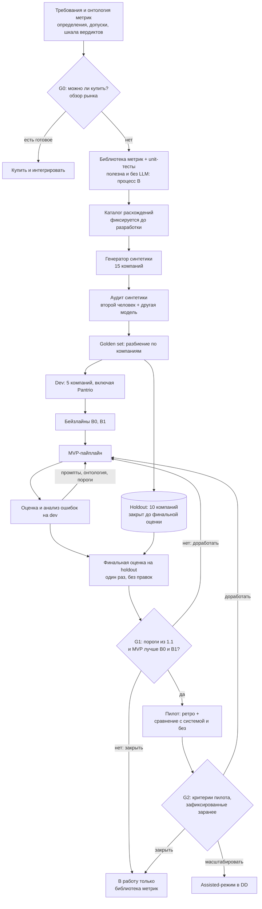
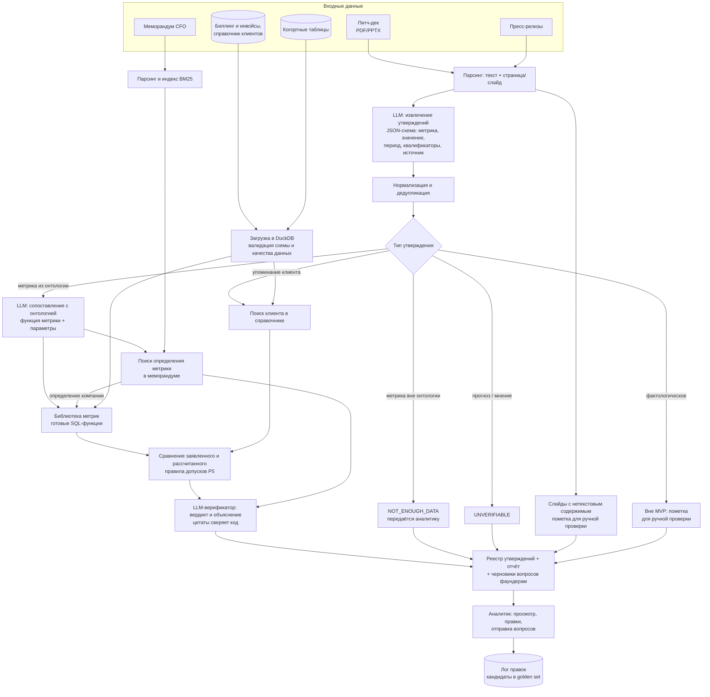
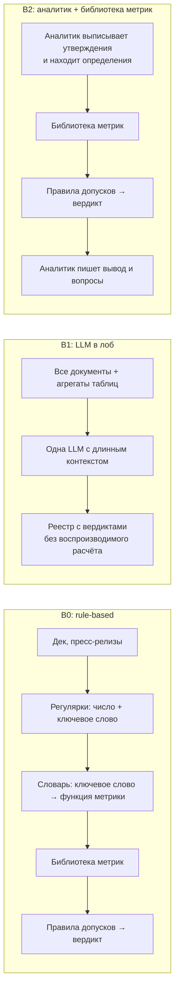
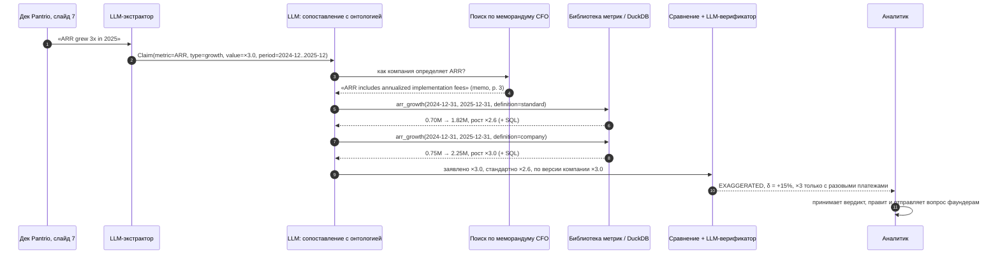

# ML System Design Doc: DD Verifier

**Автоматическая проверка утверждений стартапа по его документам и данным для due diligence венчурного фонда**

| | |
| --- | --- |
| Статус | черновик v0.3 (ДЗ №1: разделы 1–2, доработан по итогам двух раундов ревью — см. [историю изменений](#история-изменений)) |
| Автор | Булат Гумеров |
| Шаблон | [ML System Design Doc (Reliable ML, ODS)](https://github.com/IrinaGoloshchapova/ml_system_design_doc_ru/blob/main/ML_System_Design_Doc_Template.md) |
| Сквозной пример | Pantrio: B2B SaaS для учёта запасов в ресторанах, раунд Series A |

> **Про цифры в документе.** Проект учебный, заказчик условный. Всё, что помечено **[гипотеза]**, — допущения автора от лица заказчика: бизнес-цель, объёмы, пороги, сроки. Бизнес-цель и требования формулирует и подтверждает заказчик, поэтому каждое такое число — кандидат на письменное согласование (вопросы в [разделе 3.4](#34-открытые-вопросы-к-заказчику)). Числа в примерах с Pantrio иллюстративные.

## Термины

| Термин | Значение |
| --- | --- |
| DD, due diligence | проверка компании перед инвестицией: финансы, коммерция, продукт, юридическая часть, команда |
| Data room | набор документов и выгрузок, который стартап открывает фонду под NDA |
| IC memo | меморандум для инвестиционного комитета фонда с выводами DD и рекомендацией |
| Утверждение (claim) | высказывание компании о себе, которое можно проверить: «ARR вырос в 3 раза за 2025 год» |
| Красный флаг | вердикт `EXAGGERATED` или `CONTRADICTED` |
| ARR / MRR | годовая / месячная регулярная (подписочная) выручка |
| NRR / GRR | net / gross revenue retention: удержание выручки когорты клиентов с учётом / без учёта допродаж |
| Logo churn | доля клиентов, ушедших за период |
| ACV | средняя годовая стоимость контракта |
| HITL | human-in-the-loop: аналитик просматривает и правит выдачу системы |

---

## 1. Цели и предпосылки

### 1.1. Зачем идём в разработку продукта?

#### Заказчик, пользователи, стейкхолдеры

- **Заказчик (Product Owner):** инвестиционный партнёр венчурного фонда стадий Seed – Series B, который отвечает за качество DD.
- **Пользователи:** аналитики и ассоциаты фонда, которые проводят DD.
- **Стейкхолдеры:**
  - инвестиционный комитет: читает выводы DD и принимает решение;
  - юристы и compliance: отвечают за соблюдение NDA и хранение данных;
  - LP фонда: косвенно, им важно качество инвестиционных решений.

#### Бизнес-цель

**[гипотеза, формулировка от лица заказчика]** Фонд хочет проводить глубокий DD по большему числу сделок тем же составом аналитиков и реже переплачивать за компании, которые завышают свои метрики.

Как это превращается в деньги (уровень L0):

- **Мощность — избегание расходов.** При росте потока сделок фонд не нанимает ещё одного аналитика или тем же штатом доводит до глубокого DD больше сделок. Эффект есть, только если на мощность есть спрос: у фонда есть очередь сделок, которые сейчас отсеиваются из-за нехватки времени аналитиков **[гипотеза, вопрос 2 в 3.4]**.
- **Потери — снижение ожидаемого ущерба.** Пойманное завышение метрик меняет оценку компании или само решение об инвестиции. Ожидаемый эффект = вероятность пропустить существенное завышение × размер переплаты. Заранее эту величину не посчитать, поэтому на пилоте измеряем прокси: число существенных расхождений, которые нашла система и пропустила обычная проверка.

Высвобожденное время аналитика само по себе деньгами не является: эффектом оно становится только через один из двух механизмов выше.

#### Как процесс устроен сейчас

1. Стартап присылает питч-дек и пресс-релизы, после подписания NDA открывает data room: выгрузку биллинга и инвойсов, справочник клиентов, когортные таблицы, финмодель, меморандум CFO с пояснениями к метрикам.
2. Аналитик вручную выписывает утверждения из дека и пресс-релизов: «ARR вырос в 3 раза», «120+ ресторанных сетей», «NRR 130%», «logo churn ниже 2% в месяц».
3. Для каждого утверждения аналитик ищет данные и определение метрики, пересчитывает её в Excel или SQL и сверяет результат с меморандумом CFO. Если что-то не сходится, он формулирует вопрос фаундерам.
4. Выводы попадают в DD-отчёт и IC memo.

#### Проблема

- **Долго.** Проверка финансовых и коммерческих утверждений одного стартапа занимает у аналитика несколько рабочих дней **[гипотеза: 3–5 дней]**. Сроки при этом жёсткие: в конкурентном раунде эксклюзивность длится 2–4 недели **[гипотеза]**.
- **Неполно.** Времени хватает на 5–10 ключевых метрик **[гипотеза]**, остальные утверждения принимаются на веру.
- **Непоследовательно.** Что входит в ARR, как считается NRR, кто считается клиентом: от сделки к сделке и от аналитика к аналитику ответы разные. Не остаётся следа, по каким данным сделан вывод.
- **Дорого ошибиться.** Типичные приёмы, которые завышают метрики:
  - разовые платежи (внедрение, обучение) включены в ARR;
  - аннуализирован пиковый месяц;
  - подписанные, но не запущенные контракты и пилоты посчитаны как клиенты;
  - выбран удобный период сравнения;
  - выручка показана gross вместо net.

  Пропущенное расхождение означает переплату в оценке или неудачную инвестицию, а заодно репутационный риск перед LP.

#### Почему здесь нужен ML, а где не нужен

Проверку одного утверждения можно разложить на четыре шага:

1. Выписать утверждение и понять, что именно утверждается: метрика, период, база сравнения, квалификаторы («более», «около»).
2. Найти нужные данные и определение метрики, которым пользуется компания.
3. Пересчитать метрику.
4. Сравнить с заявленным, сформулировать вывод и вопрос фаундерам.

**Шагам 3 и 4 ML не нужен.** Метрики считает детерминированный, протестированный код (библиотека метрик), сравнение делают правила допусков. **Шаги 1 и 2** — языковые задачи на разнородных текстах: утверждения написаны в произвольной форме и разбросаны по слайдам, сноскам и пресс-релизам, определения метрик спрятаны в меморандуме. Правила и регулярные выражения здесь ломаются (это бейзлайн B0, см. [2.1](#21-постановка-задачи)), поэтому для этих шагов нужен LLM.

#### Альтернативы и «можно ли купить»

| Альтернатива | Что закрывает | Чего не закрывает |
| --- | --- | --- |
| **A.** Ручная проверка (as-is) | Всё, но медленно и выборочно | Масштаб, единообразие, след выводов |
| **B.** Аналитик + библиотека метрик, без LLM | Пересчёт и сравнение по единым определениям, воспроизводимость | Утверждения выписывает и сопоставляет с метриками человек, определения в меморандуме ищет человек |
| Аутсорс финансового DD (аудиторы, консультанты) | Глубину проверки | Дорого и долго для Seed – Series A |
| Универсальный LLM-чат: «загрузить всё и спросить» (бейзлайн B1) | Быстрый черновик | Галлюцинации в числах, нет воспроизводимого расчёта, данные под NDA уходят третьей стороне |
| Купить: AI-функции data room-платформ (вопросы к документам, суммаризация) | Поиск по текстам data room | Сверку с первичными транзакционными данными и единую онтологию метрик |
| Купить: AI-инструменты для инвесткоманд (скрининг, рыночные данные, CRM) | Внешнюю информацию о компании | Проверку внутренних данных data room |

**Вывод про покупку.** Готового продукта, который сверяет утверждения с транзакционными данными стартапа и работает в контуре фонда, на этапе дизайна не видно **[гипотеза: подтвердить обзором рынка — это гейт G0 перед PoC, см. 2.2.1]**.

**Лучшая альтернатива без ML — B.** Поэтому эффект ML-решения C считаем как дельту к лучшей альтернативе, а не к ручному процессу: эффект = ценность(C) − max(ценность(A), ценность(B)). Отсюда два следствия для плана:

1. Библиотеку метрик делаем первой. Она нужна и MVP, и процессу B, и полезна аналитикам сама по себе, даже если LLM-часть не оправдается.
2. LLM-часть должна доказать, что экономит время аналитика относительно B при не худшей полноте найденных расхождений.

#### Что станет лучше благодаря ML

Аналитик получает **реестр утверждений** за часы, а не за дни. По каждому утверждению в реестре есть:

- вердикт;
- пересчитанное значение и отклонение от заявленного;
- доказательства: SQL-расчёт из библиотеки метрик и цитаты с указанием страницы;
- черновик вопроса фаундерам.

Время аналитика смещается с выписывания и сопоставления утверждений на разбор флагов и разговор с командой. Все утверждения проверяются по одним правилам, у каждого вывода есть след.

#### Метрики и критерии успеха

Это единая таблица ролей метрик для всего документа; в [2.1](#21-постановка-задачи) — только диагностические метрики и протокол оценки.

| Роль | Уровень | Метрика | Цель / порог |
| --- | --- | --- | --- |
| Финансовая цель | L0 | Мощность: стоимость не нанятого аналитика или дополнительных глубоких DD тем же штатом. Потери: переплата, которой удалось избежать (прокси на пилоте — число существенных завышений, найденных до решения IC) | Рост; в деньгах считается после внедрения (вопросы 1–2 в 3.4) |
| Целевая | L1 | Время аналитика на проверку утверждений одной сделки **вместе с просмотром и правкой выдачи системы**, относительно процесса B | Цель −50%, порог гейта пилота −40% **[гипотеза]** |
| Драйвер | L2 | Покрытие: доля проверяемых количественных утверждений из текстового слоя дека и пресс-релизов, попавших в реестр. Рядом показывается доля помеченного для ручной проверки (нетекстовые слайды, фактологические утверждения), чтобы покрытие нельзя было «улучшить» исключениями | ≥ 90% **[гипотеза]** |
| Драйвер | L2 | Среднее время просмотра одного вердикта; аномально быстрые просмотры (< 10 с) отслеживаются как сигнал просмотра «не глядя» | ≤ 2 мин **[гипотеза]** |
| Драйвер | L2 | Доля верных вердиктов, принятых аналитиком без правок (от всех верных вердиктов) | ≥ 70% **[гипотеза]** |
| Защитная | L2 | Доля ошибочных вердиктов, принятых аналитиком без правок (от всех ошибочных вердиктов; automation bias) | ≤ 5% **[гипотеза]** |
| Защитная | L3 | Recall красных флагов | ≥ 0,9 **[гипотеза]** |
| Защитная | L3 | Precision красных флагов: при частых ложных тревогах аналитики перестают доверять флагам | ≥ 0,7 **[гипотеза]** |
| Защитная | L3 | Точность пересчитанных значений относительно эталона | ≥ 95% **[гипотеза]** |
| Жёсткое ограничение | L3 | Critical error rate: доля неверных утверждений, получивших `SUPPORTED` | ≤ 5% **[гипотеза]** |
| Жёсткое ограничение | L3 | Число в отчёте без источника (цитаты или воспроизводимого расчёта) | 0 |
| Жёсткое ограничение | — | Инциденты с данными data room вне согласованного контура | 0 |
| Ограничение | L4 | Время полного прогона по сделке; стоимость инференса на сделку | ≤ 1 ч; ≤ $50 **[гипотеза]** |

**Почему −50% и −40%.** −50% — цель, под которую посчитана экономика ([3.3](#33-оценка-экономики)). −40% — минимальный результат пилота, при котором имеет смысл масштабироваться; это условие гейта G2, оно фиксируется до старта пилота.

**Почему доля принятых вердиктов разделена.** Максимизировать общую долю принятых нельзя: она растёт и тогда, когда аналитик бездумно соглашается с ошибками. Поэтому «принято верных» — драйвер, а «принято ошибочных» — защитная метрика.

**Критерий успеха текущей итерации (MVP курса) — гейт G1.** Считается один раз на закрытом holdout по компаниям (см. протокол в [2.1](#21-постановка-задачи)):

- recall красных флагов ≥ 0,9, precision ≥ 0,7, critical error rate ≤ 5%;
- точность пересчитанных значений ≥ 95%;
- MVP лучше B0 и B1 по recall красных флагов при не худшей precision (парное сравнение на одних и тех же утверждениях).

Если G1 не пройден, в работу уходит только библиотека метрик (процесс B), а LLM-часть дорабатывается или закрывается.

### 1.2. Бизнес-требования и ограничения

> **Статус согласования.** Все требования ниже — черновик автора от лица заказчика. Числовые значения помечены **[гипотеза]** и становятся требованиями только после письменного подтверждения заказчиком.

#### Функциональные требования

| # | Требование |
| --- | --- |
| FR1 | **Вход (MVP):** питч-дек (PDF/PPTX), пресс-релизы (PDF/HTML/TXT/MD), выгрузки биллинга и инвойсов, справочник клиентов и когорты в CSV/XLSX, меморандум CFO (PDF/DOCX/MD). SQL-дампы и другие форматы — следующие итерации |
| FR2 | Извлечение проверяемых утверждений из текстового слоя с источником: документ, страница или слайд, точная цитата. Слайды, где значимая часть содержимого — изображения (графики, скриншоты), помечаются для ручной проверки |
| FR3 | По каждому утверждению: вердикт по шкале ниже, пересчитанное значение, отклонение, доказательства, объяснение, уверенность |
| FR4 | Воспроизводимость: любой расчёт можно перезапустить, сохраняются функция метрики, параметры, SQL и хэш версии данных |
| FR5 | Сводный отчёт: топ расхождений по существенности, черновики вопросов фаундерам, список непроверенных утверждений с причинами. Вопросы фаундерам — только черновики, отправляет их аналитик |
| FR6 | Аналитик может поправить вердикт или параметры расчёта (период, определение метрики) и перезапустить проверку одного утверждения; все правки логируются |
| FR7 | Язык документов: английский в MVP (основной язык деков на Series A), русский — следующая итерация |

**Шкала вердиктов**

| Вердикт | Когда ставится | Пример (Pantrio, иллюстративно) |
| --- | --- | --- |
| `SUPPORTED`: подтверждено | Заявленное совпадает с рассчитанным в пределах допуска (P5) | «120+ ресторанных сетей»: в базе 127 активных платящих клиентов |
| `EXAGGERATED`: преувеличено | Направление верное, но величина завышена сверх допуска или получается только при нестандартном определении метрики | «ARR ×3 за 2025»: по стандартному определению ×2,6; ×3 выходит, только если включить разовые платежи за внедрение |
| `CONTRADICTED`: противоречит данным | Данные опровергают утверждение | «Logo churn ниже 2% в месяц»: фактически 4,5% |
| `NOT_ENOUGH_DATA`: недостаточно данных | Утверждение проверяемо, но нужных данных в data room нет, или метрика не описана в онтологии | «CAC payback 9 месяцев» при отсутствии данных о маркетинговых расходах; уходит в вопросы фаундерам |
| `UNVERIFIABLE`: непроверяемо | Прогноз, оценка или мнение | «Станем лидером рынка в Европе к 2028 году» |

#### Нефункциональные требования

| Аспект | Требование | Комментарий |
| --- | --- | --- |
| Нагрузка | 20–50 сделок на глубоком DD в год, до 3–5 параллельно; 30–150 утверждений на сделку; data room до ~1 ГБ и до 10⁶ строк инвойсов **[гипотеза]** | Нагрузка низкая, сложность не в RPS, а в разнородности данных |
| Скорость | Пакетный режим: полный прогон по сделке ≤ 1 часа; перепроверка одного утверждения ≤ 2 минут **[гипотеза]** | Real-time не нужен, батч дешевле и проще |
| Надёжность | Отказ системы не блокирует DD (fallback — процесс B); идемпотентные перезапуски; кэш ответов LLM | |
| Конфиденциальность | Data room под NDA. Для пилота на реальных сделках нужна либо open-weight LLM в закрытом контуре, либо провайдер с zero data retention и DPA, согласованный с юристами фонда. Данные разных стартапов изолированы друг от друга | Для MVP на синтетике можно использовать внешний API |
| Аудит | Логируются входы, версии промптов и моделей, вызовы функций метрик, результаты; срок хранения по политике фонда | |
| Стоимость | Инференс ≤ $50 на сделку **[гипотеза]** | Оценка в [3.3](#33-оценка-экономики) |
| Интерпретируемость | Каждый вердикт объясним; просмотр одного вердикта аналитиком ≤ 2 минут **[гипотеза]** | |

#### Бизнес-ограничения

- **Поддержка решений, а не автопилот.** Система не даёт инвестиционных рекомендаций и не заменяет аналитика. Выводы в IC memo подписывает человек, вердикты без просмотра аналитиком в отчёт не попадают.
- **Вопросы фаундерам отправляет только аналитик.** Ложный флаг, отправленный от имени фонда, портит отношения с командой — особенно в конкурентном раунде.
- **Только собственные данные компании.** Проверка идёт по документам и данным из data room. Внешние источники (рынок, конкуренты, реестры) — следующие итерации.
- **Определения метрик и пороги согласуются заранее.** Они фиксируются в версионируемой онтологии, а не «зашиваются» в промпты.
- **Ошибки асимметричны.** Пропустить расхождение (ложное `SUPPORTED`) намного дороже ложной тревоги, поэтому recall красных флагов — защитная метрика, а ложное `SUPPORTED` — жёсткое ограничение.

#### Ожидания от итерации (MVP курса)

1. **Библиотека метрик** по онтологии с unit-тестами — первый результат; она полезна и без LLM (процесс B).
2. **Генератор синтетических data room:** Pantrio и ещё 14 компаний с расхождениями из заранее зафиксированного каталога. Генерация дешёвая, поэтому компаний много: golden set разбит по компаниям — 5 для разработки, 10 — закрытый holdout.
3. **Пайплайн для количественных утверждений:** документы → реестр утверждений → отчёт; CLI и одна HTTP-ручка инференса (FastAPI).
4. **Офлайн-оценка** на holdout против бейзлайнов B0 и B1, анализ ошибок, решение по гейту G1.

#### Как система встраивается в процесс на пилоте

1. **Ретроспективный пилот — проверка качества.** Прогон по 5–10 закрытым сделкам фонда **[гипотеза]**, где DD уже провели вручную и найденные расхождения известны. Сравниваем флаги системы с находками аналитиков.
2. **Сравнение «с системой / без системы» — проверка эффекта по времени.** На 5–10 текущих сделках **[гипотеза]** утверждения каждой сделки случайно делятся пополам с балансом по типам метрик. Одну половину аналитик проверяет по процессу B (сам + библиотека метрик), другую — с реестром системы. Время фиксируется по каждому утверждению в инструменте, а не по таймшитам. Так сравниваются одинаковые по сложности задачи у тех же аналитиков. Порядок половин чередуется между сделками и аналитиками: если бы половина «без системы» всегда шла первой, ко второй аналитик уже знал бы data room, и система выглядела бы быстрее, чем есть. Порядок записывается и учитывается при анализе.
3. **Assisted-режим** после гейта G2: аналитик начинает DD сразу с реестра системы.

#### Критерии успешного пилота (гейт G2, фиксируются до старта)

- Ретро: система находит ≥ 90% расхождений, которые аналитики нашли вручную.
- Сравнение: время на утверждение с системой на ≥ 40% меньше, чем по процессу B, при не худшей полноте найденных расхождений.
- Доля ошибочных вердиктов, принятых без правок, ≤ 5%; доля верных, принятых без правок, ≥ 70%.
- Ни одного инцидента с данными data room.

Утверждения внутри одной сделки зависимы, поэтому эффективный размер выборки — число сделок, а не утверждений. На 5–10 сделках статистически строгого вывода не получится, и это признаём заранее: пилот проверяет эффект на порядок величины. Разницу во времени оцениваем смешанной моделью со сделкой и аналитиком как случайными эффектами (или бутстрепом по сделкам), а уверенность в эффекте накапливается с новыми сделками в assisted-режиме.

Если пилот не проходит G2, решаем по Stage-Gate: доработать или остановиться на библиотеке метрик (процесс B).

#### Возможные пути развития

- Фактологические утверждения, проверяемые по текстам data room (партнёрства, интеграции, награды): полноценный RAG по документам.
- Метрики вне онтологии через text-to-SQL — только с обязательной проверкой SQL человеком.
- Внешняя верификация: размер рынка, конкуренты, корпоративные реестры, новости, публичные профили команды.
- Мониторинг портфеля: ежемесячная сверка investor updates с отчётностью уже проинвестированных компаний.
- Интеграция с CRM фонда и data room-платформой.

### 1.3. Что входит в скоуп проекта/итерации, что не входит

Первая итерация намеренно узкая: только **количественные утверждения, которые проверяются по биллингу и справочнику клиентов**. Это ядро ценности (выручка, рост, клиенты, удержание) и самая формализуемая часть задачи.

#### Входит в MVP

| Блок | Что делаем |
| --- | --- |
| Приём документов | Дек (PDF/PPTX), пресс-релизы, меморандум CFO; текст с привязкой к странице или слайду; пометка слайдов с нетекстовым содержимым |
| Приём данных | CSV/XLSX биллинга, справочника клиентов и когорт загружаются в DuckDB с проверкой схемы и качества: дубли, пропуски, валюты, аннулированные инвойсы |
| Библиотека метрик | Онтология ~10 SaaS-метрик с формулами и unit-тестами; два варианта определения там, где компании обычно расходятся (например, ARR с разовыми платежами и без) |
| Извлечение утверждений | Количественные утверждения: ARR/MRR и рост, число клиентов, logo churn, GRR/NRR, ACV, концентрация выручки; упоминания клиентов (есть ли такой клиент в справочнике). Фактологические утверждения распознаются и помечаются для ручной проверки, но не проверяются |
| Поиск определений | BM25 по меморандуму CFO — только чтобы найти, как компания определяет метрику |
| Вердикт | Правила допусков (P5) + LLM-верификатор для расхождений в определениях и объяснения |
| Результат | Реестр утверждений (JSON/CSV) и отчёт (Markdown/HTML) с черновиками вопросов фаундерам |
| Оценка | Генератор синтетики, каталог расхождений, golden set с разбиением по компаниям, офлайн-оценка против B0 и B1 |
| Сервинг | CLI и одна HTTP-ручка (FastAPI) для прогона по одной сделке |

#### Не входит в MVP

| Что | Почему |
| --- | --- |
| Фактологические утверждения, которые проверяются только по текстам (партнёрства, интеграции, награды) | Нужен полноценный RAG по всему data room — следующая итерация |
| Метрики вне онтологии (text-to-SQL) | LLM писала бы расчёт сама, а это противоречит P6. Такие утверждения получают `NOT_ENOUGH_DATA` и уходят аналитику |
| Внешняя верификация (рынок, конкуренты, реестры, новости, LinkedIn) | Другой класс источников и рисков. Задача итерации — проверка по собственным документам и данным компании |
| Legal, tech и team DD | Отдельные экспертизы и данные |
| Инвестиционная рекомендация или скоринг стартапа | Решение остаётся за людьми; другая постановка задачи |
| Выявление подделки первичных документов (forensic accounting) | Система ловит несоответствия между заявлениями и данными, но не подделку самих инвойсов |
| OCR сканов, разбор графиков | Утверждения на картинках не извлекаются: такие слайды помечаются для ручной проверки и не входят в знаменатель метрики покрытия |
| Документы на русском, SQL-дампы | Следующая итерация (FR1, FR7) |
| Гибридный поиск и реранкер | Для поиска определений в одном меморандуме хватает BM25 |
| Полноценный UI, интеграции с CRM и data room-платформами | После пилота; в MVP хватит отчёта и CLI/API |
| Развёртывание в закрытом контуре | Спроектировано (см. 1.2), реализуется под пилот на реальных данных |

#### Требования к качеству кода и воспроизводимости

- Репозиторий с `ruff` и `pre-commit`, зависимости зафиксированы в `uv.lock`, CI запускает линтеры на каждый пуш.
- Функции метрик покрыты unit-тестами на синтетических данных с известным ответом.
- Вызовы LLM: фиксированная версия модели, `temperature=0`, версионируемые промпты, кэширование ответов. Повторный прогон оценки воспроизводит результат.
- Конфиги (онтология метрик, допуски, модели) отделены от кода.
- Офлайн-оценка запускается одной командой и выдаёт отчёт с метриками.

#### Технический долг, который оставляем на следующие итерации

- Только количественные утверждения по биллингу; фактологические — следующая итерация.
- Нет дообучения моделей: только промптинг и few-shot.
- Упрощённая онтология SaaS-метрик (~10 метрик), без отраслевых особенностей.
- BM25 вместо гибридного поиска.
- Однопользовательский режим, без разграничения доступа между сделками на уровне сервиса.
- Нет OCR и разбора графиков.
- Нет UI для правок аналитика: правки идут через файл реестра.

### 1.4. Предпосылки решения

| # | Допущение | Обоснование |
| --- | --- | --- |
| P1 | В data room есть транзакционные данные биллинга. Минимум: `invoice_id`, `customer_id`, дата, период оказания услуги, сумма, валюта, тип платежа (подписка, разовый, внедрение), статус (оплачен, аннулирован, кредит-нота). Есть справочник клиентов: дата подписания, дата go-live, дата оттока, сегмент. Если стартап даёт только агрегаты (помесячную выручку по клиентам), проверка идёт по ним с пометкой пониженной уверенности | Стандартный запрос фонда на Series A **[гипотеза, вопрос 6 в 3.4]**. Без этих данных финансовые утверждения получают `NOT_ENOUGH_DATA`, и это корректный исход, а не ошибка |
| P2 | Для MVP данные синтетические: генератор с известными «истинными» метриками и расхождениями из каталога, который фиксируется до разработки пайплайна. Pantrio — сквозной пример. Параметры holdout-компаний автор не смотрит во время разработки | Реальные data room закрыты NDA. Синтетика даёт точную разметку. Каталог заранее и закрытый holdout снижают риск, что автор «сажает» только то, что сам умеет ловить |
| P3 | Метрики описаны в **онтологии**: ARR, MRR, рост за период, число активных клиентов, logo churn, GRR/NRR, ACV, концентрация выручки, gross margin при наличии данных. У каждой метрики есть формула, протестированная функция и пороги допусков. Если компания определяет метрику иначе (видно из меморандума CFO), считаем оба варианта и отдельно отмечаем расхождение определений | Главный источник «преувеличений» в SaaS — разные определения метрик. Явная онтология делает проверку единообразной |
| P4 | Вердикт выносится по отдельному утверждению. Метрики считаются помесячно. Если период в утверждении не указан, берётся последний закрытый месяц или год на дату документа, и это допущение записывается в реестр | Деки обычно опираются на месячный биллинг. Явные допущения проверяет аналитик |
| P5 | **Допуски зависят от типа метрики** **[гипотеза: пороги согласуются с фондом и задаются в онтологии]**.  • *Уровни* (ARR, MRR, число клиентов, ACV): δ = (заявленное − рассчитанное) / рассчитанное.  • *Рост*: любая формулировка приводится к множителю («×3», «+200%», «утроили» → 3,0), δ считается по множителю.  • *Доли* (logo churn, GRR/NRR, gross margin): разница в процентных пунктах, у каждой метрики свои пороги (например, для месячного churn — 0,3 и 1 п.п.).  Правило: отклонение в пределах нижнего порога → `SUPPORTED`; завышение в пользу компании между порогами → `EXAGGERATED`; выше верхнего порога, противоположное направление или отсутствие факта → `CONTRADICTED`. Для уровней и роста пороги 5% и 25%. Квантификаторы: «более N» выполнено, если факт ≥ N; «около N» означает ±5% | Деки округляют, поэтому нужно отделить округление от систематического завышения. Приведение роста к множителю делает вердикт независимым от формулировки: «×3» и «+200%» против фактических ×2,6 дают одно и то же δ = +15%. Относительное δ на маленьких долях «взрывается»: заявлен churn 1%, факт 1,5% — это 33%, хотя разница всего 0,5 п.п. Поэтому для долей нужны пункты |
| P6 | LLM решает только языковые задачи: извлечение утверждений, сопоставление с метрикой онтологии и параметрами, поиск определения, объяснение. Вся арифметика и все запросы к данным — заранее написанный и протестированный код библиотеки метрик; **LLM не пишет SQL**. Цитаты проверяются точным совпадением с исходным текстом | Главная защита от галлюцинаций в числах, неверных запросов и выдуманных цитат |
| P7 | Документы цифровые, с текстовым слоем, на английском | Покрывает основной поток деков на Series A; сканы и русский — следующие итерации |
| P8 | На MVP используем LLM через API: сначала подтверждаем ценность на лучшей доступной модели. Для закрытого контура — open-weight модель с function calling на своей инфраструктуре. Выбор по офлайн-оценке и TCO | Логика Stage-Gate: если лучшая модель не справляется, self-host тем более не поможет |
| P9 | Первичные записи data room не сфальсифицированы | Подделка инвойсов — задача forensic accounting. Система проверяет согласованность заявлений с данными |

---

## 2. Методология

### 2.1. Постановка задачи

С технической стороны это **верификация утверждений (claim verification / fact-checking)** по разнородному корпусу: тексты и таблицы одной компании.

Формально: дан набор документов компании $D$ (дек, пресс-релизы) и data room $R$ (таблицы и тексты). Нужно найти множество утверждений $C$ и для каждого $c_i \in C$ предсказать:

- вердикт $y_i \in$ {`SUPPORTED`, `EXAGGERATED`, `CONTRADICTED`, `NOT_ENOUGH_DATA`, `UNVERIFIABLE`};
- доказательства $E_i \subset R$: расчёт и (или) цитаты, по которым человек проверит вердикт.

Это расширение классической постановки FEVER (SUPPORTS / REFUTES / NOT ENOUGH INFO) и табличной верификации (TabFact) на числовые рассуждения над транзакционными данными.

Задача раскладывается на подзадачи:

| # | Подзадача | Тип задачи | Вход → выход | Решение в MVP |
| --- | --- | --- | --- | --- |
| 1 | Парсинг документов | не ML | PDF/PPTX/DOCX → текстовые блоки с привязкой к странице или слайду; пометка слайдов с нетекстовым содержимым | библиотеки парсинга |
| 2 | Извлечение утверждений | information extraction (structured generation) | фрагмент текста → список `Claim{text, metric, value, unit, period, comparison, qualifier, source}` | LLM с JSON-схемой и few-shot примерами |
| 3 | Тип утверждения | классификация | `Claim` → метрика из онтологии / упоминание клиента / метрика вне онтологии / фактологическое (вне MVP) / прогноз или мнение | в том же вызове LLM |
| 4 | Дедупликация | семантическое сходство | одно утверждение в деке и пресс-релизе → одно семейство | эмбеддинги + совпадение метрики и периода |
| 5 | Сопоставление с онтологией | классификация по онтологии + slot filling (function calling) | `Claim` → `Plan{metric_fn, definition, params}` | LLM выбирает функцию и параметры; вне онтологии → `NOT_ENOUGH_DATA` |
| 6 | Расчёт | не ML | план + DuckDB → значение + SQL из библиотеки | библиотека метрик |
| 7 | Поиск определения метрики | retrieval | метрика → фрагменты меморандума CFO с определением | BM25 |
| 8 | Вердикт | классификация на 5 классов (fact verification) | утверждение + расчёт + определение → вердикт, уверенность, объяснение | правила допусков (P5) для чисел + LLM-верификатор для расхождений в определениях |
| 9 | Отчёт | grounded generation | реестр → отчёт и черновики вопросов фаундерам | LLM по шаблону; числа подставляются из расчётов, а не генерируются |

> **Терминология.** Модуль вердикта в пайплайне называется **LLM-верификатором**. Термин «LLM-судья» в документе зарезервирован за оценщиком качества системы, у которого своя валидация (разделы про оценку — в следующих ДЗ).

#### Протокол оценки

- **Единица анализа — утверждение, но утверждения группируются.** Утверждения одной компании зависимы (общие данные, один стиль дека), а одно утверждение в деке и пресс-релизе — это одно семейство.
- **Разбиение по компаниям.** 5 компаний (вместе с Pantrio) — разработка: подбор промптов, few-shot примеров и порогов. 10 компаний — закрытый holdout, на котором один раз считается гейт G1; править промпты по его результатам запрещено. Если после G1 систему дорабатывают, для следующей финальной оценки генерируются новые компании.
- **Аудит синтетики до разметки.** Второй человек (аналитик-эксперт или одногруппник) проверяет реалистичность документов и корректность эталонных вердиктов, часть проверки делает модель другого семейства. Полностью проверяются 3 компании, у остальных — случайная выборка утверждений. Каталог расхождений фиксируется до разработки пайплайна.
- **Сравнение с бейзлайнами — парное**, на одних и тех же утверждениях. Интервалы — кластерный бутстреп по 10 holdout-компаниям; если они слишком широкие, добавляем компании, а не дробим утверждения.

#### Метрики

Роли и пороги метрик — в единой таблице [1.1](#11-зачем-идём-в-разработку-продукта). Здесь — диагностические метрики уровня L3, по которым ищем причины ошибок:

- precision и recall извлечения утверждений; точность слотов (метрика, значение, период);
- точность сопоставления утверждения с метрикой онтологии;
- точность пересчитанных значений относительно ground truth (порог — в таблице 1.1, входит в гейт G1);
- recall@k поиска определений в меморандуме;
- groundedness: у вердикта есть корректная ссылка на расчёт или цитату;
- macro-F1 по 5 классам — для сводки, решения по ней не принимаются.

#### Бейзлайны

- **B0, rule-based.** Регулярные выражения находят числа рядом с ключевыми словами (ARR, MRR, customers, churn, NRR). Ключевые слова вручную сопоставлены с функциями библиотеки метрик, допуски те же (P5). Это нижняя граница: показывает, сколько утверждений теряется без понимания языка.
- **B1, «LLM в лоб».** Все документы и агрегированные таблицы отправляются в длинный контекст одной LLM с просьбой выдать реестр с вердиктами. Аналог «взять готовый чат». Ожидаем правдоподобные, но непроверяемые числа; измеряем, насколько это хуже.
- **B2, аналитик + библиотека метрик** — процессная альтернатива B из 1.1. Офлайн её не прогнать (нужен человек), поэтому с MVP она сравнивается на пилоте по времени и полноте найденных расхождений. Golden set по сути и есть результат тщательного B2, так что офлайн мы меряем, насколько MVP к нему приближается.
- **MVP:** пайплайн из таблицы выше.

### 2.2. Блок-схема решения

#### 2.2.1. Этапы работ и гейты

Вернуться к доработке MVP можно с G1 и G2; holdout после этого не переиспользуется (см. протокол в 2.1).

#### 2.2.2. Архитектура MVP-пайплайна (инференс по одной сделке)

Ключевые решения в схеме:

- **Числа считает только код.** LLM выбирает функцию метрики и параметры, а значение возвращает заранее написанная функция библиотеки. Это закрывает жёсткое ограничение «0 чисел без источника».
- **Определения сверяются по меморандуму.** Если компания считает метрику по-своему, поиск находит определение в меморандуме CFO, и метрика считается в двух вариантах: стандартном и «по версии компании». Так ловятся случаи вроде «×3 только с разовыми платежами».
- **Аналитик в контуре.** Вопросы фаундерам уходят только через него. Правки аналитика перезапускают проверку отдельного утверждения с шага сопоставления (FR6; на схеме эта петля не показана, чтобы не загромождать её), а лог правок даёт кандидатов в golden set — эталоном они становятся только после проверки.

#### 2.2.3. Бейзлайны

Бейзлайны заметно отличаются от MVP, поэтому для них отдельная схема:

#### 2.2.4. Пример: проверка «ARR вырос в 3 раза за 2025 год»

Строка реестра, которую получает аналитик:

| Поле | Значение |
| --- | --- |
| Утверждение | «ARR grew 3x in 2025» (дек, слайд 7) |
| Метрика / период | ARR, рост 31.12.2024 → 31.12.2025 |
| Рассчитано | ×2,6 (0,70 → 1,82 млн $) по стандартному определению; ×3,0 (0,75 → 2,25 млн $) с аннуализированными платежами за внедрение |
| Вердикт | `EXAGGERATED`, δ = +15% по множителю роста (P5) |
| Доказательства | Вызовы функции `arr_growth` с SQL для обоих определений; цитата из меморандума CFO, стр. 3 |
| Черновик вопроса фаундерам | Платежи за внедрение разовые? Какой ARR и рост без них? |

---

## 3. Дополнительно

### 3.1. Риски

Оценки по шкале 1–10, важность = вероятность × последствия.

| # | Причина → риск → эффект | Вер. | Посл. | Важн. | Стратегия |
| --- | --- | --- | --- | --- | --- |
| R1 | LLM склонна выдумывать → галлюцинация числа или цитаты → ложный вердикт в отчёте | 6 | 9 | 54 | **Mitigate:** арифметика и запросы к данным только в коде (P6); цитаты сверяются точным совпадением с источником; без доказательства вердикт понижается до `NOT_ENOUGH_DATA` |
| R2 | Синтетика проще реальных data room (форматы, грязь, нестандартные выгрузки) → качество на пилоте ниже офлайн-оценки | 7 | 7 | 49 | **Mitigate:** генератор с шумом и разными форматами; ретро-пилот на реальных закрытых сделках как можно раньше |
| R3 | Синтетику и детектор делает один человек → «сажает» только то, что сам умеет ловить → завышенная офлайн-оценка | 6 | 7 | 42 | **Mitigate:** каталог расхождений до разработки, закрытый holdout, аудит синтетики вторым человеком и другой моделью, ретро-пилот на реальных сделках |
| R4 | Компании по-разному определяют метрики → много ложных `EXAGGERATED` → аналитики перестают доверять флагам | 8 | 5 | 40 | **Mitigate:** онтология с вариантами определений, расчёт в двух вариантах, отдельная пометка «определение отличается»; precision флагов — защитная метрика |
| R5 | Data room уходит внешнему LLM-провайдеру → нарушение NDA → юридический и репутационный ущерб | 4 | 10 | 40 | **Transfer / mitigate:** MVP только на синтетике; на пилоте закрытый контур или ZDR + DPA, согласованные с юристами |
| R6 | Automation bias: аналитик соглашается с вердиктами без проверки → пропуск расхождения | 5 | 8 | 40 | **Mitigate:** доказательства рядом с каждым вердиктом; «принято ошибочных» — защитная метрика; выборочный аудит принятых вердиктов; без автоапрува |
| R7 | Аналитики не доверяют системе и не пользуются ей → эффект не доходит до процесса | 5 | 7 | 35 | **Mitigate:** аналитики участвуют в онтологии и аудите синтетики с самого начала; «принято верных» — драйвер; ложные флаги ограничены защитной метрикой |
| R8 | Мало сделок на пилоте → эффект по времени не доказать статистически | 7 | 5 | 35 | **Mitigate:** ретро-пилот увеличивает выборку; сравнение внутри сделки (утверждения пополам) убирает разброс между сделками; оценка по сделкам (смешанная модель или бутстреп), без иллюзии «сотен независимых наблюдений»; пилот проверяет эффект на порядок величины |
| R9 | Провайдер обновил или отключил версию LLM → деградация качества | 5 | 6 | 30 | **Mitigate:** фиксированные версии моделей, регрессионный прогон golden set при любой смене, совместимость с open-weight моделью |
| R10 | Ложный флаг ушёл фаундерам → испорчены отношения с командой в конкурентном раунде | 3 | 9 | 27 | **Mitigate:** система готовит только черновики, отправляет аналитик; формулировки нейтральные — просьба уточнить, а не обвинение |
| R11 | Стартап не даёт сырые инвойсы, только агрегаты, или data room неполный → много `NOT_ENOUGH_DATA` | 5 | 5 | 25 | **Accept / mitigate:** проверка по агрегатам с пометкой пониженной уверенности; список недостающих данных — тоже полезный результат; сырые выгрузки — в стандартный чек-лист запроса DD |

### 3.2. AI Canvas (кратко)

| Блок | Содержание |
| --- | --- |
| Value Proposition | Проверка всех количественных утверждений стартапа за часы вместо дней, с доказательствами |
| Customers | Аналитики и ассоциаты венчурного фонда |
| Stakeholders | Инвестпартнёр (заказчик), инвестиционный комитет, юристы и compliance |
| Data | Дек, пресс-релизы, биллинг и инвойсы, справочник клиентов, когорты, меморандум CFO; для MVP — синтетика |
| Solution | Библиотека метрик + LLM-пайплайн: извлечение → сопоставление с онтологией → детерминированный расчёт → вердикт с доказательствами |
| Integration | MVP: CLI/API и отчёт. Позже: CRM фонда, data room-платформа |
| Output | Время аналитика относительно процесса B; recall красных флагов |
| Skills | NLP/LLM, SQL, понимание SaaS-метрик и венчурного DD; эксперт-аналитик для онтологии, аудита синтетики и разметки |
| Cost / Revenue | Затраты: разработка (1 ML-инженер), время эксперта, прогоны оценки, токены или GPU. Эффект: мощность команды DD и меньше переплат |

### 3.3. Оценка экономики

Денежные механизмы — мощность и потери (см. «Бизнес-цель» в 1.1). Ниже — эффект по времени относительно лучшей альтернативы B, с учётом времени на просмотр выдачи системы (HITL). Все значения — **[гипотеза]**.

**Время аналитика на одну сделку**

| Процесс | Из чего складывается | Дней на сделку |
| --- | --- | --- |
| A: как сейчас | выписать утверждения, найти данные и определения, пересчитать, сравнить, написать вывод | 4 |
| B: аналитик + библиотека метрик | то же, но пересчёт и сравнение делает код | 3 |
| C: MVP + просмотр | просмотр 100 вердиктов × 2 мин ≈ 0,4 дня; правка 30% всех вердиктов (ошибочные + уточнение верных) × 10 мин ≈ 0,6 дня; утверждения вне онтологии, нетекстовые слайды и вопросы фаундерам ≈ 0,5 дня | 1,5 |

Эффект ML-решения = T(B) − T(C) = 1,5 дня на сделку, то есть −50% к процессу B. Сравнение с ручным процессом (4 − 1,5 = 2,5 дня) завысило бы эффект: день из этих 2,5 даёт библиотека метрик без всякого ML.

**Сценарии**

| Параметр | Негативный | Базовый | Позитивный |
| --- | --- | --- | --- |
| Сделок на глубоком DD в год | 20 | 30 | 50 |
| T(B), дней на сделку | 2,5 | 3 | 3,5 |
| T(C), дней на сделку | 1,5 | 1,5 | 1,1 |
| Снижение времени к процессу B | −40% (порог G2) | −50% (цель) | −69% |
| Экономия на сделку, дней | 1,0 | 1,5 | 2,4 |
| Экономия в год, дней аналитика | 20 | 45 | 120 |
| В долях ставки (≈ 220 рабочих дней в году) | ≈ 0,09 | ≈ 0,2 | ≈ 0,55 |

Негативный сценарий — система проходит гейт G2 ровно на пороге (−40%), а сделок мало; результаты хуже порога в эксплуатацию не попадают, их отсекает G2. В позитивном сценарии правок мало (10% вердиктов): 0,42 + 0,21 + 0,5 ≈ 1,1 дня. На пороге G2 при базовых значениях (30 сделок, T(B) = 3): 1,2 дня × 30 = 36 дней в год.

**Чувствительность.** Сильнее всего эффект зависит от T(C), то есть от времени на просмотр и правки: каждые +10 п.п. вердиктов, требующих правки, добавляют ≈ 0,2 дня на сделку (10 вердиктов × 10 мин). Поэтому precision флагов и «принято верных» стоят в таблице метрик. Второй по силе фактор — число сделок и наличие спроса на высвобожденную мощность.

**Вывод.** По одному только времени эффект скромный: в базовом сценарии ≈ 0,2 ставки аналитика в год, а заметную часть выигрыша (A → B, 1 день на сделку) даёт библиотека метрик без LLM. LLM-часть оправдана, только если выполняется хотя бы одно условие:

1. У фонда есть очередь сделок, и сэкономленные дни превращаются в дополнительные глубокие DD (мощность).
2. На ретро-пилоте система находит существенные расхождения, которые пропускает обычная проверка (потери).

Оба условия проверяются гейтами G1 и G2. Если они не подтверждаются, проект останавливается на библиотеке метрик.

**TCO первого года**

| Статья | Оценка |
| --- | --- |
| Разработка MVP | 6 недель одного ML-инженера в оптимистичном сценарии → закладываем 12 (правило «×2 от оптимистичной оценки») |
| Эксперт: каталог расхождений, аудит синтетики, разметка | ≈ 5–10 дней аналитика **[гипотеза]** |
| Прогоны оценки | На 5 dev-компаниях ≈ $20–300 за прогон (5 × $4–60); за разработку десятки прогонов — от сотен долларов до ~$10 тыс. в зависимости от модели, снижается кэшированием и прогонами на подвыборке. Финальная оценка на 10 holdout-компаниях — один прогон ≈ $40–600 |
| Инференс в эксплуатации | 30 сделок × $4–60 ≈ $120–1 800 в год |
| Закрытый контур для пилота | ZDR-API без своей инфраструктуры или аренда GPU под open-weight модель; оценивается после выбора модели (P8) |
| Поддержка | Обновление онтологии, регрессионный прогон golden set при смене модели — ≈ 1–2 дня ML-инженера в месяц **[гипотеза]** |

Разработка — ≈ 60 дней ML-инженера, поддержка — ещё 12–24 дня в год. Если день инженера и день аналитика стоят примерно одинаково **[гипотеза]**, чистая экономия в базовом сценарии — 45 − (12…24) = 21–33 дня в год, и разработка окупается по одному времени за 2–3 года. В негативном сценарии (20 дней в год) экономия едва покрывает поддержку, и по времени проект не окупается; в позитивном (120 дней) — окупается меньше чем за год. Поэтому решение принимается по эффекту на мощность и потери, а не только по экономии времени.

**Стоимость инференса на сделку.** На сделку уходит примерно:

- извлечение утверждений: ~30 тыс. токенов;
- до 150 утверждений × ~10 тыс. токенов на сопоставление и вердикт ≈ 1,5 млн;
- отчёт: ~50 тыс.

Итого ≈ 1,6 млн входных и ~0,2 млн выходных токенов; с запасом ×1,5 на ретраи, расчёт по двум определениям и перепроверки (FR6) — ≈ 2,4 млн и 0,3 млн. При ценах API от ~$1 до ~$15 за млн входных и от ~$5 до ~$75 за млн выходных токенов выходит **≈ $4–60 на сделку**. Ограничение ≤ $50 выполняется для всех классов моделей, кроме самых дорогих, а для них — с кэшированием контекста.

### 3.4. Открытые вопросы к заказчику

1. Сколько сделок в год доходит до глубокого DD и сколько дней аналитика уходит на проверку утверждений? (Гипотезы для L1 и экономики.)
2. Есть ли очередь сделок, которые не доходят до глубокого DD из-за нехватки времени аналитиков? Без неё эффект по мощности не превращается в деньги.
3. Какие утверждения важнее всего для решения инвесткомитета? Задаёт приоритеты онтологии.
4. Какие отклонения по каждому типу метрики считать округлением, а какие — преувеличением? (P5)
5. Можно ли передавать данные data room внешнему LLM-провайдеру на условиях ZDR + DPA, или нужен закрытый контур?
6. Дают ли стартапы на Series A сырые выгрузки инвойсов или только агрегаты? (P1)
7. В каком виде нужен результат: Excel, Notion/Google Docs, раздел IC memo?
8. Есть ли закрытые сделки с задокументированными находками DD для ретро-пилота? Кто из аналитиков может провести аудит синтетики?

### 3.5. Что дальше

Следующие ДЗ раскроют остальные разделы шаблона:

- данные: каталог расхождений, генератор синтетического data room и EDA;
- метрики и схема валидации (детализация протокола из 2.1);
- бейзлайны и MVP;
- анализ ошибок;
- внедрение, мониторинг, нагрузка.

## История изменений

| Версия | Что изменилось |
| --- | --- |
| v0.1 | Первая версия: разделы 1–2 по шаблону, риски, AI Canvas, оценка экономики |
| v0.2 | По итогам первого ревью:  • явная бизнес-цель и денежные механизмы (L0);  • альтернатива B «аналитик + библиотека метрик», эффект считается как дельта к ней; вопрос «можно ли купить» закрыт предварительно, обзор рынка вынесен в гейт G0;  • единая таблица ролей метрик; доля принятых вердиктов разделена на «принято верных» (драйвер) и «принято ошибочных» (защитная); согласованы цель −50% и порог пилота −40%;  • пилот: вместо замера времени в shadow-режиме — сравнение «с системой / без системы» на половинах утверждений одной сделки; кластерный бутстреп по сделкам;  • протокол оценки: holdout по компаниям, запрет правок по holdout, аудит синтетики; гейты G0–G2 на схеме этапов;  • P5: допуски по типам метрик, рост приводится к множителю, доли — в процентных пунктах;  • скоуп сужен до количественных утверждений по биллингу; text-to-SQL убран (противоречил P6); BM25 вместо гибридного поиска; согласованы FR1 и FR7 со скоупом; нетекстовые слайды помечаются и не входят в знаменатель покрытия;  • модуль вердикта переименован в LLM-верификатор, «LLM-судья» оставлен за оценщиком;  • экономика: HITL вычтен, три сценария, чувствительность, TCO; уточнена стоимость инференса;  • риски: добавлены R3, R7, R10, R11;  • все числовые требования помечены как гипотезы до согласования |
| v0.3 | По итогам повторного ревью:  • окупаемость пересчитана с учётом поддержки; прогоны оценки в TCO — только на dev-компаниях;  • сценарии пересчитаны: негативный — на пороге гейта G2, позитивный следует из допущений; добавлен расчёт на пороге G2;  • синтетика расширена до 15 компаний (5 dev, 10 holdout), аудит — 3 компании целиком и выборка остальных;  • пилот: порядок половин «с системой / без» чередуется; честная оценка мощности пилота на 5–10 сделках;  • маршрут для фактологических утверждений (пометка «вне MVP»); доля помеченного показывается рядом с покрытием;  • нижняя граница времени просмотра как сигнал «не глядя»; уточнены знаменатели долей принятых вердиктов; точность значений добавлена в таблицу метрик; L0 выражен в деньгах;  • на схеме 2.2.1 — возврат с G1 на доработку; на схеме 2.2.2 цитаты сверяет код; убраны повторы |
