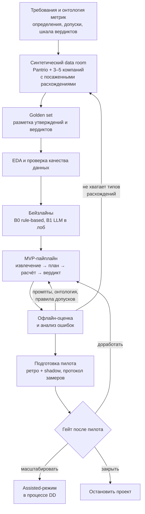
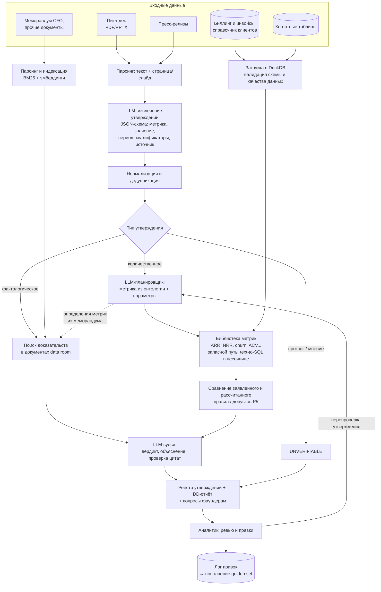
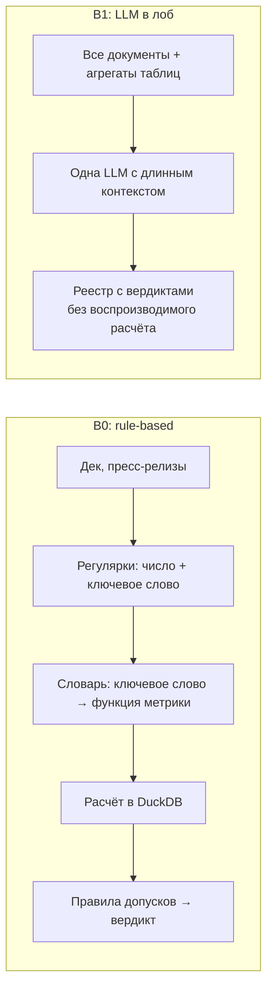
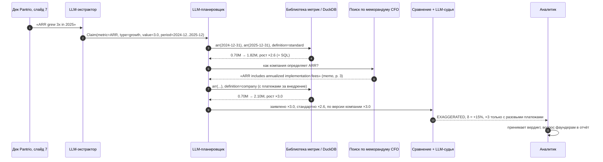

# ML System Design Doc: DD Verifier

**Автоматическая проверка утверждений стартапа по его документам и данным для due diligence венчурного фонда**

| | |
| --- | --- |
| Статус | черновик v0.1 (ДЗ №1: разделы 1–2) |
| Автор | Булат Гумеров |
| Шаблон | [ML System Design Doc (Reliable ML, ODS)](https://github.com/IrinaGoloshchapova/ml_system_design_doc_ru/blob/main/ML_System_Design_Doc_Template.md) |
| Сквозной пример | Pantrio: B2B SaaS для учёта запасов в ресторанах, раунд Series A |

> **Про цифры в документе.** Проект учебный, заказчик условный. Количественные оценки с пометкой **[гипотеза]** — допущения автора, их нужно подтвердить у заказчика (список вопросов в [разделе 3.4](#34-открытые-вопросы-к-заказчику)). Числа в примерах с Pantrio иллюстративные.

## Термины

| Термин | Значение |
| --- | --- |
| DD, due diligence | проверка компании перед инвестицией: финансы, коммерция, продукт, юридическая часть, команда |
| Data room | набор документов и выгрузок, который стартап открывает фонду под NDA |
| IC memo | меморандум для инвестиционного комитета фонда с выводами DD и рекомендацией |
| Утверждение (claim) | высказывание компании о себе, которое можно проверить: «ARR вырос в 3 раза за 2025 год» |
| ARR / MRR | годовая / месячная регулярная (подписочная) выручка |
| NRR / GRR | net / gross revenue retention: удержание выручки когорты клиентов с учётом / без учёта допродаж |
| Logo churn | доля клиентов, ушедших за период |
| ACV | средняя годовая стоимость контракта |

---

## 1. Цели и предпосылки

### 1.1. Зачем идём в разработку продукта?

#### Заказчик, пользователи, стейкхолдеры

- **Заказчик (Product Owner):** инвестиционный партнёр венчурного фонда стадий Seed – Series B, который отвечает за качество DD.
- **Пользователи:** аналитики и ассоциаты фонда, которые проводят DD.
- **Стейкхолдеры:**
  - инвестиционный комитет: читает выводы DD и принимает решение;
  - юристы и compliance: отвечают за соблюдение NDA и хранение данных;
  - LP фонда: косвенно, им важно качество инвестиционных решений.

#### Как процесс устроен сейчас

1. Стартап присылает питч-дек и пресс-релизы, после подписания NDA открывает data room: выгрузку биллинга и инвойсов, справочник клиентов, когортные таблицы, финмодель, меморандум CFO с пояснениями к метрикам.
2. Аналитик вручную выписывает утверждения из дека и пресс-релизов: «ARR вырос в 3 раза», «120+ ресторанных сетей», «NRR 130%», «logo churn ниже 2% в месяц».
3. Для каждого утверждения аналитик ищет данные для проверки, пересчитывает метрику в Excel или SQL и сверяет результат с меморандумом CFO. Если что-то не сходится, он формулирует вопрос фаундерам.
4. Выводы попадают в DD-отчёт и IC memo.

#### Проблема

- **Долго.** Проверка финансовых и коммерческих утверждений одного стартапа занимает у аналитика несколько рабочих дней **[гипотеза: 3–5 дней]**. Сроки при этом жёсткие: в конкурентном раунде эксклюзивность длится 2–4 недели.
- **Неполно.** Времени хватает на 5–10 ключевых метрик, остальные утверждения принимаются на веру.
- **Непоследовательно.** Что входит в ARR, как считается NRR, кто считается клиентом: от сделки к сделке и от аналитика к аналитику ответы разные. Не остаётся следа, по каким данным сделан вывод.
- **Дорого ошибиться.** Типичные приёмы, которые завышают метрики:
  - разовые платежи (внедрение, обучение) включены в ARR;
  - аннуализирован пиковый месяц;
  - подписанные, но не запущенные контракты и пилоты посчитаны как клиенты;
  - выбран удобный период сравнения;
  - выручка показана gross вместо net.

  Пропущенное расхождение означает переплату в оценке или неудачную инвестицию, а заодно репутационный риск перед LP.

#### Почему здесь нужен ML, а где не нужен

Утверждения написаны на естественном языке в произвольной форме и разбросаны по слайдам, сноскам и пресс-релизам. Чтобы сопоставить утверждение с нужными данными и расчётом, нужно понимать язык и предметную область. Правила и регулярные выражения на этом ломаются, поэтому они станут бейзлайном B0 (см. [2.1](#21-постановка-задачи)).

**Сами вычисления ML не нужны.** Метрики считает детерминированный, протестированный код (SQL/Python). LLM только извлекает утверждения, планирует проверку, находит цитаты и объясняет результат.

#### Альтернативы

| Альтернатива | Почему не закрывает проблему |
| --- | --- |
| Ручная проверка (as-is) | см. «Проблема»; остаётся fallback-процессом |
| Аутсорс финансового DD (аудиторы, консультанты) | дорого и долго для Seed – Series A; оправдано на поздних стадиях |
| Универсальный LLM-чат: «загрузить всё и спросить» | галлюцинации в числах, расчёт нельзя воспроизвести, таблица инвойсов не помещается в контекст, данные под NDA уходят третьей стороне. Берём как бейзлайн B1 |
| Готовые AI-инструменты для VC, data room-платформы с AI-поиском | в основном поиск и суммаризация, а не сверка с первичными данными; перед пилотом нужен отдельный анализ рынка |

#### Что станет лучше благодаря ML

Аналитик получает **реестр утверждений** за часы, а не за дни. По каждому утверждению в реестре есть:

- вердикт;
- пересчитанное значение и отклонение от заявленного;
- доказательства: SQL-запрос или расчёт плюс цитаты с указанием страницы;
- готовый вопрос фаундерам.

Время аналитика смещается с механической сверки на разбор флагов и разговор с командой. Все утверждения проверяются по одним правилам, у каждого вывода есть след.

#### Критерии успеха (бизнес)

Метрики разложены по иерархии L1–L4 и ролям из курса.

| Роль | Метрика | Цель |
| --- | --- | --- |
| Целевая (L1) | Время аналитика на этап проверки утверждений в одной сделке | −50% к текущему **[гипотеза]**, измеряется на пилоте |
| Драйвер (L2) | Покрытие: доля проверяемых утверждений из дека и пресс-релизов, попавших в реестр | ≥ 90% |
| Драйвер (L2) | Доля вердиктов, принятых аналитиком без правок | ≥ 70% |
| Защитная (L3) | Полнота красных флагов (вердикты «преувеличено» и «противоречит данным») | ≥ 90%: система не должна пропускать расхождения |
| Жёсткое ограничение | Число в отчёте без источника (цитаты или воспроизводимого расчёта) | 0 |
| Жёсткое ограничение | Данные data room за пределами согласованного контура | 0 инцидентов |

**Критерий успеха текущей итерации (MVP курса):** пайплайн работает от начала до конца на синтетическом data room и достигает офлайн-порогов из [2.1](#21-постановка-задачи) на размеченном golden set: recall красных флагов ≥ 0.9, precision ≥ 0.7, точность пересчитанных значений ≥ 95%. Он также должен обгонять бейзлайны B0 и B1 по recall красных флагов и точности значений.

### 1.2. Бизнес-требования и ограничения

#### Функциональные требования

| # | Требование |
| --- | --- |
| FR1 | **Вход:** питч-дек (PDF/PPTX), пресс-релизы (PDF/HTML/TXT) и data room: выгрузка биллинга и инвойсов (CSV/XLSX/SQL-дамп), справочник клиентов, когортные таблицы, меморандум CFO, прочие текстовые документы (PDF/DOCX/MD) |
| FR2 | Извлечение всех проверяемых утверждений с источником: документ, страница или слайд, точная цитата |
| FR3 | По каждому утверждению: вердикт по шкале ниже, пересчитанное значение, отклонение, доказательства, объяснение, уверенность |
| FR4 | Воспроизводимость: любой расчёт можно перезапустить, сохраняются SQL/код, параметры и хэш версии данных |
| FR5 | Сводный отчёт: топ расхождений по существенности, вопросы фаундерам, список непроверенных утверждений с причинами |
| FR6 | Аналитик может поправить вердикт или параметры расчёта (период, определение метрики) и перезапустить проверку одного утверждения; все правки логируются |
| FR7 | Документы на английском и русском |

**Шкала вердиктов**

| Вердикт | Когда ставится | Пример (Pantrio, иллюстративно) |
| --- | --- | --- |
| `SUPPORTED`: подтверждено | Заявленное совпадает с рассчитанным в пределах допуска | «120+ ресторанных сетей»: в базе 127 активных платящих клиентов |
| `EXAGGERATED`: преувеличено | Направление верное, но величина завышена сверх допуска или получается только при нестандартном определении метрики | «ARR ×3 за 2025»: по стандартному определению ×2,6; ×3 выходит, только если включить разовые платежи за внедрение |
| `CONTRADICTED`: противоречит данным | Данные опровергают утверждение | «Logo churn ниже 2% в месяц»: фактически 4,5% |
| `NOT_ENOUGH_DATA`: недостаточно данных | Утверждение проверяемо, но нужных данных в data room нет | «CAC payback 9 месяцев» при отсутствии данных о маркетинговых расходах; уходит в вопросы фаундерам |
| `UNVERIFIABLE`: непроверяемо | Прогноз, оценка или мнение | «Станем лидером рынка в Европе к 2028 году» |

#### Нефункциональные требования

| Аспект | Требование | Комментарий |
| --- | --- | --- |
| Нагрузка | 20–50 сделок на глубоком DD в год, до 3–5 параллельно; 30–150 утверждений на сделку; data room до ~1 ГБ и до 10⁶ строк инвойсов **[гипотеза]** | Нагрузка низкая, сложность не в RPS, а в разнородности данных |
| Скорость | Пакетный режим: полный прогон по сделке ≤ 1 часа; перепроверка одного утверждения ≤ 2 минут | Real-time не нужен, батч дешевле и проще |
| Надёжность | Отказ системы не блокирует DD (fallback на ручной процесс); идемпотентные перезапуски; кэш ответов LLM | |
| Конфиденциальность | Data room под NDA. Для пилота на реальных сделках нужна либо open-weight LLM в закрытом контуре, либо провайдер с zero data retention и DPA, согласованный с юристами фонда. Данные разных стартапов изолированы друг от друга | Для MVP на синтетике можно использовать внешний API |
| Аудит | Логируются входы, версии промптов и моделей, запросы к данным, результаты; срок хранения по политике фонда | |
| Стоимость | Инференс ≤ $50 на сделку **[гипотеза]** | Порядок оценки в [3.3](#33-оценка-экономики) |
| Интерпретируемость | Каждый вердикт объясним и проверяем человеком за 1–2 минуты | |

#### Бизнес-ограничения

- **Поддержка решений, а не автопилот.** Система не даёт инвестиционных рекомендаций и не заменяет аналитика. Выводы в IC memo подписывает человек, вердикты без просмотра аналитиком в отчёт не попадают.
- **Только собственные данные компании.** Проверка идёт по документам и данным из data room. Внешние источники (рынок, конкуренты, реестры) войдут в следующие итерации.
- **Определения метрик и пороги согласуются заранее.** Они фиксируются в версионируемом конфиге, а не «зашиваются» в промпты.
- **Ошибки асимметричны.** Пропустить расхождение (ложное `SUPPORTED`) намного дороже ложной тревоги, поэтому система настраивается на полноту красных флагов.

#### Ожидания от итерации (MVP курса)

- Синтетический data room Pantrio и ещё 3–5 синтетических компаний с заранее «посаженными» расхождениями разных типов. Для них размечен golden set утверждений с эталонными вердиктами.
- Пайплайн от документов до реестра утверждений и отчёта; CLI и HTTP-ручка инференса (FastAPI).
- Офлайн-оценка против бейзлайнов B0 и B1, анализ ошибок.

#### Как система встраивается в процесс на пилоте

1. **Ретроспективный пилот.** Прогон по 5–10 закрытым сделкам фонда, где DD уже провели вручную и найденные расхождения известны. Сравниваем флаги системы с находками аналитиков.
2. **Shadow-режим** на 3–5 текущих сделках. Аналитик работает как обычно и параллельно получает реестр от системы. Фиксируем время, совпадения, уникальные находки с обеих сторон, правки.
3. **Assisted-режим.** Аналитик начинает DD сразу с реестра системы.

#### Критерии успешного пилота

- Система находит ≥ 90% расхождений, которые аналитики нашли вручную (ретро-пилот).
- Время на этап проверки утверждений сокращается на ≥ 40% (shadow и assisted, по таймшитам).
- ≥ 70% вердиктов принимаются без правок; аналитики оценивают полезность на ≥ 4 из 5.
- Ни одного инцидента с данными data room.

Если пилот не дотягивает, решаем по гейтам Stage-Gate: доработать (онтология, промпты, данные) или закрыть.

#### Возможные пути развития

- Внешняя верификация: размер рынка, конкуренты, корпоративные реестры, новости, публичные профили команды.
- Мониторинг портфеля: ежемесячная сверка investor updates с отчётностью уже проинвестированных компаний.
- Интеграция с CRM фонда и data room-платформой.
- Legal DD (договоры, cap table): отдельный проект.

### 1.3. Что входит в скоуп проекта/итерации, что не входит

#### Входит в MVP

| Блок | Что делаем |
| --- | --- |
| Приём документов | PDF/PPTX-дек, пресс-релизы (PDF/HTML/TXT/MD), меморандум (PDF/DOCX/MD) с привязкой текста к странице или слайду |
| Приём данных | CSV/XLSX биллинга, справочника клиентов и когорт загружаются в DuckDB с проверкой схемы и качества: дубли, пропуски, валюты, аннулированные инвойсы |
| Извлечение утверждений | Количественные и фактологические утверждения о выручке и росте, клиентах, удержании и оттоке, ACV, концентрации выручки; известные логотипы клиентов |
| Проверка | Количественные: через библиотеку метрик по онтологии. Фактологические: через поиск по документам data room. Прогнозы и мнения помечаются как `UNVERIFIABLE` |
| Результат | Реестр утверждений (JSON/CSV) и отчёт (Markdown/HTML) с вопросами фаундерам |
| Оценка | Генератор синтетических data room с посаженными расхождениями, golden set, скрипт офлайн-оценки, сравнение с B0/B1 |
| Сервинг | CLI и минимальная HTTP-ручка (FastAPI) для прогона по одной сделке |

#### Не входит в MVP

| Что | Почему |
| --- | --- |
| Внешняя верификация (рынок, конкуренты, реестры, новости, LinkedIn) | Другой класс источников и рисков. Задача итерации: «по собственным документам и данным компании» |
| Legal, tech и team DD | Отдельные экспертизы и данные |
| Инвестиционная рекомендация или скоринг стартапа | Решение остаётся за людьми; другая постановка задачи |
| Выявление подделки первичных документов (forensic accounting) | Система ловит несоответствия между заявлениями и данными и между источниками внутри data room, но не подделку самих инвойсов |
| OCR сканов, графики-картинки в деке | Сложность парсинга не окупается в первой итерации; утверждения из картинок помечаются как «не извлечено» |
| Полноценный UI, интеграции с CRM и data room-платформами | После пилота; в MVP хватит отчёта и CLI/API |
| Развёртывание в закрытом контуре | Спроектировано (см. 1.2), реализуется под пилот на реальных данных |

#### Требования к качеству кода и воспроизводимости

- Репозиторий с `ruff` и `pre-commit`, зависимости зафиксированы в `uv.lock`, CI запускает линтеры на каждый PR.
- Функции метрик покрыты unit-тестами на синтетических данных с известным ответом.
- Вызовы LLM: фиксированная версия модели, `temperature=0`, версионируемые промпты, кэширование ответов. Повторный прогон оценки воспроизводит результат.
- Конфиги (онтология метрик, допуски, модели) отделены от кода.
- Офлайн-оценка запускается одной командой и выдаёт отчёт с метриками.

#### Технический долг, который оставляем на следующие итерации

- Нет дообучения моделей: только промптинг и few-shot.
- Упрощённая онтология SaaS-метрик (~10 метрик), без отраслевых особенностей.
- Однопользовательский режим, без разграничения доступа между сделками на уровне сервиса.
- Нет OCR и разбора графиков.
- Нет UI для правок аналитика: правки идут через файл реестра.

### 1.4. Предпосылки решения

| # | Допущение | Обоснование |
| --- | --- | --- |
| P1 | В data room есть транзакционные данные биллинга. Минимум: `invoice_id`, `customer_id`, дата, период оказания услуги, сумма, валюта, тип платежа (подписка, разовый, внедрение), статус (оплачен, аннулирован, кредит-нота). Есть справочник клиентов: дата подписания, дата go-live, дата оттока, сегмент | Стандартный запрос фонда на Series A. Без этих данных финансовые утверждения получают `NOT_ENOUGH_DATA`, и это корректный исход, а не ошибка |
| P2 | Для MVP данные синтетические: генератор с известными «истинными» метриками и посаженными расхождениями разных типов. Pantrio — сквозной пример | Реальные data room закрыты NDA. Синтетика даёт точную разметку и позволяет контролировать типы манипуляций |
| P3 | Метрики описаны в **онтологии**: ARR, MRR, рост за период, число активных клиентов, logo churn, GRR/NRR, ACV, концентрация выручки, gross margin при наличии данных. У каждой метрики есть формула и протестированная функция. Если компания определяет метрику иначе (видно из меморандума CFO), считаем оба варианта и отдельно отмечаем расхождение определений | Главный источник «преувеличений» в SaaS — разные определения метрик. Явная онтология делает проверку единообразной |
| P4 | Вердикт выносится по отдельному утверждению. Метрики считаются помесячно. Если период в утверждении не указан, берётся последний закрытый месяц или год на дату документа, и это допущение записывается в реестр | Деки обычно опираются на месячный биллинг. Явные допущения проверяет аналитик |
| P5 | Допуски для числовых утверждений. Отклонение δ = (заявленное − рассчитанное) / рассчитанное, «в пользу компании» — с учётом направления метрики. При \|δ\| ≤ 5% вердикт `SUPPORTED` (округления, «около», «более»). Завышение от 5 до 25% даёт `EXAGGERATED`. Завышение больше 25%, противоположное направление или отсутствие факта дают `CONTRADICTED`. Квантификаторы: «более N» означает ≥ N, «около N» означает ±5% **[гипотеза: пороги согласуются с фондом и задаются в конфиге]** | Деки округляют. Важно отделить округление от систематического завышения |
| P6 | LLM решает только языковые задачи: извлечение, планирование проверки, поиск цитат, объяснение. Вся арифметика — детерминированный код (SQL/Python). Цитаты проверяются точным совпадением с исходным текстом | Главная защита от галлюцинаций в числах и выдуманных цитатах |
| P7 | Документы цифровые, с текстовым слоем | Покрывает основной поток (деки из PowerPoint/Keynote/Google Slides); сканы вне скоупа |
| P8 | На MVP используем LLM через API: сначала подтверждаем ценность на лучшей доступной модели. Для закрытого контура — open-weight модель с function calling на своей инфраструктуре. Выбор по офлайн-оценке и TCO | Логика Stage-Gate: если лучшая модель не справляется, self-host тем более не поможет |
| P9 | Первичные записи data room не сфальсифицированы | Подделка инвойсов — задача forensic accounting. Система проверяет согласованность заявлений с данными и источников между собой |

---

## 2. Методология

### 2.1. Постановка задачи

С технической стороны это **верификация утверждений (claim verification / fact-checking)** по разнородному корпусу: тексты и таблицы одной компании.

Формально: дан набор документов компании $D$ (дек, пресс-релизы) и data room $R$ (таблицы и тексты). Нужно найти множество утверждений $C$ и для каждого $c_i \in C$ предсказать:

- вердикт $y_i \in$ {`SUPPORTED`, `EXAGGERATED`, `CONTRADICTED`, `NOT_ENOUGH_DATA`, `UNVERIFIABLE`};
- доказательства $E_i \subset R$: расчёт и (или) цитаты, по которым человек проверит вердикт.

Это расширение классической постановки FEVER (SUPPORTS / REFUTES / NOT ENOUGH INFO) и табличной верификации (TabFact) на числовые рассуждения над транзакционными данными.

Задача раскладывается на подзадачи:

| # | Подзадача | Тип задачи | Вход → выход | Решение в MVP |
| --- | --- | --- | --- | --- |
| 1 | Парсинг документов | не ML | PDF/PPTX/DOCX → текстовые блоки с привязкой к странице или слайду | библиотеки парсинга |
| 2 | Извлечение утверждений | information extraction (structured generation) | фрагмент текста → список `Claim{text, metric, value, unit, period, comparison, qualifier, source}` | LLM с JSON-схемой и few-shot примерами |
| 3 | Тип и проверяемость | классификация | `Claim` → количественное / фактологическое / прогноз или мнение | в том же вызове LLM |
| 4 | Дедупликация | семантическое сходство | одно утверждение в деке и пресс-релизе → один кластер | эмбеддинги + совпадение метрики и периода |
| 5 | План проверки | slot filling + выбор инструмента (agentic tool use) | `Claim` → `Plan{metric_fn, params}` или поисковый запрос | function calling по онтологии метрик; запасной путь — text-to-SQL в read-only песочнице |
| 6 | Расчёт | не ML | план + DuckDB → значение + SQL | библиотека метрик |
| 7 | Поиск доказательств в текстах | retrieval | `Claim` → top-k фрагментов меморандума и других документов | гибридный поиск BM25 + эмбеддинги, reranker |
| 8 | Вердикт | классификация на 5 классов (fact verification) | утверждение + расчёт + цитаты → вердикт, уверенность, объяснение | правила допусков (P5) для чисел + LLM-судья для определений метрик и текстовых фактов |
| 9 | Отчёт | grounded generation | реестр → отчёт и вопросы фаундерам | LLM по шаблону; каждое число ссылается на расчёт или цитату |

#### Метрики (предварительно, подробно — в следующем ДЗ)

| Уровень | Метрика | Роль |
| --- | --- | --- |
| L1 | Время аналитика на проверку утверждений в сделке | целевая |
| L2 | Покрытие утверждений; доля вердиктов без правок | драйверы |
| L3 | Recall красных флагов (`EXAGGERATED` + `CONTRADICTED`) | защитная, ≥ 0.9 |
| L3 | Доля ложных `SUPPORTED` среди неверных утверждений (critical error rate) | жёсткое ограничение, ≤ 5% **[гипотеза]** |
| L3 | Precision красных флагов; macro-F1 по 5 классам | диагностические, precision ≥ 0.7 |
| L3 | Precision/recall извлечения утверждений; точность слотов (метрика, значение, период) | диагностические |
| L3 | Точность пересчитанных значений относительно ground truth; groundedness (у вердикта есть корректная ссылка на расчёт или цитату) | диагностическая (≥ 95%) / ограничение (100% ссылок) |
| L4 | Время прогона и стоимость на сделку | ограничения: ≤ 1 ч, ≤ $50 |

#### Бейзлайны

- **B0, rule-based.** Регулярные выражения находят числа рядом с ключевыми словами (ARR, MRR, customers, churn, NRR, «клиентов», «выручка»). Ключевые слова вручную сопоставлены с функциями метрик, допуски те же (P5). Это нижняя граница: показывает, сколько утверждений теряется без понимания языка.
- **B1, «LLM в лоб».** Все документы и агрегированные таблицы отправляются в длинный контекст одной LLM с просьбой выдать реестр с вердиктами. Аналог «взять готовый чат». Ожидаем правдоподобные, но непроверяемые числа; измеряем, насколько это хуже.
- **MVP:** пайплайн из таблицы выше.

### 2.2. Блок-схема решения

#### 2.2.1. Этапы работ: от данных до пилота

#### 2.2.2. Архитектура MVP-пайплайна (инференс по одной сделке)

Ключевые решения в схеме:

- **Числа считает только код.** LLM выбирает функцию метрики и параметры, а значение возвращает DuckDB. Это закрывает жёсткое ограничение «0 чисел без источника».
- **Определения сверяются по меморандуму.** Если компания считает метрику по-своему, ветка RAG находит определение в меморандуме CFO. Метрика тогда считается в двух вариантах, стандартном и «по версии компании»: так ловятся случаи вроде «×3 только с разовыми платежами».
- **Аналитик в контуре.** Правки аналитика возвращаются в систему: можно перепроверить отдельное утверждение, а лог правок пополняет golden set для следующих итераций.

#### 2.2.3. Бейзлайны B0 и B1

Бейзлайны заметно отличаются от MVP, поэтому для них отдельная схема:

#### 2.2.4. Пример: проверка «ARR вырос в 3 раза за 2025 год»

Строка реестра, которую получает аналитик:

| Поле | Значение |
| --- | --- |
| Утверждение | «ARR grew 3x in 2025» (дек, слайд 7) |
| Метрика / период | ARR, рост 31.12.2024 → 31.12.2025 |
| Рассчитано | ×2,6 по стандартному определению; ×3,0 с аннуализированными платежами за внедрение |
| Вердикт | `EXAGGERATED`, δ = +15% |
| Доказательства | SQL-расчёт ARR на две даты; цитата из меморандума CFO, стр. 3 |
| Вопрос фаундерам | Платежи за внедрение разовые? Какой ARR и рост без них? |

---

## 3. Дополнительно

### 3.1. Риски

Оценки по шкале 1–10, важность = вероятность × последствия.

| # | Причина → риск → эффект | Вер. | Посл. | Важн. | Стратегия |
| --- | --- | --- | --- | --- | --- |
| R1 | LLM склонна выдумывать → галлюцинация числа или цитаты → ложный вердикт в отчёте | 6 | 9 | 54 | **Mitigate:** арифметика только в коде (P6); цитаты сверяются точным совпадением с источником; без доказательства вердикт понижается до `NOT_ENOUGH_DATA` |
| R2 | Синтетика проще реальных data room (форматы, грязь, нестандартные выгрузки) → качество на пилоте ниже офлайн-оценки | 7 | 7 | 49 | **Mitigate:** генератор с шумом и разными форматами; ретро-пилот на реальных закрытых сделках как можно раньше |
| R3 | Компании по-разному определяют метрики → много ложных `EXAGGERATED` → аналитики перестают доверять флагам | 8 | 5 | 40 | **Mitigate:** онтология с вариантами определений, расчёт в двух вариантах, отдельная пометка «определение отличается» |
| R4 | Data room уходит внешнему LLM-провайдеру → нарушение NDA → юридический и репутационный ущерб | 4 | 10 | 40 | **Transfer / mitigate:** MVP только на синтетике; на пилоте закрытый контур или ZDR + DPA, согласованные с юристами |
| R5 | Automation bias: аналитик доверяет `SUPPORTED` без проверки → пропуск расхождения | 5 | 8 | 40 | **Mitigate:** доказательства рядом с каждым вердиктом, выборочный аудит принятых вердиктов, без автоапрува |
| R6 | Мало сделок на пилоте → эффект по времени не доказать статистически | 7 | 5 | 35 | **Mitigate:** ретро-пилот увеличивает выборку; качество меряем на уровне утверждений (сотни на сделку), а не сделок |
| R7 | Провайдер обновил или отключил версию LLM → деградация качества | 5 | 6 | 30 | **Mitigate:** фиксированные версии моделей, регрессионный прогон golden set при любой смене, совместимость с open-weight моделью |
| R8 | Неполный data room → много `NOT_ENOUGH_DATA` → низкая воспринимаемая ценность | 6 | 4 | 24 | **Accept:** список недостающих данных — тоже полезный результат (запрос фаундерам) |

### 3.2. AI Canvas (кратко)

| Блок | Содержание |
| --- | --- |
| Value Proposition | Проверка всех утверждений стартапа за часы вместо дней, с доказательствами |
| Customers | Аналитики и ассоциаты венчурного фонда |
| Stakeholders | Инвестпартнёр (заказчик), инвестиционный комитет, юристы и compliance |
| Data | Дек, пресс-релизы, биллинг и инвойсы, справочник клиентов, когорты, меморандум CFO; для MVP — синтетика |
| Solution | LLM-пайплайн: извлечение → план → детерминированный расчёт → вердикт с доказательствами |
| Integration | MVP: CLI/API и отчёт. Позже: CRM фонда, data room-платформа |
| Output | Время аналитика на проверку утверждений; recall красных флагов |
| Skills | NLP/LLM, SQL, понимание SaaS-метрик и венчурного DD; эксперт-аналитик для разметки и ревью |
| Cost / Revenue | Затраты: разработка (1 MLE), токены или GPU. Эффект: высвобожденные дни аналитиков, меньше ошибок в оценке |

### 3.3. Оценка экономики

- **Эффект по времени:** $N_{deals} \times T_{verify} \times s \times C_{day}$, где:
  - $N_{deals}$ — сделки на DD в год (**[гипотеза]** 30);
  - $T_{verify}$ — дни аналитика на проверку утверждений в одной сделке (**[гипотеза]** 4);
  - $s$ — доля сэкономленного времени (цель 0,5);
  - $C_{day}$ — стоимость дня аналитика (уточнить у фонда).

  Итого ≈ **60 дней аналитика в год**, и они уходят на разбор флагов и работу с командой стартапа.
- **Эффект по качеству:** покрытие растёт с 5–10 ключевых метрик до всех проверяемых утверждений. Одно пойманное завышение ARR на Series A может сдвинуть оценку компании на величину, несопоставимую со стоимостью системы. Заранее это не посчитать: на пилоте считаем число существенных находок, которые аналитики пропустили вручную.
- **Стоимость инференса.** На сделку уходит примерно:
  - извлечение утверждений: ~30 тыс. токенов;
  - до 150 утверждений × ~10 тыс. токенов на план и вердикт ≈ 1,5 млн;
  - отчёт: ~50 тыс.

  Всего ≈ 1,6 млн входных и ~0,2 млн выходных токенов. При ценах API от единиц до ~$15 за млн входных токенов выходит **≈ $10–40 на сделку**, это укладывается в ограничение ≤ $50.
- **Стоимость разработки** (правило «×2 от оптимистичной оценки»): MVP — 6 недель одного ML-инженера в оптимистичном сценарии, закладываем 12. Основной долгосрочный расход — поддержка онтологии и регрессионной оценки.

### 3.4. Открытые вопросы к заказчику

1. Сколько сделок в год доходит до глубокого DD и сколько дней аналитика уходит на проверку утверждений? (Подтвердить гипотезы для L1 и экономики.)
2. Какие утверждения важнее всего для решения инвесткомитета? Задаёт приоритеты онтологии.
3. Какие допуски считать нормальным округлением, а какие преувеличением? (P5)
4. Можно ли передавать данные data room внешнему LLM-провайдеру на условиях ZDR + DPA, или нужен закрытый контур?
5. В каком виде нужен результат: Excel, Notion/Google Docs, раздел IC memo?
6. Есть ли закрытые сделки с задокументированными находками DD для ретро-пилота?

### 3.5. Что дальше

Следующие ДЗ раскроют остальные разделы шаблона:

- данные: генератор синтетического data room и EDA;
- метрики и схема валидации;
- бейзлайны и MVP;
- анализ ошибок;
- внедрение, мониторинг, нагрузка.
