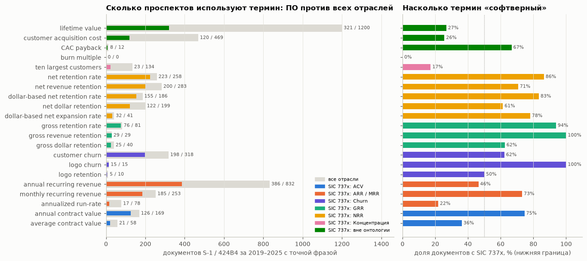
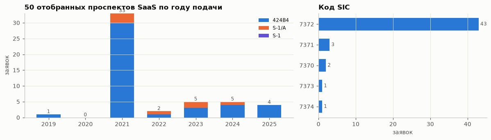

# EDA 01. Как SaaS-метрики называют в реальных проспектах SEC

Ноутбук: [`notebooks/01_eda_sec_claims.ipynb`](../../notebooks/01_eda_sec_claims.ipynb).
Графики: `reports/figures/01_*.png`. Данные: [`data/reference/sec_efts_term_counts.csv`](../../data/reference/sec_efts_term_counts.csv)
(21 термин), [`data/reference/sec_filings_selected.csv`](../../data/reference/sec_filings_selected.csv) (50 проспектов).

## Зачем и что доступно

Система извлекает утверждения из текстов компаний, а синтетические тексты пишет наш генератор. Нужна внешняя
точка отсчёта: какими словами компании называют ARR, NRR, churn и концентрацию и насколько эти слова специфичны
для софтверных компаний.

- **Источник.** Полнотекстовый поиск EDGAR (<https://efts.sec.gov/LATEST/search-index>), формы S-1 и 424B4, подача
  2019-01-01…2025-12-31. Тексты EDGAR — public domain. Запросы идут с общим User-Agent
  `dd-verifier-student-project research`, не чаще 4 в секунду.
- **Что даёт поиск:** число документов с точной фразой и агрегат по отраслевым кодам SIC (30 самых частых кодов,
  остальное — одной суммой). Текста документов поиск не отдаёт.
- **Чего пока нет.** Архив `www.sec.gov` без контакта в User-Agent отвечает 403, поэтому корпус предложений
  `data/reference/sec_kpi_claims.csv` (квалификаторы, периоды, определения рядом с числом, точность экстрактора)
  не собран. Как его получить — в последнем разделе. Выводы ниже — только о названиях метрик и об источниках
  корпуса.
- **Единица счёта** — документ (файл заявки), а не компания: одна компания подаёт S-1, несколько S-1/A и 424B4.
  Синонимы пересекаются: документ с «dollar-based net retention rate» содержит и «net retention rate».

## 1. Частоты терминов: все отрасли и проспекты ПО



SIC 737x — программное обеспечение и компьютерные услуги (7370–7379). Число для 737x — нижняя граница: коды вне
30 самых частых в агрегат не попадают.

| Группа | Документов, все отрасли | Документов SIC 737x | Доля 737x | Самое частое название в 737x (доля упоминаний группы) |
| --- | --- | --- | --- | --- |
| NRR (5 названий) | 967 | 732 | 76% | net retention rate, 30% |
| ARR / MRR (3) | 1 163 | 588 | 51% | annual recurring revenue, 66% |
| Churn (3) | 343 | 218 | 64% | customer churn, 91% |
| ACV (2) | 227 | 147 | 65% | annual contract value, 86% |
| GRR (3) | 150 | 130 | 87% | gross retention rate, 58% |
| Концентрация (1) | 134 | 23 | 17% | ten largest customers |
| Вне онтологии (4) | 1 681 | 449 | 27% | lifetime value, 71% |

Выводы:

- **У NRR нет доминирующего названия.** В проспектах ПО пять названий встречаются в 32–223 документах каждое;
  самое частое («net retention rate») — 30% упоминаний группы, следующие — 27%, 21% и 17%. Словарь бейзлайна B0
  и шаг сопоставления с онтологией (подзадача 5 в 2.1) должны знать все пять. В синтетике NRR названа двумя
  способами («net revenue retention» и «NRR»), поэтому сопоставление на ней проще, чем в жизни (риск R2).
- **У GRR три названия, у churn одно доминирует.** «Customer churn» — 198 документов ПО, «logo churn» — 15, то есть
  в 13 раз реже. Синтетика пишет «logo churn», а проспекты — «customer churn»: синонимы для генератора и B0.
- **ARR — главный «софтверный» термин, но не только софтверный.** «Annual recurring revenue» — в 832 документах,
  из них 386 (46%) — ПО; остальное — медицина и фарма (SIC 2834/2836), SPAC и другие отрасли с подписочной моделью.
  «Annualized run-rate» в ПО встречается редко: 17 документов из 78.
- **Термины вне онтологии в общеотраслевых счётах не показательны для SaaS.** «Lifetime value» — 1 200 документов во
  всех отраслях, но в ПО только 321 (27%); «customer acquisition cost» — 469 и 120 (26%). Вывод «в SaaS-деках будет
  много утверждений вне онтологии» на общеотраслевых числах не держится. Можно сказать только, что эти термины в
  проспектах ПО есть: 449 документов на 4 термина. Сколько из них — утверждения с числом, покажет корпус.
- «Ten largest customers» — общий термин раскрытия рисков: в ПО лишь 17% документов. Концентрацию в проспектах ПО
  описывают другими словами (проверить на корпусе).
- «Burn multiple» в проспектах не встречается ни разу: в публичных документах его не раскрывают, хотя в деках
  встречается. Утверждение о нём система будет помечать `NOT_ENOUGH_DATA` (нет данных о денежном потоке).

## 2. Проспекты, отобранные для корпуса предложений



`scripts/fetch_sec_claims.py` ищет 6 фраз (ARR и пять названий NRR/GRR), оставляет основные документы заявки
(S-1, S-1/A, 424B4) компаний с первым кодом SIC 737x и берёт одну заявку на компанию: 424B4 предпочтительнее S-1/A,
S-1/A — S-1. Компании ранжируются по числу разных запросов, на которые они нашлись.

| Признак | Значение |
| --- | --- |
| Заявок / компаний | 50 / 50 |
| Форма | 424B4 — 43, S-1/A — 7 |
| SIC | 7372 (готовое ПО) — 43, 7371 — 3, 7370 — 2, 7373 — 1, 7374 — 1 |
| Год подачи | 2019 — 1, 2021 — 33, 2022 — 2, 2023 — 5, 2024 — 5, 2025 — 4 |
| Нашлись по запросам | 2 из 6 — 43 компании, 3 из 6 — 7 |

Выводы:

- **Две трети корпуса — IPO 2021 года** (33 из 50). Корпус будет смещён к одному году и одному стилю раскрытия;
  при сборе стоит ограничить долю одного года (например, не больше 15 заявок на год).
- Почти все заявки — окончательные проспекты 424B4: тексты после ответов на комментарии SEC, то есть с более
  аккуратными определениями, чем первые S-1. Для поиска «спорных» определений полезнее S-1 и переписка SEC
  (`docs/real_world_cases.md`).
- Компании найдены максимум по 3 из 6 запросов: ни одна не использует сразу ARR и все варианты NRR/GRR. Это
  ещё одно подтверждение, что название метрики выбирает компания, а система должна сопоставлять синонимы.

## 3. Что дальше: корпус предложений

Корпус собирается одной командой; контакт задаётся только переменной окружения и в репозиторий не попадает:

```bash
SEC_USER_AGENT="<имя> <e-mail>" uv run python scripts/fetch_sec_claims.py
```

После этого в ноутбук 01 добавляется раздел по предложениям (`data/reference/sec_kpi_claims.csv`, < 500 КБ):
доли утверждений по метрикам, квалификаторы («more than», «approximately»), типы периодов («as of December 31»,
«for the year ended»), числовые форматы, доля предложений-определений и точность экстрактора на ручной выборке из
60 извлечённых и 30 отклонённых предложений. Раздел 8 EDA 03 уже умеет сравнивать синтетику с этим файлом.
До этого гипотезами остаются: доля квалификаторов в реальных текстах, формат сумм «$X million» и частота
определений рядом с числом (EDA 03, раздел 8).

## Ограничения

- Счёт по документам, а не по компаниям и не по утверждениям: компания с тремя S-1/A даёт до 4 документов.
- SIC 737x — нижняя граница (агрегат отдаёт 30 кодов); код SIC — у заявителя, а не у продукта.
- Точная фраза не различает утверждение с числом, определение и упоминание в рисках.
