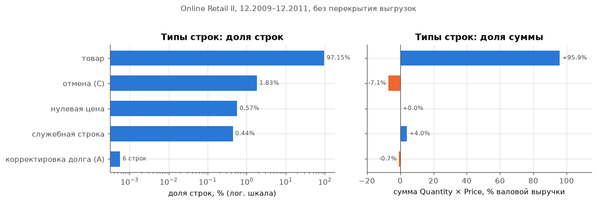
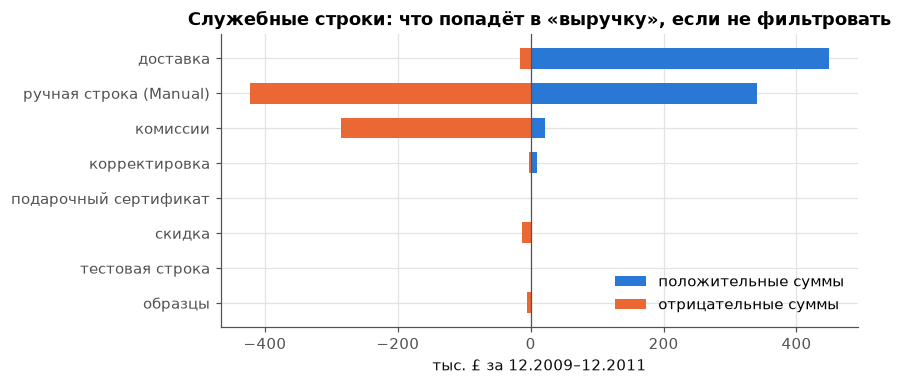
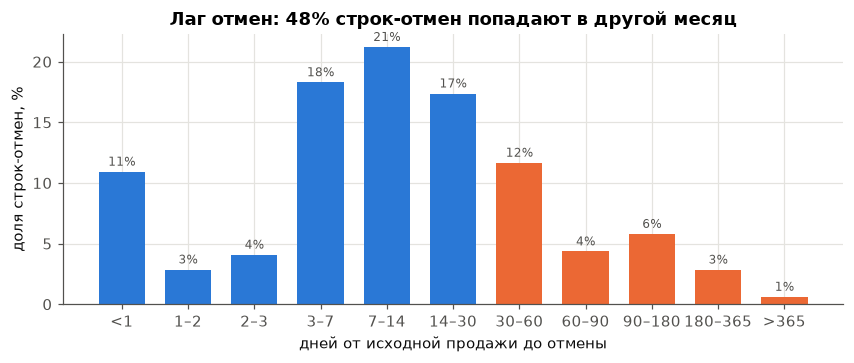
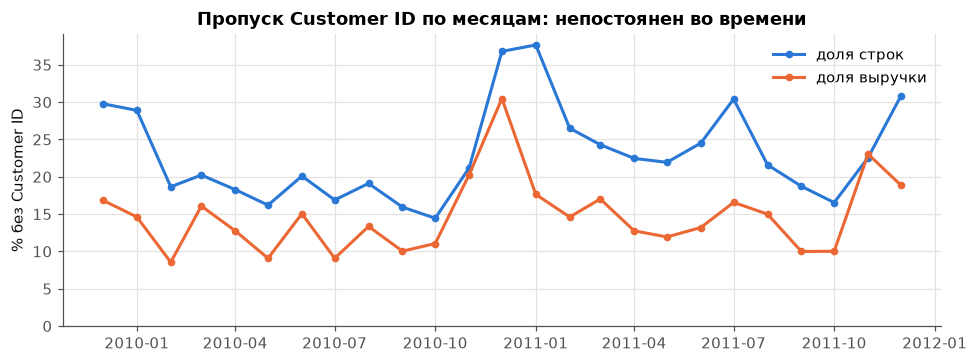
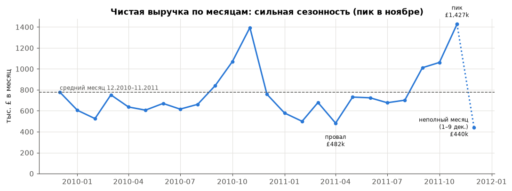
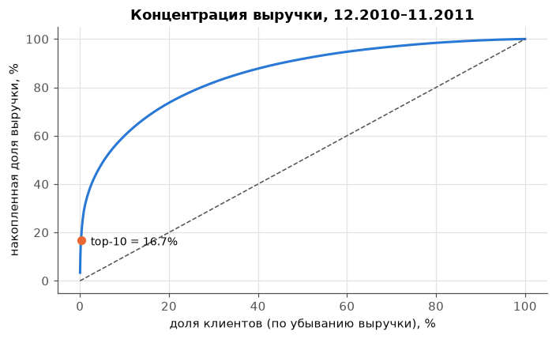
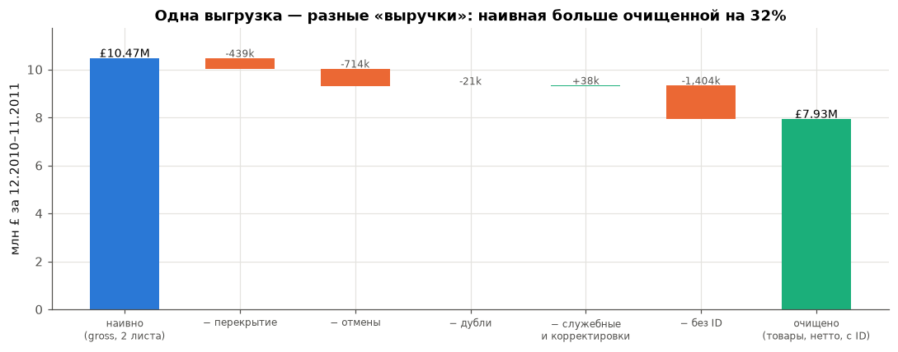
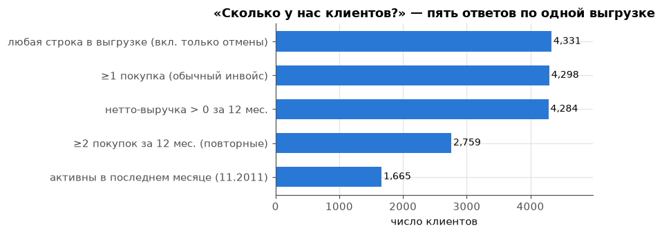

# EDA 02. Реальная выгрузка инвойсов как прокси биллинга data room

Ноутбук: [`notebooks/02_eda_billing_proxy.ipynb`](../../notebooks/02_eda_billing_proxy.ipynb).
Графики: `reports/figures/02_*.png`.

## Зачем этот разбор

Данные MVP синтетические (P2). Главный риск такой схемы — R2: синтетика чище реального data room, и качество
на пилоте оказывается ниже офлайн-оценки. Реальные data room закрыты NDA, поэтому берём открытую реальную
выгрузку построчных инвойсов и смотрим на неё глазами FR1 («загрузка в DuckDB с проверкой схемы и качества»).

Что хотим получить:

1. Какие проблемы качества встречаются в настоящей выгрузке инвойсов и с какой частотой.
2. Насколько очистка и выбор определения меняют KPI. Это прямая иллюстрация того, на чём строится проверка
   утверждений: одна и та же выгрузка даёт разные «выручку» и «число клиентов».
3. Частоты для калибровки блока `noise:` в `configs/synth.yaml` с пересчётом на B2B SaaS (раздел 9).

## Датасет

| | |
| --- | --- |
| Название | Online Retail II (UCI Machine Learning Repository, id 502) |
| Ссылка | <https://archive.ics.uci.edu/dataset/502/online+retail+ii> |
| Автор | Daqing Chen, 2019 |
| Лицензия | CC BY 4.0 |
| Что это | все транзакции британского онлайн-магазина подарков (часть клиентов — оптовики), 01.12.2009–09.12.2011 |
| Формат | один XLSX, два листа: «Year 2009-2010» и «Year 2010-2011» |
| Поля | `Invoice`, `StockCode`, `Description`, `Quantity`, `InvoiceDate`, `Price` (GBP), `Customer ID`, `Country` |
| Воспроизведение | `uv run python scripts/fetch_online_retail.py` → `data/external/online_retail_ii/*.parquet` (в git не попадает) |
| sha256 архива | `572e36277c2390fbfde10664750731e0a86f55e33470d91919085f0408e67bfb` |

Соответствие схеме P1: `Invoice` → `invoice_id`, `Customer ID` → `customer_id`, `InvoiceDate` → `issue_date`,
`Quantity × Price` → `amount`. Префикс `C` у номера инвойса — отмена (аналог `credit_note`). Полей
`payment_type`, `status`, `service_period_*` и `currency` нет: тип строки приходится восстанавливать по
косвенным признакам. Это тоже находка: в реальной выгрузке схема P1 может быть неполной.

## 1. Объём

| Показатель | Значение |
| --- | --- |
| Строк в двух листах | 1 067 371 |
| Строк без перекрытия листов | 1 044 848 |
| Инвойсов | 53 628 (из них 8 292 отмены `C`, 6 корректировок `A`) |
| Клиентов (`Customer ID`) | 5 942 |
| Товарных кодов | 5 305 |
| Стран | 43 |
| Период | 25 месяцев, 01.12.2009–09.12.2011 |

**Листы перекрываются.** Первый лист заканчивается 09.12.2010, второй начинается 01.12.2010. Строки за
1–9 декабря 2010 есть в обоих листах и совпадают построчно: 22 523 строки, 1 088 инвойсов (2,2% строк),
валовая сумма положительных строк £439 тыс. (нетто с отменами £377 тыс.). Если склеить два файла «как пришли», декабрь 2010 посчитается дважды. В data room
это частый сценарий: выгрузки за годы или кварталы делают в разное время, и границы накладываются.

## 2. Типы строк

| Тип строки | Доля строк | Доля валовой суммы |
| --- | --- | --- |
| Товар | 97,15% | +95,9% |
| Отмена (`C`) | 1,83% | −7,1% |
| Нулевая цена (складские пометки) | 0,57% | 0% |
| Служебная строка (доставка, Manual, комиссии…), без отмен | 0,44% | +4,0% |
| Корректировка долга (`A`) | 6 строк | −0,7% |

База столбца «доля валовой суммы» — сумма положительных строк всей выгрузки. Служебные строки внутри отмен
(1 191 строка) учтены в строке «Отмена».

Вывод: по строкам выгрузка почти чистая (97% — товар). По деньгам — нет: отмены, служебные строки и
корректировки вместе дают 12% валовой выручки по модулю (−7,1%, +4,0%, −0,7%). Проверка качества должна считать доли
и по строкам, и по сумме.

## 3. Служебные (нетоварные) строки

Служебные коды: `POST`/`DOT`/`C2` (доставка), `M` (Manual — ручная строка с произвольной суммой),
`D` (скидка), `BANK CHARGES`/`AMAZONFEE`/`CRUK` (комиссии), `B` (Adjust bad debt), `ADJUST`,
`S` (образцы), `TEST001/002` (тестовые товары), `gift_0001_*` (подарочные сертификаты, то есть предоплата).

- 5 806 строк (0,56%) вместе с отменёнными; без отмен — 4 615 строк (0,44%, как в таблице раздела 2). Они есть в
  **9,8% обычных инвойсов**.
- Положительные суммы служебных строк = **+4,2% к товарной выручке** (+4,0% к валовой сумме всех строк, как в
  разделе 2): доставка +2,3%, Manual +1,7%.
- Manual двусторонний: +£340 тыс. и −£423 тыс. Это ручные правки, которые нельзя интерпретировать без комментария.
- Комиссии маркетплейса (`AMAZONFEE`) лежат в той же выгрузке как отрицательные строки, −£286 тыс.
- Тестовые товары (`This is a test product.`) попали в боевую выгрузку: 17 строк.

Связь с DD Verifier: это механизм D01. Разовые и служебные суммы лежат в той же таблице, что и регулярная
выручка. Если не фильтровать по типу, они попадут в «выручку» и в ARR. В SaaS роль доставки и комиссий
играют внедрение, обучение и возмещаемые расходы. Для них в схеме P1 есть `payment_type`, но в реальной
выгрузке его может не быть, и тогда тип придётся восстанавливать по справочнику кодов или описаниям.

## 4. Отмены как кредит-ноты

- Отмены: **15,5% инвойсов**, 1,8% строк, **7,1% валовой выручки**. У 43% клиентов есть хотя бы одна отмена.
- Отмена **не ссылается** на исходный инвойс. Эвристика «ближайшая предыдущая покупка того же клиента и товара»
  находит пару для 91% строк-отмен.
- Отмены в основном **частичные**: количество совпадает с исходной покупкой только в 34% случаев.
- Лаг от продажи до отмены: медиана 10 дней, p75 — 30 дней, p90 — 83 дня. 25% отмен приходят позже 30 дней.
- **48% строк-отмен (26% их суммы) попадают в другой календарный месяц**, чем исходная продажа.

Вывод для метрик: помесячная нетто-выручка зависит от правила, к какому месяцу относить кредит-ноту — к месяцу
выписки или к периоду исходного инвойса. Для MRR это особенно важно: кредит-нота, выписанная через месяц,
занижает MRR месяца выписки и не трогает MRR месяца услуги. Библиотека метрик должна фиксировать правило
(в онтологии `mrr` — «net of credit notes, recognised over service period»), а генератор — создавать
кредит-ноты с лагом и пересечением границы месяца.

Отрицательные суммы вне отмен:

- 3 393 строки (0,3%) с `Quantity < 0` без префикса `C`: все с ценой 0 и без клиента. Это складские пометки
  (`check`, `damaged`, `found`, `?`), не продажи.
- Нулевая цена: 6 024 строки (0,6%), 99% без `Customer ID`.
- Отрицательная цена: 5 строк `Adjust bad debt` на −£159 тыс. Пять строк дают 0,8% валовой выручки. Одна такая
  строка, пропущенная проверкой, сдвигает квартальную выручку на проценты.

## 5. Пропущенный Customer ID

| База | Доля без `Customer ID` |
| --- | --- |
| Строки | 22,5% |
| Инвойсы | 16,3% |
| Валовая выручка | 15,1% |
| Товарная выручка | 13,1% |
| Сумма отмен | 25,8% |

- Пропуск — на уровне **всего инвойса**: нет инвойсов, где ID есть только у части строк.
- 99% строк без ID — Великобритания. Инвойсы без ID короче: медиана 1 строка против 11 у инвойсов с ID.
- Доля непостоянна во времени: по выручке от 8,5% до 30% в месяц, пик — декабрь 2010 – январь 2011.
  Поэтому пропуск искажает не только уровень, но и динамику клиентских метрик.

Вывод: выручку без клиента нельзя распределить по клиентам. Сумма выручки по справочнику клиентов не сойдётся
с общей выручкой, а churn, NRR и концентрация считаются на неполной базе. Если склеить все строки без ID в
одного «клиента», он станет **крупнейшим клиентом** (£1,40 млн за 12 месяцев, больше любого реального).
Проверка качества должна показывать долю выручки без клиента и понижать уверенность в клиентских метриках.

## 6. Дубли

| Вид | Частота |
| --- | --- |
| Перекрытие двух выгрузок | 22 523 строки (2,2%), 1 088 инвойсов (2,0%) |
| Точные дубли строк (все 8 полей совпадают) | 11 812 строк (1,13%) в 4 387 инвойсах (8,2%); £54 тыс. (0,26% валовой) |
| Почти-дубли инвойсов (тот же клиент и состав, другой номер, ≤ 24 ч) | 110 инвойсов (0,30%), £55 тыс. (0,27% валовой); 70 из них — в пределах часа |
| Товарный код с несколькими описаниями | 1 232 из 4 950 кодов (24,9%) |
| Клиент с несколькими странами | 13 из 5 942 (0,2%) |

Точные дубли внутри инвойса неоднозначны: это может быть и ошибка выгрузки, и две одинаковые позиции.
Без ключа строки (`line_id`) различить их нельзя, поэтому проверка качества должна помечать их, а не молча
удалять. Почти-дубли инвойсов (повторно выписанный счёт) по деньгам весят столько же, сколько точные дубли.
Варианты написания описаний у четверти кодов — аналог вариантов имён клиентов («Acme Inc.» и «ACME LLC»),
которые нужны для D10.

## 7. Даты

- Номера инвойсов идут строго по датам: ни одного инвойса «задним числом» из 45 330. Выгрузка из одной
  автоматической системы. Поздние инвойсы здесь не измерить.
- 83 инвойса (0,15%) имеют несколько временных меток (строки внесены с разницей в минуту).
- Субботних продаж нет, кроме одного дня (05.12.2009, 32 инвойса). Перерыв 12 дней на Новый год.
- **Последний месяц неполный**: декабрь 2011 — только 1–9 число. Наивное сравнение декабря с ноябрём даёт
  −69%, хотя падения нет. Это сценарий для D09 и D11: компания или аналитик сравнивает неполный период с полным.

## 8. Страны и валюта

- 43 страны, но **одна валюта** (GBP) и нет поля валюты. Великобритания — 85,6% товарной выручки, топ-5 стран — 95%.
- 817 строк со страной `Unspecified` или `European Community`.
- Вывод для SaaS: страна клиента не определяет валюту инвойса. Мультивалютность в выгрузке нужно проверять
  по полю `currency`, а если его нет — это `NOT_ENOUGH_DATA` для сумм, а не повод считать всё в USD.

## 9. Концентрация и сезонность

Окно — 12 полных месяцев 12.2010–11.2011, «чистая» выручка (товары, нетто с отменами, без перекрытия и дублей).

- Годовая выручка £9,33 млн, средний месяц £778 тыс. Коэффициент вариации по месяцам — 0,35.
- Пик — ноябрь 2011: £1,43 млн = **1,84× среднего месяца**. Провал — апрель 2011: 0,62× среднего.
- **D02** (пиковый месяц × 12): £17,1 млн = **1,84× фактической годовой выручки**.
- **D04** (удобная база): ноябрь 2011 к ноябрю 2010 — **×1,02**, к провальному апрелю 2011 — **×2,96**.
  Один и тот же ноябрь даёт «рост в 3 раза» или «без роста» в зависимости от базы.

- 4 284 клиента с положительной выручкой за 12 месяцев.
- Топ-10 клиентов — **16,7%** выручки идентифицированных клиентов, топ-1 — 3,4%. Топ-20% клиентов — 73,6%.
- Знаменатель тоже определение: если делить на всю выручку, включая строки без ID, топ-10 = 14,2% (−2,5 п.п.).
  Для `top10_concentration` это разница на уровне порога допуска (2 / 5 п.п.).

## 10. Наивный и очищенный KPI

Окно 12.2010–11.2011, шаги применяются последовательно.

| Шаг | Выручка | К наивной |
| --- | --- | --- |
| Наивно: два листа склеены, сумма всех строк > 0 (gross) | £10 466 745 | — |
| − перекрытие выгрузок (1–9.12.2010) | £10 027 892 | −4,2% |
| − отмены (нетто) | £9 314 080 | −11,0% |
| − точные дубли строк | £9 293 306 | −11,2% |
| − служебные строки и корректировки | £9 330 919 | −10,9% |
| − строки без `Customer ID` | £7 927 325 | −24,3% |

Наивная выручка больше очищенной товарной нетто-выручки в **1,12 раза** и больше выручки идентифицированных
клиентов в **1,32 раза**. Шаг «служебные строки» здесь даёт +£38 тыс.: отрицательные Manual, комиссии и
bad debt перевешивают положительную доставку. Знак эффекта очистки заранее не известен.

| Определение «клиента» за 12.2010–11.2011 | Клиентов | К наивному |
| --- | --- | --- |
| Любая строка в выгрузке (включая только отмены) | 4 331 | 100% |
| ≥ 1 покупка | 4 298 | 99,2% |
| Нетто-выручка > 0 | 4 284 | 98,9% |
| ≥ 2 покупок (повторные) | 2 759 | 63,7% |
| Активны в последнем месяце (11.2011) | 1 665 | 38,4% |

У 33 клиентов в окне только отмены: они «клиенты» по наивному счёту и не клиенты по любому разумному.
Разрыв между «были за год» и «активны на конец периода» — 2,6 раза. Это тот же механизм, что D03
(в число клиентов попадают неактивные) и D09 (значение на другую дату).

Главный вывод EDA: **на реальной выгрузке выбор определения и очистки меняет выручку на 12–32% и число
клиентов в 2,6 раза**. Это больше допусков P5 (5% для уровней). Значит, верификатор обязан считать метрику
по стандартному определению и по определению компании и показывать, какие шаги очистки применены. Без этого
расхождение «данные vs утверждение» нельзя отличить от расхождения «чистка аналитика vs чистка компании».

## 11. Что НЕ переносится из B2C-ритейла в B2B SaaS

| Свойство ритейла | Почему в SaaS иначе | Что делаем |
| --- | --- | --- |
| 16% инвойсов без клиента (гостевые покупки) | В SaaS счёт выставляется по договору, клиент известен почти всегда | Масштабируем вниз (раздел 12) |
| Отмены 15% инвойсов, 7% выручки (возвраты товаров) | Кредит-ноты в SaaS — даунгрейды, ошибки биллинга, сервисные кредиты; реже | Масштабируем вниз, берём форму лага и частичность |
| Сезонность 1,84× (подарки к Рождеству) | MRR сглажен подпиской; сезонны новые продажи, а не выручка | Пиковый эффект D02 в генераторе ~1,1–1,3×, не 1,84× |
| Нет периода услуги, нет признания выручки | В SaaS ключевое — `service_period_start/end`, годовая предоплата | Не измеряется здесь; параметры предоплаты берём из архетипов генератора |
| Нет `payment_type`, `status`, `currency` | В P1 эти поля обязательны | Проверка схемы: отсутствие поля → пониженная уверенность / `NOT_ENOUGH_DATA` |
| Тысячи клиентов, ~20 строк на инвойс | 40–500 клиентов, 1–3 строки на инвойс | Частоты по строкам пересчитываем в частоты по инвойсам |
| Нет договора и даты оттока: «активный» = купил | В SaaS churn по `churn_date`, активность по go-live и MRR > 0 | Определения клиентов из раздела 10 — иллюстрация, не калибровка |
| Нет реселлеров и gross/net (D05) | В SaaS канал продаж — отдельное поле | Не измеряется |
| Одна валюта на 43 страны | Мультивалютные SaaS выставляют счета в USD/EUR/GBP | Доля не-USD инвойсов задаётся архетипом |
| Концентрация топ-10 = 16,7% | B2B SaaS: SMB 5–15%, enterprise 30–60% | Ритейл — нижняя граница, концентрация задаётся архетипом |
| Номера инвойсов строго по датам | Ручные счета и миграции биллинга дают поздние инвойсы | Поздние инвойсы задаём экспертно |

Что переносится: структура проблем (перекрытие выгрузок, отмены без ссылки, лаг через границу месяца,
частичные отмены, служебные и ручные строки в той же таблице, пропуск ID на уровне инвойса, тестовые записи,
неполный последний месяц) и порядок величин «денежного» эффекта каждой проблемы.

## 12. Калибровка шума генератора: измеренная частота → параметр

Принцип пересчёта: (а) частоту по строкам переводим в частоту по инвойсам, так как в SaaS 1–3 строки на
инвойс; (б) явления, которые порождает B2C-специфика (гостевые покупки, возвраты товаров), масштабируем
вниз в 5–10 раз; (в) форму распределений (лаг, частичность, концентрацию по времени) берём из данных как есть;
(г) диапазон задаём так, чтобы 1–2 dev-компании и часть holdout получили «грязный» верх диапазона —
это стресс-тест проверок качества (R2). Имена параметров — предложение; итоговые ключи и значения — в `configs/synth.yaml`
(блок `noise:`) и в EDA 03, раздел 4.4.

| Шум | Измерено в Online Retail II | Пересчёт на B2B SaaS | Предлагаемый параметр: по умолчанию (диапазон) |
| --- | --- | --- | --- |
| Точные дубли строк инвойса | 1,13% строк; 8,2% инвойсов задеты; 0,26% суммы | Автоматический биллинг дублирует реже; дубль в SaaS — целый инвойс | `duplicate_invoice_rate`: 0,5% инвойсов (0,2–1,5%) |
| Почти-дубль (повторно выписанный счёт, другой номер) | 0,30% инвойсов, 0,27% суммы | Переносится почти как есть | `reissued_invoice_rate`: 0,3% (0–0,5%); новый `invoice_id`, тот же клиент, сумма и период, дата +0–1 день |
| Перекрытие выгрузок | 2,2% строк (9 дней из 25 мес.) | Сценарий уровня файла, а не строки | `overlapping_export`: у 1–2 компаний повторить 1–2 недели на стыке двух файлов |
| Пропуск `customer_id` | 16,3% инвойсов, 15,1% выручки; весь инвойс; доля меняется по месяцам 9–30% | Гостевых покупок нет; остаются ручные счета и миграция | `missing_customer_id_rate`: 1% инвойсов (0,5–3%); весь инвойс; чаще у `one_time`/`implementation` и в первых 6 месяцах истории; 5% у одной стресс-компании |
| Кредит-ноты: частота | 15,5% инвойсов, 7,1% валовой выручки | Возвратов товара нет; даунгрейды и ошибки биллинга | `credit_note_rate`: 3% инвойсов (1–5%); целевая сумма ≈ 1,5–3% выручки |
| Кредит-ноты: размер | Полная отмена только в 34% случаев | Переносится | `credit_note_fraction`: 1/3 полных (100%), 2/3 частичных (U[10%; 90%]) |
| Кредит-ноты: лаг | Медиана 10 дн., p75 30, p90 83; 48% в другом месяце; 25% позже 30 дней | Переносится как форма | `credit_note_lag_days`: лог-нормальное, медиана 10, p90 ≈ 80; ожидаемо ~45% в другом месяце |
| Кредит-нота без ссылки на исходный инвойс | Ссылки нет в 100% случаев; эвристика находит пару для 91% | В SaaS ссылка обычно есть, но не всегда выгружается | `credit_note_unlinked_rate`: 30% (0–100%) — поле ссылки пустое |
| Аннулированные (void) и технические записи | 0,9% строк: цена 0 или qty<0 без продажи, 99% без клиента | Аналог — void-инвойсы, которые нельзя считать выручкой | `void_rate`: 1% инвойсов (0,5–2%), сумма сохраняется, `status=void` |
| Служебные и разовые строки | В 9,8% инвойсов; +4,2% к товарной выручке (доставка 2,3%, Manual 1,7%) | Механизм D01; база разовых платежей нужна и в чистых компаниях | Доля `one_time`+`implementation` в выручке: 3–10% по архетипу; `manual_adjustment_rate`: 0,5% инвойсов, сумма ±5–20% среднего чека |
| Списание долга | 5 строк, −0,8% валовой выручки | Редкое, но крупное | `bad_debt_writeoff`: 0–1 кредит-нота на компанию, 0,5–1% годовой выручки |
| Тестовые записи | 17 строк | Бывает при запуске биллинга | `test_invoice_rate`: 0,05% (0–0,1%), клиент `TEST`, малые суммы |
| Варианты имён | 24,9% кодов с >1 описанием | Аналог: имя клиента в документах ≠ справочнику | `name_variant_rate`: 20% упоминаний клиентов в документах (10–30%) |
| Несогласованная страна клиента | 0,2% клиентов | Переносится | `country_mismatch_rate`: 0,2% (0–1%) |
| Мультивалютность | 1 валюта, 15% выручки вне UK | Не переносится | Доля не-USD инвойсов задаётся архетипом: 0% / 10–30% / до 60% у multi-currency |
| Поздние инвойсы | 0 из 45 330 (единая система) | Не измерено; экспертная оценка | `late_issued_rate`: 1% (0,5–2%), выписка через 1–2 мес. после начала периода услуги |
| Неполный последний месяц | Декабрь 2011 — 9 дней из 31 | Переносится как сценарий | `partial_last_month`: у 1–2 компаний выгрузка обрывается на 5–20 день |
| Сезонность | CV 0,35, пик 1,84× среднего | Не переносится на MRR | Архетип `seasonal`: амплитуда новых продаж ±30%, пик MRR / средний ≈ 1,1–1,3 |

## 13. Что это даёт проверкам качества (`src/dd_verifier/data/quality.py`)

Проверки, которые следуют из найденного, по убыванию денежного эффекта:

1. Доля выручки без `customer_id` по месяцам. Порог для пометки «пониженная уверенность клиентских метрик» —
   например, > 2% выручки.
2. Перекрытие файлов: один `invoice_id` в двух загруженных файлах.
3. Кредит-ноты: доля, лаг, доля без ссылки, доля в другом месяце. Правило отнесения к месяцу фиксируется в метрике.
4. Отрицательные суммы вне `credit_note` и крупные разовые корректировки (bad debt): список строк для аналитика.
5. Служебные и ручные строки: доля по сумме, не только по строкам.
6. Точные дубли и почти-дубли инвойсов: помечаются, а не удаляются молча.
7. Неполный последний месяц: число дней с данными в крайних месяцах периода.
8. Отсутствующие поля схемы P1 (`payment_type`, `status`, `currency`, период услуги).

## Ограничения

- Ритейл, а не SaaS: переносим структуру проблем и порядок величин, а не сами частоты (раздел 11).
- Тип строки восстановлен по словарю служебных кодов. Словарь составлен вручную по описаниям; редкие коды
  (`DCGS*`, `PADS`, `SP1002`) отнесены к товарам.
- Сопоставление отмен с покупками — эвристика. Она не видит покупки до 01.12.2009 и не различает несколько
  одинаковых покупок одного товара.
