# EDA 03. Синтетический data room: состав, качество, разметка, реализм

Ноутбук: [`notebooks/03_eda_synthetic_dataroom.ipynb`](../../notebooks/03_eda_synthetic_dataroom.ipynb).
Графики: `reports/figures/03_*.png`. Данные: `uv run python -m dd_verifier.synth --config configs/synth.yaml --out data/synthetic`.

## Что читали и чего не читали

- **Читали:** dev-сплит `data/synthetic/dev/*` (5 компаний: brewbase, clinicore, pantrio, routelane, tallybird)
  и агрегаты `data/synthetic/holdout_summary.json`.
- **Не открывали:** каталоги holdout-компаний (`data/synthetic/holdout/*`) — ни таблицы, ни документы, ни
  манифесты. Всё, что ниже сказано про holdout, взято из `holdout_summary.json`.
- Числа реального прокси (UCI Online Retail II) перенесены из [отчёта 02](02_billing_proxy.md); сам датасет
  в этом разборе не читается.
- Данные — генератор v0.2: исправлен D09 (устаревшее значение теперь всегда в пользу компании), в эталон добавлены
  `delta_p5`, `true_value_observed` и `noise_sensitive` (разделы 4.3, 4.5, 6). Все 83 теста проходят.

## 1. Объём

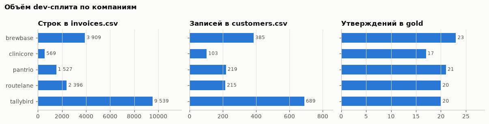

| Компания | Архетип | История | customers | invoices | fx_rates | Документов | Слов | Утверждений | Семейств |
| --- | --- | --- | --- | --- | --- | --- | --- | --- | --- |
| brewbase | SMB, высокий отток | 2023-11..2025-12 (26 мес.) | 385 | 3 909 | 78 | 3 | 649 | 23 | 18 |
| clinicore | концентрация на enterprise | 2022-09..2025-12 (40) | 103 | 569 | 120 | 4 | 645 | 17 | 13 |
| pantrio | быстрый рост | 2023-01..2025-12 (36) | 219 | 1 527 | 108 | 4 | 666 | 21 | 17 |
| routelane | реселлеры | 2023-07..2025-12 (30) | 215 | 2 396 | 90 | 4 | 663 | 20 | 14 |
| tallybird | мультивалютная, медленный рост | 2022-01..2025-12 (48) | 689 | 9 539 | 144 | 4 | 658 | 20 | 15 |
| **итого dev** | | | **1 611** | **17 940** | **540** | **19** | **3 281** | **101** | **77** |

Holdout (агрегаты): 10 компаний, 3 717 записей клиентов (72–988 на компанию), 42 366 строк инвойсов
(228–12 185), 1 050 строк курсов, 197 утверждений (16–29 на компанию, в среднем 19,7).

Выводы:

- Таблицы маленькие: самая большая компания — 9,5 тыс. строк инвойсов. Нагрузка из NFR (до 10⁶ строк) синтетикой
  не проверяется. Для MVP это не важно: расчёт идёт в DuckDB, но тест на объём нужен отдельно.
- **Документы короткие: 630–670 слов на компанию** на 3–4 документа. Реальный дек Series A с пресс-релизами и
  меморандумом длиннее на порядок. Задача извлечения утверждений на синтетике проще, чем в жизни (риск R2).
- 101 утверждение dev образует 77 семейств: 48 утверждений повторяются в деке и пресс-релизе. При оценке
  вердиктов семейство надо считать одним наблюдением, иначе ошибка на одном факте считается дважды.

## 2. Состав

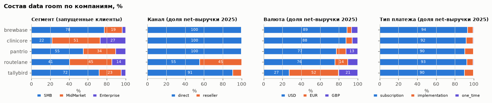

| Компания | SMB / Mid / Ent среди запущенных, % | Реселлеры, % net-выручки 2025 | Не-USD, % выручки | Внедрение + разовые, % выручки | Годовая предоплата, % инвойсов | Пилотов | Подписаны, не запущены |
| --- | --- | --- | --- | --- | --- | --- | --- |
| brewbase | 77,5 / 19,0 / 3,5 | 0 | 11 | 6,4 | 1,6 | 33 | 5 |
| clinicore | 21,8 / 51,3 / 26,9 | 0 | 12 | 8,0 | 19,7 | 23 | 2 |
| pantrio | 55,0 / 34,5 / 10,5 | 0 | 23 | 9,6 | 3,8 | 14 | 5 |
| routelane | 40,7 / 45,1 / 14,3 | 45 | 24 | 7,3 | 2,4 | 29 | 4 |
| tallybird | 71,9 / 23,3 / 4,8 | 9 | 73 | 9,8 | 1,5 | 95 | 6 |

Статусы инвойсов: paid 89–95%, open 1–3%, void 0,9–1,2%, credit_note 0,8–8,4%. Кредит-нот больше у brewbase и
routelane (посаженный D04 — SLA-кредит-ноты в начале окна роста) и у clinicore, routelane и tallybird (D09 —
скидки старым клиентам в последние 3 месяца).

Выводы:

- Архетипы различаются по тем осям, на которых строятся случаи каталога: доля реселлеров (D05 возможен только у
  routelane), мультивалютность (tallybird — 73% выручки не в USD), годовая предоплата (clinicore — 20% инвойсов),
  доля SMB (определение churn «без малых клиентов», D07).
- **Платежи за внедрение и разовые — 6–10% выручки 2025 у всех компаний**, не только у тех, где посажен D01.
  Поэтому вариант ARR `incl_one_time` завышает ARR в любой компании (раздел 3).

## 3. Траектории ARR: стандарт и определения компании

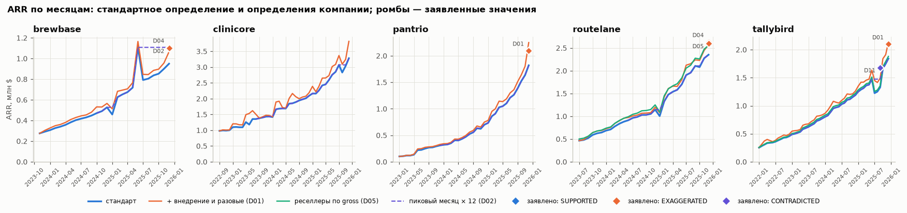

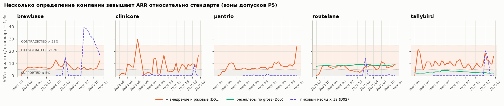

ARR на 2025-12, тыс. $, и разрыв варианта компании к стандарту:

| Компания | Стандарт | + внедрение и разовые (D01) | Реселлеры по gross (D05) | Пиковый месяц × 12 (D02) | Посажено |
| --- | --- | --- | --- | --- | --- |
| brewbase | 950 | 1 066 (+12,2%) | 950 (0) | 1 108 (+16,7%) | D02, D04 |
| clinicore | 3 281 | 3 817 (+16,3%) | 3 281 (0) | 3 281 (0) | D01, D09 |
| pantrio | 1 820 | 2 250 (+23,6%) | 1 820 (0) | 1 820 (0) | D01 |
| routelane | 2 352 | 2 570 (+9,3%) | 2 558 (+8,8%) | 2 352 (0) | D04, D05, D09 |
| tallybird | 1 842 | 2 134 (+15,9%) | 1 880 (+2,1%) | 1 842 (0) | D01, D09, D11 |

Выводы:

- Pantrio воспроизводит пример дизайн-документа: стандарт 0,70 → 1,82 млн $ (×2,6), с внедрением 0,75 → 2,25 млн $
  (×3,0). Заявленный «рост ×3» даёт ARR 2,10 млн $ (ромб на графике) — между стандартом и вариантом компании,
  δ = +15,4% → `EXAGGERATED`.
- **D01 виден по разрыву, но разрыв есть у всех.** Вариант `incl_one_time` выше стандарта на 9–24% у всех пяти
  компаний, включая brewbase и routelane, где D01 не посажен. Значит, сам факт «ARR с внедрением больше» не
  отличает компанию-нарушителя. Вердикт даёт P5 по стандартному определению; вопрос «каким определением получено
  заявленное число и раскрыто ли оно в меморандуме» — это объяснение (атрибуция определения), а не правило
  «вариант > стандарта → флаг».
- Разрыв `incl_one_time` скачет во времени (у clinicore до +30% в 2023-06): платежи за внедрение приходятся на
  месяцы онбординга. Утверждение на «удобную» дату может попасть и в `SUPPORTED`, и в `CONTRADICTED`.
- D05 (routelane): gross завышает ARR на 8,8% — зона `EXAGGERATED`. У tallybird реселлеров 9% выручки, и
  gross-вариант даёт лишь +2,1% — в пределах допуска. D05 детектируется только у реселлер-ориентированных компаний.
- D02 (brewbase): посаженный разовый пик MRR в середине 2025 года даёт `peak_month` на 40% выше стандарта летом и на
  16,7% в декабре. Рядом D04: провал ARR в 2025-01 (кредит-ноты) делает «рост от провала» удобной базой.
- D09 (clinicore, routelane, tallybird): скидки старым клиентам в 2025-10…12 снижают ARR на конце, поэтому кривая
  стандарта у этих компаний к концу 2025 года загибается вниз. Это то «ухудшение», которое делает прошлое
  значение NRR удобным (раздел 6).

### 3.1. Таблица когорт компании против инвойсов и слайды без текста

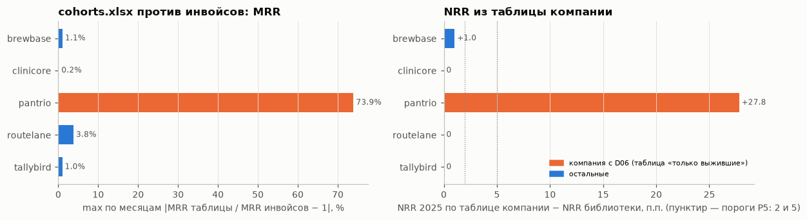

`cohorts.xlsx` готовит сама компания: помесячный подписочный MRR по когортам go-live. Сравнили суммарный MRR таблицы
с MRR из инвойсов (файлы «как пришли» минус точные дубли) и NRR 2025 года по таблице (когорты с go-live ≤ 2024-12:
MRR 2025-12 / MRR 2024-12) с NRR библиотеки.

| Компания | Определение в листе notes | max \|разрыв MRR\| по месяцам | Разрыв MRR 2024-12 | NRR по таблице | NRR библиотеки | Δ NRR | Слайдов / image-only | Утверждений на image-only |
| --- | --- | --- | --- | --- | --- | --- | --- | --- |
| brewbase | все клиенты | 1,1% | 0,0% | 83,7% | 82,7% | +1,0 п.п. | 13 / 2 | 0 |
| clinicore | все клиенты | 0,2% | 0,0% | 94,1% | 94,1% | 0,0 | 13 / 2 | 0 |
| pantrio (D06) | только выжившие | **73,9%** | **−24,4%** | **105,8%** | 78,0% | **+27,8 п.п.** | 13 / 2 | 0 |
| routelane | все клиенты | 3,8% | 0,0% | 89,9% | 89,9% | 0,0 | 13 / 2 | 0 |
| tallybird | все клиенты | 1,0% | 0,0% | 87,7% | 87,7% | 0,0 | 13 / 2 | 0 |

Выводы:

- **У четырёх компаний без D06 таблица когорт совпадает с инвойсами** до 0,2–3,8% по месяцам; NRR по ней отличается
  от библиотеки на 0–1 п.п. (меньше нижнего порога P5 в 2 п.п.). Разрыв MRR в отдельных месяцах — следствие шума
  (пустые `customer_id`, дубли): таблицу генератор строит по чистым данным.
- **У Pantrio (D06) таблица «только выжившие» даёт NRR 105,8% против 78,0%: +27,8 п.п.** Ушедших клиентов в ней
  нет, поэтому MRR ранних месяцев занижен на 24–74%. Бейзлайн B1, который читает `cohorts.xlsx` как есть, на D06 будет
  обманут: NRR компании «подтвердится» её же таблицей. Признак для системы — лист notes («Cohorts include only
  customers retained…») и расхождение суммы таблицы с MRR из инвойсов в ранних месяцах.
- В dev таблица с «удобным» определением одна (D06 посажен только у Pantrio), поэтому на ней видно механизм, но не
  измерить частоту ошибки B1.
- **Слайды без текстового слоя есть во всех деках: по 2 из 13, и на них 0 утверждений.** Генератор кладёт числа
  только в текст, поэтому покрытие FR2 (числа на графиках) на синтетике не измеряется. Это отдельный пункт
  улучшений (раздел 9).
## 4. Качество данных

### 4.1. Проверки `dd_verifier.data.quality` на dev

25 проверок; ошибок уровня `error` (схема, разбор типов, неизвестные валюты, нет курса, дубли id) — **0**.

| Проверка | Уровень | Найдено | Доля | Компаний |
| --- | --- | --- | --- | --- |
| multi_month_service (годовая предоплата, онбординг) | info | 1 564 | 8,72% строк | 5 |
| credit_note_share (шум + D04/D09/D11) | info | 648 | 3,61% | 5 |
| issued_outside_service_month (поздние + предоплата) | info | 433 | 2,41% | 5 |
| void_share | info | 188 | 1,05% | 5 |
| duplicate_invoice_rows | warning | 99 | 0,55% | 4 |
| missing_customer_id | warning | 31 | 0,17% | 5 |
| customer_name_variants | warning | 20 | 1,24% записей клиентов | 4 |
| live_without_invoices (записи-дубли клиентов) | warning | 10 | 0,72% | 4 |

По деньгам (доля валовой суммы инвойсов): кредит-ноты 0,5–2,2%, void 0,8–1,1%, суммы без `customer_id` 0–0,15%.

### 4.2. Сравнение с реальной выгрузкой

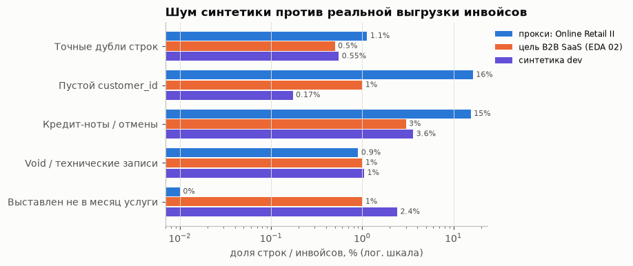

| Проблема | Online Retail II (EDA 02) | Цель для B2B SaaS (EDA 02, раздел 12) | Синтетика dev |
| --- | --- | --- | --- |
| Точные дубли строк | 1,13% строк | 0,5% | 0,55% |
| Пустой customer_id | 16,3% инвойсов | 1% | **0,17%** |
| Кредит-ноты / отмены | 15,5% инвойсов, 7,1% выручки | 3% инвойсов, 1,5–3% выручки | 3,61% строк, 0,5–2,2% суммы |
| Void / технические записи | 0,9% строк | 1% | 1,05% |
| Выставлен не в месяц услуги | 0 (единая система) | 1% (экспертно) | 2,41% (вкл. предоплату) |

Выводы:

- Дубли и void откалиброваны точно по цели. Кредит-нот по строкам даже больше цели (3,6% против 3%), но это за
  счёт посаженных D04/D09 (по нескольку кредит-нот на клиента в 1–3 месяцах); шумовые кредит-ноты — только полные
  к ошибочным инвойсам, частичных (2/3 случаев в реальных данных) генератор не делает.
- **Пустых `customer_id` в 6 раз меньше цели** (0,17% против 1%). Это осознанное отступление, см. 4.3.
- Чего в синтетике нет совсем (из найденного в EDA 02): перекрытия выгрузок, частичных кредит-нот с лагом через
  границу месяца, кредит-нот без ссылки, служебных и ручных строк, тестовых записей, неполного последнего месяца,
  почти-дублей с новым номером. Проверки качества на эти случаи пока не протестированы — список улучшений в разделе 9.

### 4.3. Почему пустых `customer_id` 0,2%, а не 1%: чувствительность эталона

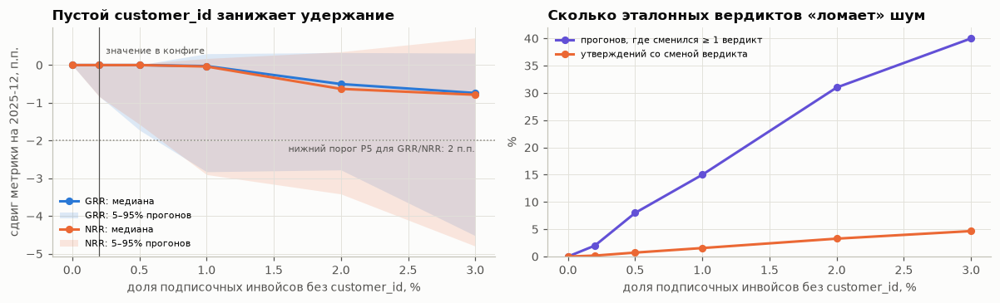

В генераторе v0.1 при 1% у 4 утверждений dev вердикт по «грязным» файлам разошёлся с эталоном. Эксперимент:
чистые таблицы 5 dev-компаний × 6 частот × 20 случайных наложений шума (600 прогонов, генератор v0.2).

| Пустых customer_id | Медиана ΔGRR, п.п. | 5-й перцентиль ΔGRR | 5-й перцентиль ΔNRR | Медиана Δ активных клиентов | Прогонов со сменой ≥ 1 вердикта | Утверждений со сменой вердикта |
| --- | --- | --- | --- | --- | --- | --- |
| 0 | 0 | 0 | 0 | 0 | 0% | 0% |
| 0,2% (в конфиге) | 0 | −0,82 | −0,83 | 0 | 2% | 0,17% |
| 0,5% | 0 | −1,72 | −1,57 | −0,26% | 8% | 0,72% |
| 1% (предложение EDA 02) | −0,03 | −2,83 | −2,90 | −0,75% | 15% | 1,56% |
| 3% | −0,74 | −4,52 | −4,80 | −2,11% | 40% | 4,67% |

Выводы:

- **Механизм.** Инвойс без клиента выпадает из клиентских метрик: клиент выглядит «ушедшим» в этом месяце, его MRR
  не попадает в числитель GRR/NRR. Уже 1% пустых id сдвигает удержание до −2,9 п.п. — больше нижнего порога P5 для
  NRR/GRR (2 п.п.).
- Остальной шум (дубли, void, ошибочные инвойсы с кредит-нотами, поздние инвойсы) нейтрален: при 0% пустых id
  вердикты не меняются ни в одном из 100 прогонов.
- Ломаются утверждения у порогов: D09 у routelane (NRR, δ = +4,1 п.п. при верхнем пороге 5 п.п.) — в 38 из 120
  прогонов, обычные NRR/GRR-утверждения brewbase и routelane и D09 у tallybird — в 18–19 прогонах.
- **Ошибка процедуры, исправлена в v0.2.** В v0.1 значение 0,2% выбрали как максимум, при котором инвариант
  «шум не меняет эталонный вердикт» выполнялся на всех 15 компаниях, т. е. с учётом исходов holdout, и тест
  проверял этот инвариант на holdout. Это подгонка под holdout: новый holdout (≈26 компаний, новые seed) прошёл бы
  такой тест с вероятностью около 0,2 и толкал бы к перебору seed. Теперь инвариант не гейт: генератор пишет у
  каждого утверждения `noise_sensitive` (вердикт по файлам «как пришли» ≠ эталону) и `true_value_observed`, тест
  только отчитывает их число (сейчас 0 в dev и 0 в holdout). Блок `noise:` заморожен по dev и EDA 02 и при
  перегенерации holdout не меняется.
- Для системы: **проверка качества «доля выручки без customer_id» должна понижать уверенность вердиктов по
  NRR/GRR/churn/числу клиентов**, а стресс-сценарий с 1–5% пустых id нужен как отдельная компания с эталоном,
  посчитанным по «грязным» данным.

### 4.4. Итоговая калибровка блока `noise:`

| Параметр | Было (генератор v0.1) | Стало | Предложение EDA 02 | Почему так |
| --- | --- | --- | --- | --- |
| duplicate_invoice_rate | 0,4% | **0,5%** | 0,5% (0,2–1,5%) | как предложено |
| missing_customer_id_rate | 0,3% | **0,2%** | 1% (0,5–3%) | при ≥ 0,3% меняется эталон (4.3) |
| void_reissue_rate | 1% | 1% | 1% (0,5–2%) | совпадает |
| erroneous_invoice_credit_rate | 0,4% | **1%** | 3% кредит-нот, из них 1/3 полных | генератор делает только полные кредит-ноты: 3% × 1/3 = 1% |
| late_issue_rate | 4% | **2%** | 1% (0,5–2%, экспертно) | верх диапазона: в B2B с ручными счетами и реселлерами поздних счетов больше, чем в одной автоматической системе |
| late_issue_max_months | 2 | 2 | лаг p90 ≈ 80 дней | совпадает |
| customer_name_case_rate | 5% | 5% | нет прямого замера | имён клиентов в прокси нет |
| customer_duplicate_record_rate | 1% | 1% | нет прямого замера | — |

### 4.5. Эталон значения: чистые таблицы или файлы «как пришли»

`true_value_standard` считается по чистым таблицам, а система видит только «грязные» файлы. Сравнили его с
`true_value_observed` — тем же расчётом библиотеки по файлам «как пришли» минус точные дубли (путь
`load_data_room`). Из 68 числовых утверждений dev с рассчитанным значением **61 (90%) совпадает в пределах допуска
точности G1** (0,5% относительно или 0,1 п.п.), 7 — нет: NRR и GRR brewbase (−1,0 п.п. ×3), у Pantrio число клиентов
51 → 50, рост клиентов 2,49 → 2,54, NRR −0,4 п.п. и GRR −0,5 п.п.

Вывод: **если мерить точность значений против `true_value_standard`, даже идеальная система получит около 0,90**,
то есть метрика G1 мерила бы шум генератора. Точность значений надо мерить против `true_value_observed`: эталонная
библиотека воспроизводит его на 100% (тест `test_gold_reproduced_by_library_on_disk_data`). Вердикты при этом не
меняются (`noise_sensitive` = 0).

## 5. Утверждения и баланс эталонных вердиктов

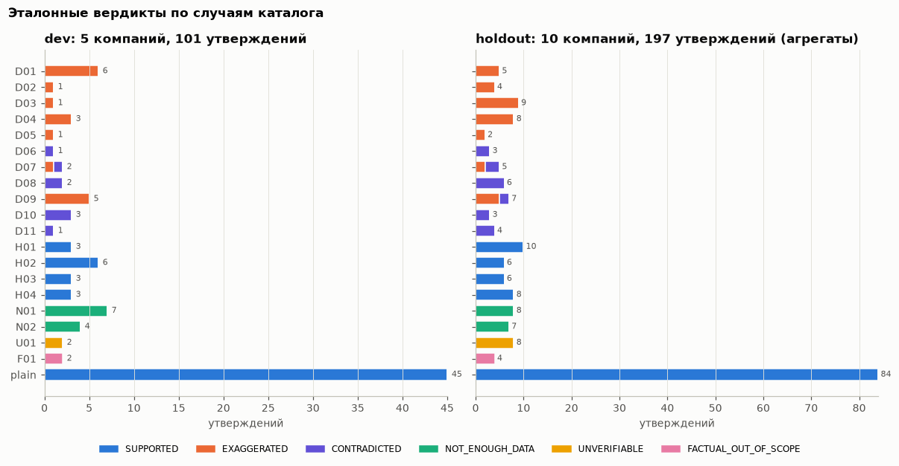

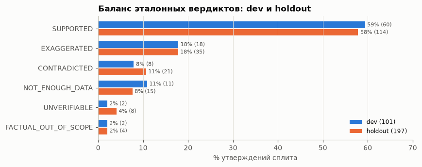

| Вердикт | dev | % | holdout | % |
| --- | --- | --- | --- | --- |
Проценты — от всех утверждений сплита (6 меток); доли в 5 классах — в выводах ниже.

| Вердикт | dev | % | holdout | % | Семейств dev | Семейств holdout |
| --- | --- | --- | --- | --- | --- | --- |
| SUPPORTED | 60 | 59,4 | 114 | 57,9 | 47 | 87 |
| EXAGGERATED | 18 | 17,8 | 35 | 17,8 | 12 | 25 |
| CONTRADICTED | 8 | 7,9 | 21 | 10,7 | 8 | 17 |
| NOT_ENOUGH_DATA | 11 | 10,9 | 15 | 7,6 | 6 | 10 |
| UNVERIFIABLE | 2 | 2,0 | 8 | 4,1 | 2 | 6 |
| FACTUAL_OUT_OF_SCOPE | 2 | 2,0 | 4 | 2,0 | 2 | 4 |

Типы утверждений dev: share 32, customer_mention 18, level 17, growth 13, count 10, out_of_ontology 7, forecast 2,
factual 2. Квалификаторы: exact 92, more_than 5, about 2, less_than 2. Дек — 63 утверждения, пресс-релизы — 38.

Выводы:

- **Красные флаги — 26% утверждений в 5 классах в dev (26 из 99) и 29% в holdout (56 из 193).** `SUPPORTED` —
  61% в dev (60 из 99) и 59% в holdout (114 из 193); база здесь и дальше — 5 классов без `FACTUAL_OUT_OF_SCOPE`.
  Классификатор «всё SUPPORTED» даёт accuracy 0,6 при нулевом recall флагов, поэтому accuracy в отчётах не
  используем.
- **Семейство — одно наблюдение.** 26 флагов dev — это 20 семейств, 56 флагов holdout — 42 семейства; утверждений
  с эталоном ≠ `SUPPORTED` в 5 классах — 39 (28 семейств) в dev и 79 (58 семейств) в holdout. Интервалы и размер
  holdout надо считать по семействам.
- Малые классы: `UNVERIFIABLE` — 2 в dev и 8 в holdout, `FACTUAL_OUT_OF_SCOPE` — 2 и 4. F1 по классу из 8 примеров
  меняется на ~0,1 от одной ошибки. Поэтому **macro-F1 — только для сводки** (как и записано в 2.1 дизайн-документа),
  а решения принимаются по recall/precision красных флагов и critical error rate.
- **Ширина интервала.** Если recall флагов на holdout будет 0,90, 95% интервал Уилсона на 42 семействах-флагах —
  [0,77; 0,96] (на 56 утверждениях было бы [0,79; 0,95] — слишком узко, потому что повторы одного факта не
  независимы), а с учётом кластеризации по 10 компаниям ещё шире. Порог гейта G1 (≥ 0,9) на таком holdout
  проверяется только как точечная оценка; вывод «прошли/не прошли» при recall 0,88–0,92 статистически не различим.
  Для ±0,05 нужно ≈140 семейств-флагов; при 4,2 семейства-флага на компанию — **≈33 компании**. Путь, уже
  заложенный в протокол: добавлять компании, а не дробить утверждения.
- Покрытие случаев: в dev каждый id каталога есть, но D02, D03, D05, D06 — по одному утверждению. В holdout
  D05 — 2 утверждения, D06 — 3, D02 — 4. Recall по отдельному типу расхождения на таких числах не измерить —
  только по группам («определение ARR»: D01+D02+D05; «клиенты»: D03+D08+D10).
- **D06 ни разу не `EXAGGERATED`** (0 из 4, dev + holdout): «только выжившие» в dev завышает NRR на 26,6 п.п. —
  далеко за верхним порогом 5 п.п. D09 после исправления генератора — `EXAGGERATED` в 10 из 12 (dev 5 из 5, holdout 5 из 7);
  в v0.1 было 1 из 13, потому что генератор брал устаревшее значение в любую сторону (5 из 5 D09 в dev были
  занижениями). Класс `EXAGGERATED` держится на D01–D05 и D09.

## 6. Отклонение δ относительно порогов P5

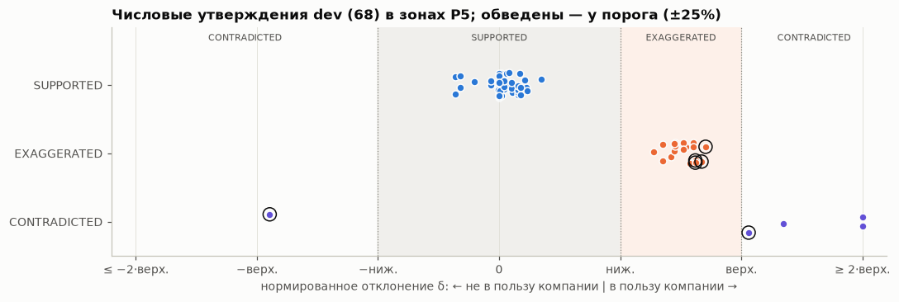

68 числовых утверждений dev с посчитанным δ. Ось нормирована: 0–1 — `SUPPORTED`, 1–2 — между порогами, > 2 — выше
верхнего порога; «−» — отклонение не в пользу компании. δ берём из поля эталона `delta_p5`: оно равно 0, если
квантификатор «более / менее N» выполнен, и сырому отклонению от N в остальных случаях. Сырое отклонение лежит
в поле `delta` (например, у «120+» при 127 клиентах `delta` = −5,5%, `delta_p5` = 0, вердикт `SUPPORTED`).

Выводы:

- **Зона у нижнего порога пустая.** Все 45 `SUPPORTED` лежат не дальше 0,36 нижнего порога (для уровней — до 1,8%,
  медиана 0,07 порога); у 5 из них выполнен квантификатор («120+», «more than 85%», «less than 2.5%»), и
  `delta_p5` = 0. Все 18 `EXAGGERATED` начинаются от 1,67 нижнего порога (медиана 2,6 порога, т. е. около +13% для
  уровней). **В интервале 0,4–1,6 нижнего порога нет ни одного утверждения.** Это следствие генератора: размер
  D01–D05 калибруется на разрыв 10–18%, D09 — на 3–4,5 п.п. Офлайн-оценка не проверит главное различение P5 —
  «округление или завышение» на 4–7%.
- У порогов (|δ| в пределах ±25% от ближайшего порога P5, нижнего или верхнего) лежат 6 утверждений, и все они —
  красные флаги: D07 у clinicore (−0,77 п.п. при нижнем пороге 1 п.п.), D09 ×3 (NRR +3,9 и +4,1 п.п. при верхнем
  пороге 5 п.п.), D08 и D11 у tallybird (−22,9% и +26,5% при верхнем пороге 25%). Hard negatives H01–H04 «трудные» по
  формулировке, но не по числу.
- **Занижение среди числовых красных флагов — 1 из 23**: D08 у tallybird (293 клиента при 380), по каталогу D08 —
  «число не сходится» в любую сторону. В v0.1 занижений было 6 из 23, из них 5 — D09: это была ошибка генератора, а
  не свойство задачи. По P5 отклонение не в пользу компании больше нижнего порога — `CONTRADICTED`. Вопрос к
  заказчику (3.4) остаётся, но его вес теперь меньше: считать ли занижение красным флагом или отдельным классом
  «неточно».

## 7. Какие данные нужны для какой метрики (матрица)

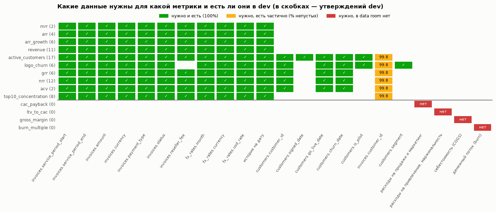

| Метрика (утверждений dev) | Таблицы и колонки | История на дату | Наличие в dev | Если данных нет |
| --- | --- | --- | --- | --- |
| mrr (2), arr (4), revenue (11) | invoices: service_period_start/end, amount, currency, payment_type, status, reseller_fee; fx_rates | месяц m (`peak_month` — 12 мес.) | 100% | `NOT_ENOUGH_DATA` |
| arr_growth (6) | то же | обе даты (`trough_base` — всё окно) | 100% | `NOT_ENOUGH_DATA` |
| active_customers (17) | + customers: customer_id, signed_date, go_live_date, churn_date, is_pilot; invoices.customer_id | месяц m | invoices.customer_id 99,8% | счёт клиентов занижается |
| logo_churn (6) | + customers.segment (вариант без SMB) | период + месяц до него | 99,8% | то же |
| grr (6), nrr (12) | customers: go_live_date, churn_date; invoices.customer_id | m и m − 12 | 99,8% | удержание занижается (4.3) |
| acv (2) | как arr + active_customers | месяц m | 99,8% | — |
| top10_concentration (8) | invoices.customer_id | 12 месяцев | 99,8% | знаменатель меняется (в EDA 02 −2,5 п.п.) |
| CAC payback, LTV/CAC, gross margin, burn multiple (7 утверждений N01) | расходы на продажи и маркетинг, COGS, денежный поток | — | **нет в data room** | `NOT_ENOUGH_DATA` |

Выводы:

- **Денежные метрики (ARR, MRR, выручка, рост) зависят только от инвойсов и курсов** и в dev считаются полностью.
  Клиентские метрики (клиенты, churn, NRR/GRR, ACV, концентрация) дополнительно требуют `customer_id` в инвойсах и
  дат go-live/оттока в справочнике — именно это место ломает шум (раздел 4.3).
- `reseller_fee` нужен для всех денежных метрик (net), но не для logo churn. `segment` и `is_pilot` нужны только
  для вариантов компании (D03, D07): без них стандартный расчёт возможен, а проверка определения компании — нет.
- **N02 — это нехватка истории, а не таблицы.** Все 4 утверждения N02 в dev — NRR «as of» 2024-06 / 2024-10 у
  компаний с историей с 2023-07 / 2023-11: для NRR нужна когорта на 12 месяцев раньше. Сценарий «нужной таблицы
  нет вовсе» (например, нет справочника клиентов) синтетика не покрывает.
- Метрики вне онтологии в синтетике — только 4 вида и только как короткая фраза («LTV/CAC of 5.2x»). В проспектах
  ПО (SIC 737x) «lifetime value» встречается в 321 документе, «customer acquisition cost» — в 120, «CAC payback» —
  в 8 (EDA 01). Это упоминания термина, а не утверждения с числом: сколько из них — проверяемые утверждения,
  покажет корпус предложений. Общеотраслевые счёты (1 200 и 469) для SaaS не показательны: доля SIC 737x в них
  26–27%.

## 8. Формулировки: синтетика против реальных проспектов SEC

**Ограничение.** Корпус предложений `data/reference/sec_kpi_claims.csv` (EDA 01) не собран: архив www.sec.gov
отвечает 403 без контакта в `SEC_USER_AGENT`. Сравнение долей метрик, квалификаторов и числовых форматов по
предложениям в ноутбуке уже написано и включится, как только файл появится. Ниже — то, что можно измерить сейчас.

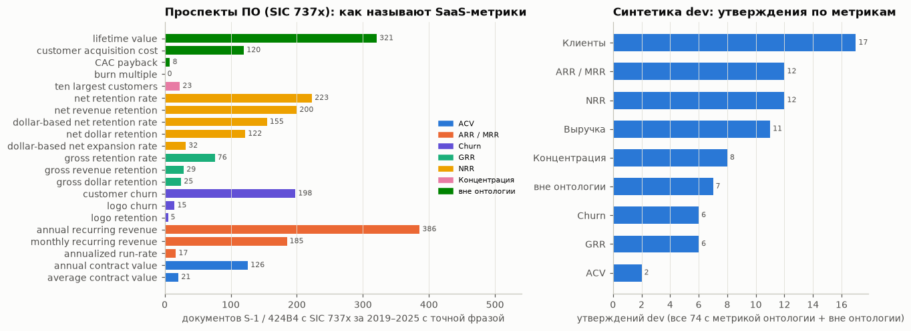

**8.1. Частоты терминов в проспектах.** Полнотекстовый поиск EDGAR (efts.sec.gov), формы S-1 и 424B4, 2019–2025,
число документов с точной фразой: сначала SIC 737x (ПО и компьютерные услуги, нижняя граница), в скобках — все
отрасли. Счёты собирает EDA 01 (`data/reference/sec_efts_term_counts.csv`).

| Группа | Термины: документов SIC 737x (все отрасли) |
| --- | --- |
| ARR / MRR | annual recurring revenue 386 (832); monthly recurring revenue 185 (253); annualized run-rate 17 (78) |
| NRR | net retention rate 223 (258); net revenue retention 200 (283); dollar-based net retention rate 155 (186); net dollar retention 122 (199); dollar-based net expansion rate 32 (41) |
| GRR | gross retention rate 76 (81); gross revenue retention 29 (29); gross dollar retention 25 (40) |
| Churn | customer churn 198 (318); logo churn 15 (15); logo retention 5 (10) |
| ACV | annual contract value 126 (169); average contract value 21 (58) |
| Концентрация | ten largest customers 23 (134) |
| Вне онтологии | lifetime value 321 (1 200); customer acquisition cost 120 (469); CAC payback 8 (12); burn multiple 0 (0) |

**8.2. Синтетика в координатах экстрактора SEC.** Тот же rule-based экстрактор (`scripts/fetch_sec_claims.py`)
на 72 числовых утверждениях dev: KPI найден в 39% (28 из 72), семейство совпало с эталоном в 39%. Не находятся
выручка уровнем (11 из 11: экстрактор ищет только рост выручки), клиенты (17 из 17: в синтетике «restaurant groups»,
«accounting firms», а не «customers»), ARR — 6 из 8 (рост «ARR grew 3x» экстрактор не берёт: для ARR он ищет
сумму в $), ACV и концентрация (10 из 10). NRR, GRR, churn и MRR находятся все (26 из 26): там синтетика использует
те же слова, что и проспекты. Это заодно предварительная оценка бейзлайна B0: на «ключевые слова + число»
ложится меньше половины утверждений.

На правой панели графика база — все 74 утверждения dev с метрикой онтологии (как в матрице раздела 7) плюс 7 вне
онтологии; в 8.2 база — 72 числовых утверждения (level, growth, share, count).

Выводы о реализме (риски R2/R3):

1. **Названия метрик в синтетике однообразны.** NRR названа «net revenue retention» в 9 из 12 утверждений и «NRR» в 3;
   в проспектах ПО у NRR 5 названий с сопоставимой частотой (32–223 документа, самое частое — меньше трети
   упоминаний), у GRR — 3, у churn — «customer churn» в 13 раз чаще, чем «logo churn». Сопоставление с онтологией
   (подзадача 5) на синтетике проще.
2. **Квантификаторов почти нет:** 92 из 101 утверждения точные. Долю «more than / approximately / over» в
   проспектах измерим на корпусе EDA 01; ожидаем, что она выше, но до сбора корпуса это гипотеза.
3. **Периоды заданы просто:** «in 2025», «at the end of 2025» (81% утверждений с годом в тексте). В проспектах —
   «as of December 31, 2024», «for the year ended», «trailing twelve months»; экстрактор нашёл тип периода только у
   5 из 72 синтетических утверждений.
4. **Нет определений в тексте рядом с числом.** В проспектах ключевая метрика раскрывается вместе с описанием
   расчёта (руководство SEC 2020 года по ключевым метрикам в MD&A), и именно в этих абзацах компании расходятся —
   см. вопросы SEC к Zoom и Cloudflare про ушедших клиентов в NRR (`docs/real_world_cases.md`). В синтетике
   определение есть только в меморандуме CFO. Долю предложений-определений покажет корпус EDA 01 (`is_definition`).
5. Числовые форматы синтетики: «X%» 33, «$XK/$XM» 16, «Nx» 12, число без единиц 9, «N+» 1, «$X million» 1. В
   проспектах суммы почти всегда «$X million / billion» — проверить на корпусе.
6. «Annualized run-rate» — 17 документов ПО (78 во всех отраслях), «burn multiple» — 0: run-rate-формулировки ARR в
   проспектах ПО редки, burn multiple не раскрывают (в деках встречается, но проверить нечем).

## 9. Что улучшить в генераторе (конкретно)

По убыванию влияния на честность офлайн-оценки:

1. **Пограничные случаи P5.** Добавить hard negatives с δ = 3–5% (округление у порога → `SUPPORTED`) и D01–D05 с
   разрывом 5–8% (→ `EXAGGERATED`). Сейчас в интервале 0,4–1,6 нижнего порога нет ни одного утверждения (раздел 6).
2. **Стресс-компания по пустым `customer_id`** (1–5%, весь инвойс, чаще у one_time/implementation и в первые 6 месяцев),
   эталон для неё — по «грязным» данным, с ожидаемой пометкой качества. Нужен override шума на уровне компании.
3. **Частичные кредит-ноты с лагом** (2/3 частичных, лаг лог-нормальный с медианой 10 дней и p90 ≈ 80, ~45% в другом
   месяце), почти-дубли с новым номером (0,3%), перекрытие двух выгрузок у 1–2 компаний, неполный последний месяц,
   служебные и тестовые строки — всё измерено в EDA 02 и сейчас не генерируется.
4. **Формулировки.** Словарь синонимов метрик по частотам SEC (5 названий NRR, 3 — GRR, «customer churn»), периоды
   «as of December 31, 2025» / «for the year ended», суммы «$X million», квантификаторы чаще (цель — доля из корпуса EDA 01).
5. **Определение рядом с числом** в деке или пресс-релизе (сноска «NRR excludes customers who churned»), а не только
   в меморандуме: так D06/D07 станут видны на уровне извлечения.
6. **EXAGGERATED для D06:** компании с низким оттоком или частичное «выживание», чтобы D06 давал не только
   `CONTRADICTED`. D09 исправлен в v0.2 (устаревшее значение в пользу компании, 10 из 12 `EXAGGERATED`).
7. **Разные шаблоны формулировок для dev и holdout.** Сейчас оба сплита рендерятся из одних шаблонов
   (`synth/documents.py`): 1–3 шаблона на метрику и площадку, одни пулы имён. Holdout тогда проверяет запомненные
   шаблоны, а не перенос на новую компанию. Для holdout v1 — отдельный пул шаблонов и синонимов (например, синонимы
   NRR/GRR из EDA 01 и «as of December 31» только в holdout), а recall извлечения отчитывать отдельно для «знакомых» и
   «новых» шаблонов.
8. **Утверждения на слайдах без текста** (раздел 3.1): сейчас 0, поэтому FR2 не проверяется.
9. **«Удобная» таблица когорт не только у D06** (раздел 3.1): например, когорты по дате подписания, а не go-live.
10. **Длина и форма документов:** дек 13 слайдов по шаблону и ~650 слов на компанию → добавить таблицы, сноски,
   отвлекающие числа (рынок, TAM, команда), PDF/PPTX.
11. **N02 «нет таблицы»**: компания без справочника клиентов или без когорт.

## Ограничения разбора

- 5 dev-компаний: доли по компаниям — иллюстрация, а не оценка распределения.
- Сравнение с реальным биллингом — через B2C-ритейл (EDA 02): переносится структура проблем, а не частоты.
- Сравнение формулировок с SEC — пока только по частотам терминов (SIC 737x — нижняя граница по агрегату EFTS);
  по предложениям — после сбора корпуса EDA 01.
- Чувствительность к пустому `customer_id` измерена на 20 наложениях шума на компанию; хвосты (5-й перцентиль)
  оценены грубо.
